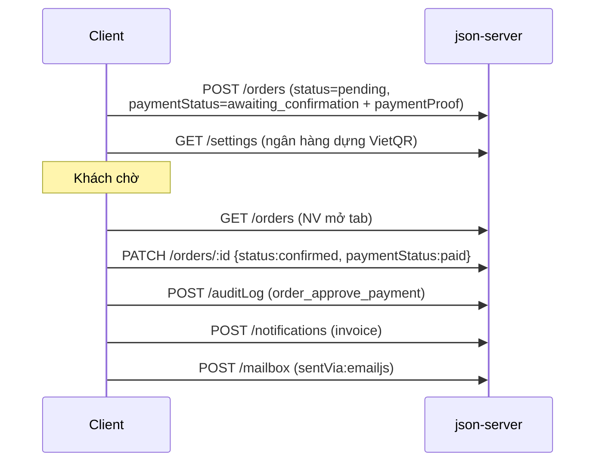
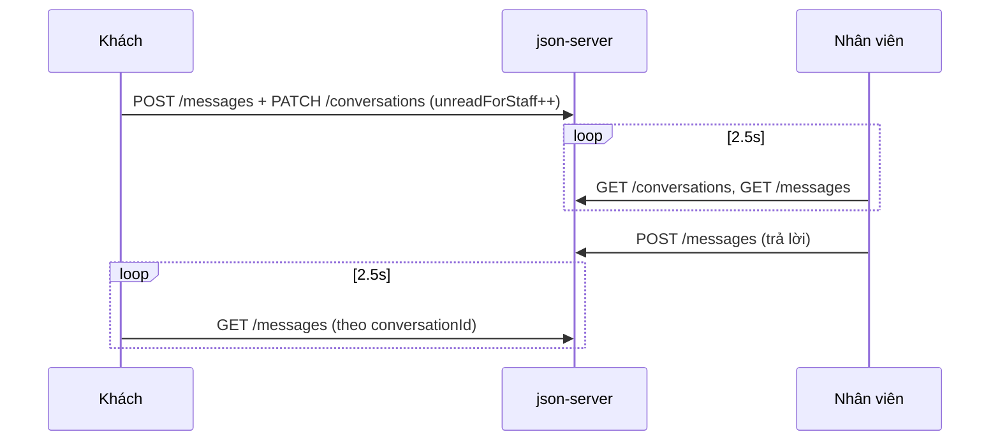
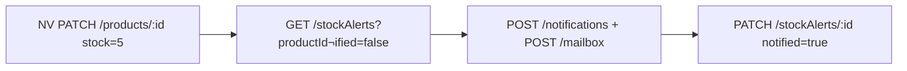
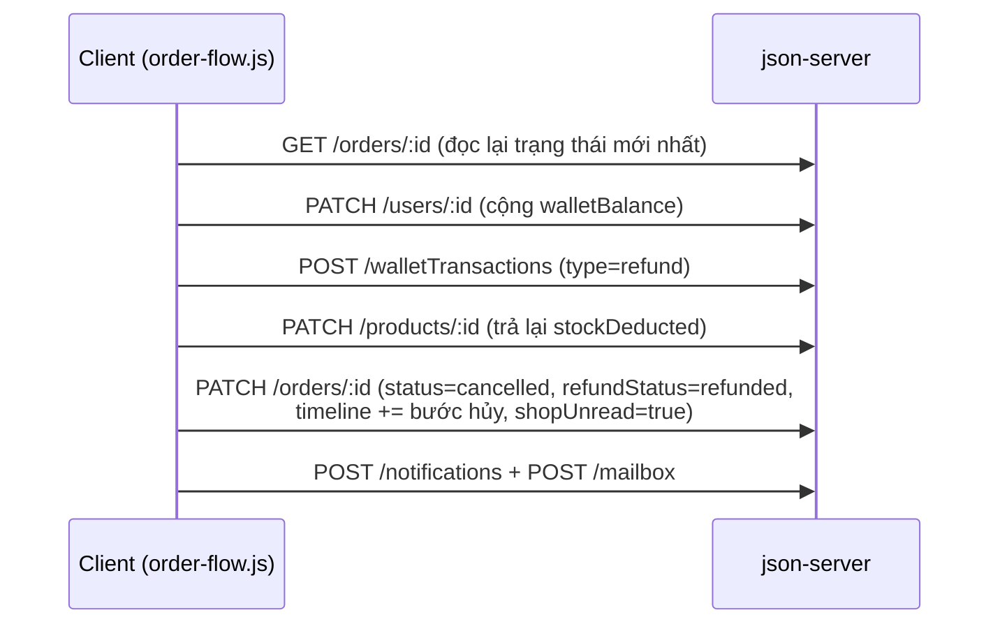
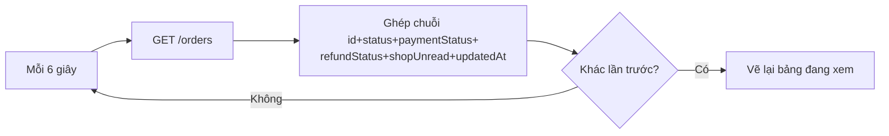

# Lá & Sỏi — Tài Liệu API

> Toàn bộ endpoint REST của website **Lá & Sỏi**.
> Backend: **json-server 0.17.4** — đúng bản ghi trong `package.json`, dùng chung cho máy local (`node tools/start-db.mjs`) và Render (`npm start`). Đọc/ghi `db.json`. Client gọi qua `js/api.js` (axios).
> Base URL: `http://localhost:3000` · Cập nhật: 2026-11-12.

---

## 1. Tổng quan

- **Giao thức:** HTTP REST (JSON).
- **Xác thực:** không có server-side (json-server). Phân quyền ở client (`storage.js → requireRole`).
- **Content-Type:** `application/json`.
- **Timeout mặc định:** 8000 ms (cấu hình trong `api.js`).
- **Lỗi mạng:** `isNetworkError(err)` phân biệt server tắt vs lỗi HTTP có response.

### Phương thức dùng
| Method | Dùng cho |
|---|---|
| `GET /collection` | Lấy toàn bộ |
| `GET /collection/:id` | Lấy 1 bản ghi (404 nếu không có) |
| `GET /collection?field=value` | Lọc (lưu ý so khớp **cứng kiểu**) |
| `POST /collection` | Tạo mới (server tự sinh `id` nếu không gửi) |
| `PATCH /collection/:id` | Cập nhật một phần |
| `PUT /collection/:id` | Thay thế toàn bộ |
| `DELETE /collection/:id` | Xoá |

### ⚠️ Lưu ý "lọc cứng kiểu"
Bộ lọc trên URL của json-server không đủ tin cậy để dùng trực tiếp: có phiên bản so khớp **cùng kiểu** (`GET /orders?userId=2` không trả bản ghi có `"userId": "2"`), và **json-server 0.17 bỏ qua hẳn bộ lọc theo một trường mà chưa bản ghi nào có** — khi đó nó trả về **cả collection**. Vì vậy `api.js` luôn so khớp lại phía client (tải collection rồi `filter`), kể cả khi đã gửi bộ lọc lên máy chủ.
`getOrdersByUser`, `getMessages`, `getNotifications`, `getStockAlerts`, `getWalletTransactions`, `getConversationByCustomer`.

---

## 2. Bảng endpoint — rút gọn

| # | Resource | Endpoint chính | Hàm client (`api.js`) |
|---|---|---|---|
| 1 | Categories | `/categories` | `getCategories` · `createCategory` · `updateCategory` · `deleteCategory` |
| 2 | Products | `/products` · `/products/:id` | `getProducts` · `getProductById` · `createProduct` · `updateProduct` · `deleteProduct` |
| 3 | Users | `/users` · `/users/:id` | `getUsers` · `getUserById` · `findUserByEmail` · `findUserByCredentials` · `createUser` · `updateUser` · `deleteUser` |
| 4 | Orders | `/orders` · `/orders/:id` | `getOrders` · `getOrdersByUser` · `getOrderById` · `createOrder` · `updateOrder` · `updateOrderStatus` · `deleteOrder` |
| 5 | Reviews | `/reviews` | `getReviews` · `createReview` · `updateReview` · `deleteReview` |
| 6 | Promotions | `/promotions` | `getPromotions` · `createPromotion` · `updatePromotion` · `deletePromotion` |
| 7 | Coupons | `/coupons` · `?code=` | `getCoupons` · `getCouponByCode` · `createCoupon` · `updateCoupon` · `deleteCoupon` |
| 8 | Banners | `/banners` | `getBanners` · `createBanner` · `updateBanner` · `deleteBanner` |
| 9 | Holidays | `/holidays` | `getHolidays` · `createHoliday` · `deleteHoliday` |
| 10 | Settings | `/settings` | `getSettings` · `updateSettings` |
| 11 | Conversations | `/conversations` | `getConversations` · `getConversationByCustomer` · `createConversation` · `updateConversation` |
| 12 | Messages | `/messages` | `getMessages(convId)` · `createMessage` |
| 13 | Notifications | `/notifications` | `getNotifications(userId)` · `createNotification` · `updateNotification` |
| 14 | Mailbox | `/mailbox` | `getMailbox` · `createMail` |
| 15 | Wallet TX | `/walletTransactions` | `getWalletTransactions` · `createWalletTransaction` · `updateWalletTransaction` |
| 16 | Audit Log | `/auditLog` | `getAuditLog` · `createAuditLog` |
| 17 | Stock Alerts | `/stockAlerts` | `getStockAlerts` · `createStockAlert` · `updateStockAlert` · `deleteStockAlert` |
| 18 | Label Groups | `/labelGroups` | `getLabelGroups` · `createLabelGroup` · `updateLabelGroup` · `deleteLabelGroup` |
| 19 | Labels | `/labels` | `getLabels` · `createLabel` · `updateLabel` · `deleteLabel` |

---

## 3. Chi tiết endpoint

### 3.1 Categories

#### `GET /categories`
```http
GET /categories HTTP/1.1
```
```json
[{ "id": "1", "name": "Cây lọc không khí", "slug": "cay-loc-khong-khi" }]
```
**200** OK · mảng.

#### `POST /categories`
```json
{ "name": "Cây leo", "slug": "cay-leo" }
```
→ **201** Created · bản ghi + `id` tự sinh.

#### `PATCH /categories/:id` · `DELETE /categories/:id`
Chuẩn CRUD. Admin dùng.

---

### 3.2 Products

#### `GET /products`
Trả về mảng toàn bộ sản phẩm.

#### `GET /products/:id`
**200** nếu có · **404** nếu không. Client bắt 404 → trả `null`.

#### `POST /products`
```json
{
  "name": "Trầu Bà Vàng",
  "scientificName": "Epipremnum aureum",
  "categoryId": "1",
  "price": 120000,
  "image": "assets/img/p21.jpg",
  "stock": 10,
  "addedDate": "2026-11-05T00:00:00.000Z"
}
```

#### `PATCH /products/:id`
Dùng nhiều nhất: **cập nhật tồn kho** (`{ "stock": 5 }`) — có ghi `auditLog`.

#### `DELETE /products/:id`

---

### 3.3 Users

#### `GET /users?email=an@gmail.com`
Dùng để kiểm trùng email khi đăng ký, và lấy user để login.
```json
[{ "id": "2", "email": "an@gmail.com", "role": "user", ... }]
```

> **Lưu ý:** không truyền cả `email` + `password` vào query — v1 có thể lọc sai. Client lấy theo email xong **so password phía client**.
>
> **Email không phân biệt hoa / thường** (`findUserByEmail` trong `api.js`): client gửi email đã viết thường; không thấy thì `GET /users` rồi so khớp không phân biệt hoa / thường (tài khoản cũ có thể đã lưu email có chữ hoa). Đăng ký mới luôn lưu email viết thường.

#### `POST /users` — Đăng ký
```json
{
  "role": "user",
  "name": "Nguyễn Văn A",
  "email": "a@gmail.com",
  "password": "123456",
  "phone": "0900000000",
  "address": "...",
  "walletBalance": 0,
  "favorites": [],
  "createdAt": "2026-11-05T00:00:00.000Z",
  "locked": false
}
```

#### `PATCH /users/:id`
Cập nhật hồ sơ, nạp ví, favorites, khoá/mở khoá:
```json
{ "locked": true }
{ "walletBalance": 250000 }
{ "favorites": ["1","13"] }
{ "role": "staff" }
{ "resetOtpHash": "<SHA-256>", "resetOtpExpiry": "2026-11-12T12:10:00Z", "resetOtpAttempts": 0 }
```

#### `DELETE /users/:id`

---

### 3.4 Orders

#### `GET /orders`
```json
[{ "id": "1", "userId": "2", "items": [...], "total": 250000, "status": "delivered" }]
```

#### `GET /orders?userId=2` ⚠️
**Không tin cậy** — do v1 lọc cứng kiểu. Client dùng `getOrdersByUser` → tải tất cả rồi filter.

#### `POST /orders` — Tạo đơn

Chuyển khoản QR (chờ nhân viên duyệt):
```json
{
  "userId": "2",
  "items": [{ "productId": "13", "name": "Kim Tiền Mini", "price": 155000, "quantity": 1 }],
  "subtotal": 155000, "shippingFee": 30000, "discount": 0, "total": 185000,
  "status": "pending",
  "paymentStatus": "awaiting_confirmation",
  "paymentMethod": "qr",
  "paymentProof": "data:image/jpeg;base64,...",
  "proofMissing": false,
  "addInfo": "LASOI2-48217",
  "shipping": { "name": "Nguyễn Văn An", "phone": "0912345678", "address": "12 Trần Hưng Đạo, P. Cầu Ông Lãnh, Q.1, TP.HCM", "note": "giao giờ hành chính" },
  "createdAt": "2026-11-12T10:00:00.000Z"
}
```
`shipping` bắt buộc với đơn mới (kiểm tra ở `cart.html` trước khi gọi API — BR25 trong USECASE). Khách tích "Lưu làm địa chỉ mặc định" thì client gọi thêm `PATCH /users/:id` `{ phone, address }`.
Trả bằng Ví web đi qua **ba lệnh ghi theo thứ tự** (không cần nhân viên duyệt):

1. `POST /orders` — đơn **chờ thanh toán**: `"status": "pending"`, `"paymentStatus": "unpaid"`, `timeline` có bước `place_order`. Chưa đụng tới tiền.
2. `PATCH /users/:id { walletBalance }` — trừ ví (ghi số dư mới, là giá trị tuyệt đối).
3. `PATCH /orders/:id` — `"status": "confirmed"`, `"paymentStatus": "paid"`, `"paidAt": "…"`, thêm bước `pay_wallet` vào `timeline`; sau đó `POST /walletTransactions` ghi lịch sử ví.

Nếu bước 2 không thành: client đọc lại `GET /users/:id` để biết chắc. Số dư chưa đổi → `PATCH /orders/:id { status: "cancelled", cancelReason, cancelledBy: "system" }` (bước `wallet_failed`), ví không bị trừ. Không đọc lại được (mạng vẫn rớt) → đơn ở lại `pending / unpaid`, khách được báo kiểm tra số dư. Nếu bước 3 báo lỗi (ví đã trừ), client **không hoàn tiền ngay** — lệnh có thể đã được máy chủ ghi mà chỉ phản hồi bị rớt. Client đọc lại `GET /orders/:id`: đơn đã `paid` → coi như thành công, đi tiếp (không hoàn tiền). Đơn chắc chắn chưa `paid` → **hoàn tiền**: đọc số dư **hiện tại** rồi `PATCH /users/:id { walletBalance: hiện tại + số tiền đơn }` (không ghi đè bằng số dư cũ), `POST /walletTransactions` loại `refund` để admin / khách thấy khoản hoàn, rồi hủy đơn (bước `wallet_refund`). Không đọc lại được đơn → **không hoàn tiền**; client chỉ thêm cờ `walletCheckNeeded: true` + `shopUnread` (nhân viên thấy ở "Cần xử lý") và báo khách liên hệ tiệm. Đơn `unpaid` không được tính vào doanh thu (chỉ đếm đơn `isCompletedSale` — xem `js/sale.js`).

Sau khi đơn đã ở đúng trạng thái thanh toán, client `PATCH /products/:id` trừ kho rồi `PATCH /orders/:id` ghi `stockDeducted` để hoàn trả đúng số khi hủy / hoàn hàng. Cuối cùng client `GET /orders/:id` để chắc đơn còn trên máy chủ; nhận `404` thì gọi lại `createOrder` với **cùng mã** (xem "Tạo đơn đúng một lần" bên dưới) — không bao giờ sinh đơn thứ hai.

> **Tạo đơn đúng một lần (`createOrder` → `postOnce` trong `js/api.js`).** Mỗi lần đặt hàng mang một **mã riêng do trình duyệt sinh** (`newClientRef()` trong `js/api.js`): mã này vừa là `id` của đơn, vừa được lưu trong trường `clientRef`.
> - Lệnh `POST /orders` gặp **lỗi mạng** (không có phản hồi) thì **không gửi lại ngay**: client tra `GET /orders?clientRef=<mã>` (và so khớp lại `clientRef` phía client). Đã có → dùng luôn đơn đó (máy chủ đã lưu, chỉ phản hồi bị rớt). Chưa có → mới gửi lại. Chưa tra được → chờ rồi tra lại, không gửi khi chưa biết. Tối đa 3 lượt.
> - Hết 3 lượt vẫn không xong → ném lỗi, kèm cờ `notCreated` (tra được, chắc chắn chưa có) hoặc `outcomeUnknown` (không tra được). Giỏ hàng giữ nguyên, **chưa có tiền nào bị trừ** vì đơn được tạo trước khi trừ ví.
> - Lớp bảo vệ thứ hai ở máy chủ: json-server 0.17 từ chối `POST` có `id` đã tồn tại (trả `500`); client coi đó là "đơn đã có" và đọc lại đơn theo mã.
> - `POST /walletTransactions` cũng đi qua `postOnce` (có `clientRef`). Client **không có bước nào tự xóa đơn**.
>
> **Lệnh nào được tự gửi lại khi lỗi mạng?** Chỉ `GET` / `HEAD` / `OPTIONS` và `PUT` (tối đa 2 lần, cách 800 ms + 1600 ms). `POST` không bao giờ tự gửi lại ngoài cơ chế tra-theo-mã ở trên. `PATCH` / `DELETE` không tự gửi lại ở `api.js`; riêng giỏ hàng tự thử lại 3 lần các lệnh `PATCH` ghi **giá trị tuyệt đối** (số dư mới, trạng thái mới) vì lặp lại vẫn ra cùng kết quả.

> **Hàng đợi ghi (`js/api.js`):** mọi lệnh `POST` / `PATCH` / `PUT` / `DELETE` đi **lần lượt**, lệnh sau cách lệnh trước tối thiểu **300 ms** (mốc lưu trong `localStorage` nên áp dụng chung cho mọi tab). Lý do: nếu json-server bị bật kiểu `--watch`, nó đọc lại cả file sau mỗi lần ghi và có thể đè mất lượt ghi tới ngay sau đó (đo trên 0.17.4 / Windows: máy chủ còn sập với lỗi `EPERM`). Lệnh `GET` không phải chờ. Hai lệnh chạy chuẩn của dự án (`node tools/start-db.mjs`, `npm start`) đều **không** dùng `--watch`, và đều có `--fks __none__` để tắt việc json-server 0.17 tự xóa "bản ghi mồ côi" mỗi khi có lệnh `DELETE`.

#### `PATCH /orders/:id` — Mọi bước vòng đời

Tất cả đi qua `performAction(orderId, key, actor)` trong `js/order-flow.js` (đọc lại đơn mới nhất → kiểm tra quyền & trạng thái → ghi một PATCH gộp).

| `key` | Ai bấm | `status` sau đó | Kéo theo |
|---|---|---|---|
| `approve_payment` | shop | `confirmed` | `paymentStatus: paid`, email hóa đơn |
| `reject_payment` | shop | `cancelled` | `paymentStatus: rejected`, trả kho |
| `set_delivery_date` | shop | giữ nguyên (`confirmed` / `shipping`) | `expectedDeliveryDate` (`YYYY-MM-DD`, không ở quá khứ), `expectedDeliveryNote`; thông báo + email "Shop hẹn giao …" |
| `ship` | shop | `shipping` | `shippedAt`, ghi mã vận đơn, xóa `outForDeliveryAt`; giao lại sau khiếu nại thì xóa cả ngày hẹn cũ |
| `out_for_delivery` | shop | `shipping` | `outForDeliveryAt`, `outForDeliveryNote`; thông báo + email "Đơn … sắp tới bạn" |
| `mark_delivered` | shop | `delivered` | `deliveredAt`, xóa `receiveReminderAt` (bắt đầu đếm hạn tự hoàn tất mới) |
| `delivery_failed` | shop | `cancelled` | hoàn tiền + trả kho |
| `shop_cancel` / `cancel` | shop / khách | `cancelled` | hoàn tiền + trả kho |
| `confirm_received` | khách | `completed` | mở khóa đánh giá |
| `report_not_received` | khách | `delivery_issue` | `notReceivedReports++` — từ `delivered` / `delivery_issue`, hoặc từ `completed` nếu đơn **tự** hoàn tất (`receivedConfirmedBy: "system"`) và còn trong 7 ngày |
| `request_return` / `cancel_return` | khách | `return_requested` / trạng thái cũ | lưu `statusBeforeReturn` |
| `approve_return` / `reject_return` | shop | `return_approved` / trạng thái cũ | |
| `receive_return` | shop | `returned` | hoàn tiền + trả kho |
| `refund_confirm` / `refund_decline` | shop | giữ nguyên | `refundStatus: refunded` / `declined` |
| `auto_complete` | hệ thống | `completed` | tự chạy sau `settings.autoCompleteDays` ngày (mặc định 3) kể từ lúc giao; `receivedConfirmedBy: "system"` |

**Nhắc trước hạn (không đổi trạng thái):** đơn `delivered` còn dưới 24 giờ tới hạn tự hoàn tất và chưa có `receiveReminderAt` → `PATCH /orders/:id { receiveReminderAt }` + `POST /notifications` + `POST /mailbox` (email "Bạn đã nhận được đơn … chưa?"). Cả việc nhắc lẫn tự hoàn tất chạy trong `autoCompleteDelivered()` khi có người mở trang đơn hàng (khách hoặc shop).

Mỗi lần thực hiện, cùng một PATCH ghi thêm: `timeline` (ai · lúc nào · lý do/ghi chú), mốc thời gian tương ứng, và `shopUnread` (khách thao tác → `true`, shop thao tác → `false`). Sau đó client gọi thêm `POST /auditLog` (nếu người làm là nhân viên/quản trị), `POST /notifications` + `POST /mailbox` cho khách, và `PATCH /users/:id` + `POST /walletTransactions` nếu có hoàn tiền.

#### `DELETE /orders/:id`
Chỉ dùng ở tab Đơn hàng của nhân viên/quản trị để **dọn đơn đã kết thúc** (`completed`, `cancelled`, `returned`) hoặc đơn chưa thanh toán. Xóa nhiều đơn = nhiều lệnh `DELETE` + 1 `POST /auditLog` (`orders_bulk_delete`).

**Trạng thái đơn (`status`):** `pending` · `confirmed` · `shipping` · `delivered` · `delivery_issue` · `completed` · `return_requested` · `return_approved` · `returned` · `cancelled`.
**Thanh toán (`paymentStatus`):** `unpaid` → `awaiting_confirmation` → `paid` | `rejected`.
**Hoàn tiền (`refundStatus`):** `pending` → `refunded` | `declined`.

---

### 3.5 Reviews

#### `GET /reviews`
Trả tất cả. Client lọc theo `productId`/`userId`.

#### `POST /reviews`
```json
{
  "productId": "13",
  "userId": "2",
  "orderId": "1",
  "rating": 5,
  "comment": "Cây đẹp, giao nhanh.",
  "replies": [],
  "createdAt": "2026-11-12T00:00:00.000Z"
}
```
`orderId` có khi khách gửi đánh giá ngay trong trang "Đơn hàng của tôi".
Điều kiện (kiểm ở client): khách phải có **đơn `completed`** chứa sản phẩm đó, và chưa đánh giá sản phẩm này.

#### `PATCH /reviews/:id` — Trả lời đánh giá
```json
{ "replies": [{ "id": "k3f1", "userId": "3", "text": "Cảm ơn bạn!", "createdAt": "..." }] }
```
Trả lời của tài khoản `staff`/`admin` được gắn nhãn **Phản hồi từ shop**.

#### `DELETE /reviews/:id`
Chủ review hoặc admin.

---

### 3.6 Promotions

#### `GET /promotions`
#### `POST /promotions` — Admin tạo → gửi thông báo **toàn bộ khách**
```json
{
  "name": "Black Friday",
  "type": "flash_sale",
  "discountPercent": 20,
  "startDate": "2026-11-28T00:00:00Z",
  "endDate": "2026-11-29T23:59:59Z",
  "appliesTo": "all",
  "isActive": true
}
```
#### `PATCH /promotions/:id` · `DELETE /promotions/:id`

---

### 3.7 Coupons

#### `GET /coupons`
#### `GET /coupons?code=CHAOBAN` — Tra mã khi áp ở giỏ
```json
[{ "id": "1", "code": "CHAOBAN", "discountPercent": 10, "minOrder": 200000, "maxDiscount": 50000, "isActive": true }]
```
#### `POST /coupons` · `PATCH /coupons/:id` · `DELETE /coupons/:id`
`PATCH` thường để `usedCount++` sau khi áp thành công.

---

### 3.8 Banners

#### `GET /banners`
Trả mảng. Client (`banner.js`) chỉ hiện banner **có** `startDate`/`endDate` và **hôm nay trong khoảng**; chọn banner sắp kết thúc sớm nhất.

#### `POST /banners`
```json
{
  "title": "Giáng Sinh 2026",
  "image": "assets/img/xmas.jpg",
  "link": "index.html",
  "startDate": "2026-12-20",
  "endDate": "2026-12-26",
  "isActive": true,
  "order": 1
}
```

#### `PATCH /banners/:id` · `DELETE /banners/:id`

---

### 3.9 Holidays

#### `GET /holidays`
```json
[{ "id": "1", "date": "01-01", "name": "Tết Dương Lịch" }]
```
Chỉ `date` + `name`. Dùng để admin tạo banner theo mùa.

#### `POST /holidays` · `DELETE /holidays/:id`

---

### 3.10 Settings (single object)

#### `GET /settings`
Trả về **một** object:
```json
{
  "id": "shop",
  "shopName": "Lá & Sỏi",
  "phone": "0908 123 456",
  "shipFee": 30000,
  "freeShipThreshold": 300000,
  "cutoffHour": 16,
  "prepDays": 0,
  "shipDaysMin": 1,
  "shipDaysMax": 2,
  "deliverSunday": false,
  "closedDates": "01/01, 30/04, 01/05, 02/09",
  "autoCompleteDays": 3,
  "bankBin": "970436",
  "bankAccountNumber": "1051236810",
  "bankAccountName": "PHAN TA HUU DUC",
  "emailjsPublicKey": "...",
  "emailjsServiceId": "...",
  "emailjsTemplateId": "..."
}
```

#### `PATCH /settings`
Thử `PATCH /settings` trước; nếu được treat như collection → fallback `PATCH /settings/shop`.

Nhóm **lịch giao hàng** (`cutoffHour` … `autoCompleteDays`) dùng để tính "Dự kiến giao" — ý nghĩa từng trường xem [database.md §3.16](database.md). Trang quản trị kiểm tra trước khi lưu: `shipDaysMax ≥ shipDaysMin`, ngày nghỉ đúng dạng `dd/mm` / `dd/mm/yyyy`. Thiếu trường → client dùng mặc định.

---

### 3.11 Conversations + Messages

#### `GET /conversations`
Client lọc theo `customerId` (lọc phía client).

#### `POST /conversations`
```json
{
  "customerId": "2",
  "customerName": "Nguyễn Văn An",
  "unreadForStaff": 0,
  "unreadForCustomer": 0,
  "updatedAt": "2026-11-05T10:00:00Z"
}
```

#### `PATCH /conversations/:id`
```json
{ "lastMessage": "Xin chào", "lastRole": "user", "unreadForStaff": 3, "updatedAt": "..." }
```

#### `GET /messages` (lọc phía client theo `conversationId`)

#### `POST /messages`
```json
{
  "conversationId": "c2",
  "customerId": "2",
  "fromRole": "user",
  "fromName": "Nguyễn Văn An",
  "text": "Cây này còn không ạ?",
  "createdAt": "2026-11-05T10:00:00Z"
}
```

Realtime bằng **polling 2.5 giây** cả 2 phía.

---

### 3.12 Notifications (chuông 🔔)

#### `GET /notifications` (lọc theo `userId` phía client)

#### `POST /notifications`
```json
{
  "userId": "2",
  "title": "Đã xác nhận thanh toán",
  "body": "Đơn #abc đã được duyệt.",
  "type": "invoice",
  "link": "donhang.html",
  "read": false,
  "createdAt": "2026-11-05T10:00:00Z"
}
```

#### `PATCH /notifications/:id`
```json
{ "read": true }
```

Client (`notify.js`) poll 10s, mở dropdown → mark all read.

---

### 3.13 Mailbox

#### `GET /mailbox` · `GET /mailbox?toUserId=2&type=password_reset`

#### `POST /mailbox` — tự động ghi bởi `email.js`
```json
{
  "to": "an@gmail.com",
  "toUserId": "2",
  "subject": "Hoá đơn #abc — Lá & Sỏi",
  "body": "...",
  "type": "invoice",
  "sentVia": "emailjs",
  "read": false,
  "createdAt": "..."
}
```

`sentVia`:
- `emailjs` — đã gửi Gmail thật (khi admin đã cấu hình EmailJS).
- `mailbox` — chỉ mô phỏng (khi chưa cấu hình).

---

### 3.14 Wallet Transactions

#### `GET /walletTransactions` (lọc client theo `userId`/`type`/`status`)

#### `POST /walletTransactions` — Yêu cầu nạp
```json
{
  "userId": "2",
  "type": "topup",
  "amount": 200000,
  "status": "pending",
  "proofImage": "data:image/jpeg;base64,...",
  "createdAt": "..."
}
```

#### `PATCH /walletTransactions/:id` — Nhân viên duyệt
```json
{ "status": "confirmed", "confirmedBy": "3", "confirmedAt": "..." }
```
Khi `confirmed`, client cộng `walletBalance` của user + ghi audit + thông báo.

---

### 3.15 Audit Log

#### `GET /auditLog` · `POST /auditLog`
```json
{
  "staffId": "3",
  "staffName": "Trần Văn Vườn",
  "action": "confirm_payment",
  "detail": "Duyệt thanh toán đơn #abc (145.000 ₫)",
  "createdAt": "..."
}
```

**Actions:** `confirm_topup`, `reject_topup`, `update_stock`, `orders_bulk_delete`, và `order_<hành động>` cho từng bước vòng đời đơn (`order_approve_payment`, `order_reject_payment`, `order_ship`, `order_mark_delivered`, `order_delivery_failed`, `order_shop_cancel`, `order_approve_return`, `order_reject_return`, `order_receive_return`, `order_refund_confirm`, `order_refund_decline`).

---

### 3.16 Stock Alerts

#### `GET /stockAlerts` (lọc client theo `userId`/`productId`/`notified`)

#### `POST /stockAlerts`
```json
{
  "userId": "2",
  "productId": "1",
  "productName": "Trầu Bà Lỗ",
  "email": "an@gmail.com",
  "notified": false,
  "createdAt": "..."
}
```

#### `PATCH /stockAlerts/:id` → `{ "notified": true }` sau khi gửi thông báo "đã có hàng".

### 3.17 Label Groups + Labels (nhãn sản phẩm)

#### `GET /labelGroups` · `GET /labels`
```json
[{ "id": "care", "name": "Độ khó chăm sóc", "selection": "single", "order": 1 }]
[{ "id": "care-easy", "groupId": "care", "name": "Dễ chăm", "color": "green", "order": 1 },
 { "id": "safe-pet", "groupId": "safety", "name": "An toàn với thú cưng", "color": "green", "petSafe": true, "order": 1 }]
```
#### `POST` / `PATCH` / `DELETE` trên cả hai — chỉ trang quản trị dùng
Xóa một nhãn: client `PATCH /products/:id` gỡ id nhãn khỏi `labelIds` của từng sản phẩm đang dùng (kèm tính lại `difficulty`, `petSafe`) rồi mới `DELETE /labels/:id`.

Gán nhãn cho sản phẩm: `PATCH /products/:id` với `{ "labelIds": ["care-easy", "safe-pet"], "difficulty": "Dễ chăm", "petSafe": true }`.

---

## 4. Luồng API điển hình

### 4.1 Khách đặt đơn QR → nhân viên duyệt


### 4.2 Chat realtime (polling 2.5s)


### 4.3 Báo có hàng lại


### 4.4 Khách hủy đơn đã thanh toán → hoàn tiền vào ví

> Nếu đơn chuyển khoản **chưa được duyệt** mà khách đã báo đã chuyển: không cộng ví ngay, chỉ đặt `refundStatus: "pending"` để nhân viên đối soát sao kê (xem `refund_confirm` / `refund_decline`).

### 4.5 Tự làm mới khi dữ liệu đổi (`js/live.js`)

> Chỉ **đọc**; bỏ qua lượt kiểm tra khi tab ẩn, đang mở hộp thoại, đang gõ hoặc đang tick chọn đơn.

---

## 5. Mã lỗi

| Mã | Khi nào | Xử lý ở client |
|---|---|---|
| **200** | GET/PATCH/PUT thành công | Trả data |
| **201** | POST thành công | Trả bản ghi mới |
| **404** | ID không tồn tại | `getProductById`/`getUserById` → `null` |
| **500** | Lỗi server | Toast "có lỗi, thử lại" |
| *(no response)* | Server tắt / mất mạng | `isNetworkError(err)` → "Kiểm tra lại server json" |

---

## 6. Bảo mật

- Toàn bộ endpoint **mở** (json-server không có auth). Phân quyền ở client (`storage.js → requireRole`) — phù hợp phạm vi đồ án.
- Dữ liệu nhạy cảm (ảnh CK, hóa đơn): lưu trực tiếp trong `db.json` dạng base64.
- Public Key EmailJS lộ ở client là **an toàn thiết kế** (chỉ cho phép gửi, không đọc hộp thư).
- CORS: json-server bật mặc định — client cùng máy không bị chặn.

---

*Xem thêm: [database.md](database.md) · [ARCHITECTURE.md](ARCHITECTURE.md) · [WORKFLOW.md](WORKFLOW.md) · [CHUC-NANG.md](CHUC-NANG.md).*
