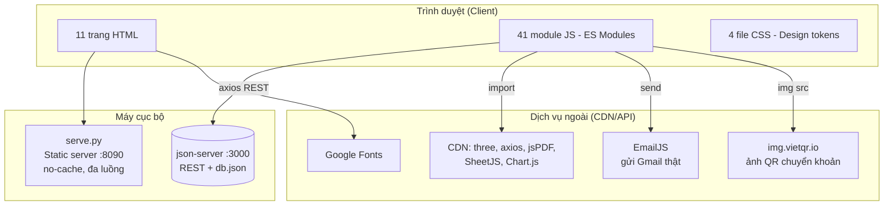
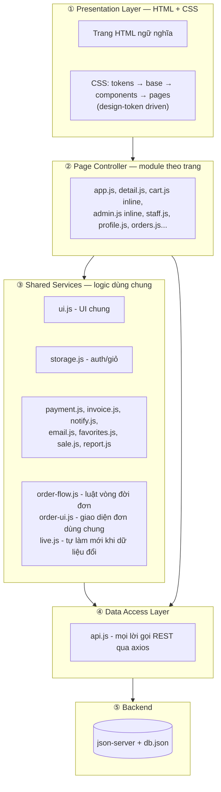
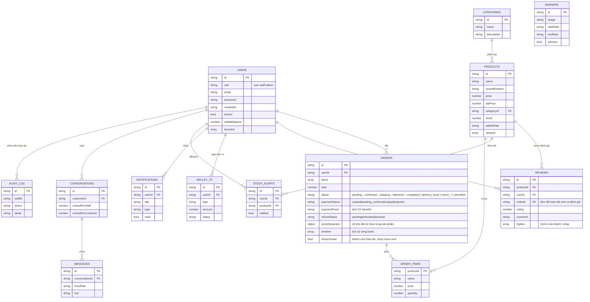

# Lá & Sỏi — Software Architecture Design

> Thiết kế kiến trúc phần mềm của website bán cây cảnh **Lá & Sỏi**.
> Tài liệu dựa trực tiếp trên mã nguồn hiện tại. Cập nhật: 2026-11-12.

---

## 1. Tổng quan kiến trúc

**Lá & Sỏi** là một **Single-Page-style static web app** (nhiều trang HTML tĩnh, logic bằng Vanilla JS ES Modules) giao tiếp với backend REST giả lập `json-server`. Không dùng framework UI (không React/Vue), không build step — chạy trực tiếp trên trình duyệt qua ES Modules + importmap.



---

## 2. Tech stack

| Lớp | Công nghệ |
|---|---|
| Ngôn ngữ | HTML5, CSS3, JavaScript (ES2020+ Modules) |
| Kiến trúc client | Vanilla JS, không framework; importmap (`three`, `axios`) |
| HTTP client | **axios 1.7.9** (instance chung, baseURL `http://localhost:3000`) |
| Backend dữ liệu | **json-server** (REST giả lập trên `db.json`), cổng 3000 |
| Static server | **serve.py** — Python `ThreadingHTTPServer`, header no-cache, cổng 8090 |
| 3D/animation | **three.js 0.170.0** (esm.sh) |
| PDF hóa đơn | **jsPDF 2.5.1** + **jsPDF-AutoTable 3.8.0** |
| Xuất báo cáo | **SheetJS (xlsx) 0.18.5** (Excel) + TXT |
| Biểu đồ | **Chart.js 4.4.0** |
| Email | **@emailjs/browser 4.4.1** (nạp động khi cần) |
| Hiệu ứng CSS | Tự viết trong `base.css` / `components.css` (đã bỏ thư viện animate.css, giữ nguyên tên class `animate__…`) |
| Font | Google Fonts: **Lora** (display) + **Be Vietnam Pro** (UI) |
| Thanh toán | **VietQR** qua `img.vietqr.io` (không cần key) |

---

## 3. Kiến trúc phân lớp (Layered)



**Nguyên tắc:** mọi truy cập dữ liệu đi qua **`api.js`** (một điểm vào duy nhất). UI và logic nghiệp vụ không gọi `axios`/`fetch` trực tiếp.

---

## 4. Bản đồ module (JS)

| Module | Vai trò |
|---|---|
| `api.js` | **Data access** — instance axios + toàn bộ hàm REST (CRUD products/users/orders/...). Lọc phía client cho các truy vấn bị `json-server` so khớp cứng kiểu; tìm email không phân biệt hoa / thường. **Hàng đợi ghi**: lệnh ghi đi lần lượt, cách nhau ≥ 300 ms (chung mọi tab) để json-server chạy kiểu `--watch` không làm rơi lượt ghi; tự thử lại khi lỗi mạng. **Chống ghi trùng:** `postOnce()` + `newClientRef()` (tạo đơn / giao dịch ví đúng một lần); chỉ tự gửi lại `GET` / `PUT` khi lỗi mạng. |
| `storage.js` | Xác thực theo tab (`sessionStorage`), giỏ hàng (`localStorage`), guard `requireRole` (đối chiếu phiên với máy chủ: tài khoản, email, vai trò). Giỏ chặn tồn kho **chung cho mọi size** của một cây; thêm từ thẻ sản phẩm tự lấy size đầu tiên. |
| `ui.js` | Header (tên user, badge giỏ, avatar), toast, dựng card sản phẩm, thước đo mật khẩu, nạp site-settings, khởi tạo trang. |
| `app.js` | Trang chủ: catalog, tìm kiếm (form + Enter), lọc danh mục, phân trang, quiz chọn cây, hero, khởi tạo Three.js & banner & chat & chatbot. |
| `detail.js` | Trang chi tiết: gallery, đánh giá sao, yêu thích, đặt trước, báo có hàng, thêm giỏ. |
| `product-flow.js` | Chuyển cảnh từ một thẻ sản phẩm sang trang chi tiết, dùng chung cho mọi liên kết tới `product-detail.html`: thẻ được bấm nhấn nhẹ, các thẻ khác mờ đi; ảnh của thẻ bay tới khung ảnh lớn (View Transitions liên trang, dự phòng bằng Web Animations); trang chi tiết hiện khung xương kèm sẵn ảnh vừa bấm; bấm quay lại thì về đúng vị trí cuộn và đúng trang phân trang cũ. Tôn trọng `prefers-reduced-motion`. |
| `cart.html (inline)` | Giỏ hàng + checkout (gọi `payment.js`, `invoice.js`): khối **Giao đến** (điền sẵn từ Hồ sơ, kiểm tra SĐT / địa chỉ), dự kiến nhận hàng, kiểm tra lại tồn kho trước khi thanh toán, đọc lại đơn sau khi tạo. |
| `payment.js` | Dựng mã VietQR, modal chọn Ví/QR + upload ảnh CK, modal nạp ví. |
| `invoice.js` | Xuất hóa đơn PDF (jsPDF + AutoTable + font Việt). |
| `notify.js` | Tạo thông báo web + email, chuông 🔔 header, phát toàn bộ khách (sale). |
| `email.js` | `sendEmail` — luôn lưu `mailbox`, gửi EmailJS nếu đã cấu hình (nạp SDK động). |
| `favorites.js` | Danh sách yêu thích: lưu trên tài khoản; khách chưa đăng nhập lưu tạm ở `localStorage` và **tự gộp vào tài khoản khi đăng nhập**. Phát sự kiện `favorites:change` để header cập nhật số trên icon tim. |
| `labels.js` | **Nhãn sản phẩm quản lý được**: nạp `labelGroups` + `labels` (có cache), trả về nhãn của từng sản phẩm và dựng chip có màu. Sản phẩm chưa gán `labelIds` thì suy ra từ 2 trường cũ để không mất thông tin. |
| `admin-labels.js` | Quản trị › Nhãn sản phẩm: thêm / sửa / xóa / đổi tên / đổi màu nhóm và nhãn; bộ chọn nhãn trong form sản phẩm; xóa nhãn thì gỡ khỏi sản phẩm đang dùng. Giữ đồng bộ `difficulty` / `petSafe` cho chatbot và gợi ý chọn cây. |
| `admin-dashboard.js` | Quản trị › Thống kê: bộ lọc tháng / quý / năm / tự chọn ngày (lưu `localStorage`); xếp từ quan trọng nhất xuống chi tiết — câu tóm tắt kỳ, phiếu số liệu (doanh thu đứng riêng một hàng, 4 chỉ số phụ bên dưới, ô nào cũng ghi số kỳ trước), nhóm **Xu hướng doanh thu** (biểu đồ đường theo ngày / tuần / tháng chồng đường kỳ trước, đổi được sang cột, bấm chú thích để ẩn / hiện từng đường), nhóm **Đơn hàng**, nhóm **Sản phẩm & khách hàng** (biểu đồ cột so sánh danh mục / sản phẩm / khách / bốn quý + bảng xếp hạng chi tiết gập mở được). |
| `admin-audit.js` | Quản trị › Nhật ký nhân viên: chỉ ĐỌC `auditLog` (cách ghi không đổi). Gom theo đơn / ví / sản phẩm hoặc xem danh sách đầy đủ; chia theo ngày; lọc thời gian (mặc định hôm nay), nhân viên (ô tóm tắt đếm bằng `X-Total-Count`), loại thao tác, chỉ thao tác quan trọng, tìm kiếm (`detail_like`); phân trang ở máy chủ (`_page`/`_limit`/`_sort`) và luôn kiểm tra lại kết quả phía trình duyệt; xuất Excel theo bộ lọc. Bảng `AUDIT_TYPES` đặt tên tiếng Việt + mức độ cho mọi mã thao tác. |
| `dash-kit.js` | Mảnh ghép dùng chung của trang tổng quan Quản trị và Nhân viên: ô của phiếu số liệu (`slipCell`), cấu hình biểu đồ cột Chart.js và plugin vẽ mầm cây trên cột có doanh thu. |
| `slide-marker.js` | Dấu "đang chọn" trượt từ mục cũ sang mục mới (thẻ phân trang của trang Quản trị / Nhân viên, nút chọn kỳ). Đo vị trí mục đang chọn rồi ghi vào biến CSS; tự đặt lại khi đổi kích thước cửa sổ hoặc chữ dài ngắn đi; tôn trọng `prefers-reduced-motion`. |
| `detail-extras.js` | Bổ sung cho trang chi tiết (nạp động): thanh mua hàng dính trên màn hình rộng, "Lịch chăm sóc tuần đầu" sinh từ chỉ số nước/ánh sáng của cây, "Thường mua cùng" (chậu, giá thể). |
| `shop-extras.js` | Giỏ hàng trượt từ cạnh phải (xem nhanh, đổi số lượng, xóa — giá tính như trang giỏ hàng) và menu danh mục thả xuống dưới "Sản phẩm". |
| `search-suggest.js` | Gợi ý tức thì dưới ô tìm kiếm: tối đa 5 sản phẩm khớp kèm ảnh, giá. |
| `img-manifest.js` | Tự sinh bởi `tools/make-webp.py`: danh sách ảnh đã có bản WebP; `imgAttrs()` trong `ui.js` dựa vào đây để dùng WebP và tự quay về ảnh gốc nếu lỗi. |
| `quiz.js` | **Gợi ý chọn cây**: hộp thoại từng bước (3 câu: ánh sáng, tưới nước, thú cưng), mở được từ mọi trang. Trả lời xong kết quả hiện ngay trong hộp thoại (Thêm vào giỏ / Xem chi tiết); "Lọc cả cửa hàng theo kết quả" áp đúng câu trả lời lên lưới sản phẩm trang chủ. Giữ luật quy đổi câu trả lời → chỉ số chăm sóc dùng chung với bộ lọc. |
| `nav.js` | Thanh điều hướng dùng chung cho mọi trang (một nơi định nghĩa): Sản phẩm · Khuyến mãi (chỉ hiện khi đang có chương trình) · Gợi ý chọn cây · Liên hệ; tô đậm mục đang xem; link trong cùng trang thì cuộn mượt, không tải lại; bổ sung menu ☰ và icon giỏ cho trang còn thiếu. |
| `wishlist.js` | Trang `wishlist.html`: danh sách đã thích, Thêm vào giỏ, Bỏ thích. |
| `fx.js` | Hiệu ứng vi mô không thư viện ngoài: `flyToCart`, `heartBurst`, `celebrateOrder`, ripple, chuyển trang. Chỉ animate `transform`/`opacity`; bỏ qua khi `prefers-reduced-motion`. |
| `sale.js` | Khuyến mãi đang chạy, countdown, hàng mới về, ngày lễ, **bán chạy** (`topSellers`: tối đa 3 cây, không cắt ngang nhóm hòa nhau, hạng kiểu thi đấu). |
| `banner.js` | Banner theo lịch: full-width, parallax, carousel tự chuyển khi có ≥ 2 banner cùng dịp (chấm, mũi tên, vuốt) + hiệu ứng Three.js particles. |
| `three-ambient.js` | 4 hiệu ứng Three.js (particle field, floating leaves, topo field, banner particles). |
| `chat.js` | Widget chat khách ↔ nhân viên (polling 2.5s). |
| `chatbot.js` | Trợ lý FAQ tự động (độc lập với chat nhân viên). |
| `staff.js` | Trang nghiệp vụ nhân viên (duyệt thanh toán & nạp ví, chat, đơn hàng, tồn kho, thống kê); tab Đơn hàng dựng bằng `order-ui.js`. |
| `admin.html (inline)` | Trang quản trị (12 mục, điều hướng bằng dải thẻ phân trang đánh số 01–12 gắn trên mép trang nội dung) — import `api.js`, `ui.js`, `report.js`, `order-ui.js`. |
| `profile.js` | Hồ sơ: thông tin, avatar, đổi mật khẩu, ví, yêu thích. |
| `orders.js` | "Đơn hàng của tôi": **thanh tiến trình 5 bước có hiệu ứng** (giờ từng bước, xe chạy khi đang giao) + dải dự kiến giao kèm câu giải thích, đếm ngược tự hoàn tất, địa chỉ giao, lời nhắc theo bước, nút thao tác, hóa đơn PDF, khung đánh giá sao khi đơn hoàn tất. |
| `order-flow.js` | **Nguồn sự thật duy nhất của vòng đời đơn**: ai được làm gì ở trạng thái nào, và mỗi bước kéo theo gì (hoàn tiền vào ví, trả kho, lịch sử đơn, nhật ký, thông báo + email). Dùng chung cho khách / nhân viên / quản trị. Kèm **lịch giao hàng**: nạp quy tắc từ Cài đặt (`loadDeliveryRules`), tính khoảng ngày nhận chỉ đếm ngày làm việc (`estimateWindow`, `deliveryEstimate`, `deliveryBasisText`), ngày hẹn do nhân viên đặt; **sau khi giao**: hạn tự hoàn tất (`autoCompleteAt`), nhắc khách trước 24 giờ và tự hoàn tất (`autoCompleteDelivered`). |
| `order-ui.js` | Thành phần giao diện dùng chung cho đơn: chip trạng thái, lịch sử đơn, hộp hỏi lý do (có lý do chọn nhanh, tối thiểu 5 ký tự), **hộp chọn ngày hẹn giao**, nút thao tác, **bảng quản lý đơn** của nhân viên/quản trị (bộ lọc việc, cờ chưa đọc, địa chỉ + hạn giao từng đơn, chọn nhiều để xóa); `shopTodo` dùng chung cho badge tab và ô "Đơn cần xử lý". |
| `live.js` | Tự làm mới vùng đang xem khi dữ liệu trên máy chủ đổi (so "chữ ký" mỗi 6 giây), có cơ chế hoãn để không mất thao tác đang làm dở. |
| `i18n.js` | Đổi ngôn ngữ (6 thứ tiếng) qua Google Website Translator, nạp động từ `ui.js`. |
| `login.js` / `register.js` | Form đăng nhập / đăng ký. |
| `forgot-password.js` | Quên mật khẩu bằng **mã OTP 6 số** (băm SHA-256, hạn 10 phút, tối đa 5 lần sai, gửi lại sau 60 giây) — 3 bước trên cùng một trang. |
| `report.js` | Xuất Excel/TXT, nhập sản phẩm từ Excel. |
| `image-viewer.js` | Phóng to ảnh sản phẩm. |

---

## 5. Mô hình dữ liệu (db.json — 17 collection)



**Các collection khác:** `promotions` (khuyến mãi), `coupons` (mã giảm), `holidays` (10 ngày lễ VN cho banner theo mùa), `mailbox` (hộp thư mô phỏng — lưu vết mọi email).

> **Lưu ý kỹ thuật:** `json-server` (bản 1.x so khớp cứng kiểu; bản 0.17 đang dùng thì bỏ qua bộ lọc theo trường chưa bản ghi nào có) so khớp **cứng kiểu** (`?userId=2` không khớp chuỗi `"2"`), nên các truy vấn lọc (`getOrdersByUser`, `getMessages`, `getNotifications`...) **lọc phía client** trong `api.js`.

---

## 6. Các quyết định thiết kế quan trọng (ADR tóm tắt)

| # | Quyết định | Lý do |
|---|---|---|
| 1 | **Auth theo tab** (`sessionStorage`) thay vì `localStorage` | Cho phép mở 1 tab khách + 1 tab nhân viên song song (yêu cầu chat realtime 2 phía). Giỏ hàng vẫn `localStorage` để bền vững. |
| 2 | **Realtime bằng polling** (chat 2.5s, chuông 10s) | `json-server` không hỗ trợ WebSocket; polling đơn giản, chạy được nhiều tab nhờ state dùng chung. |
| 3 | **Lọc phía client trong `api.js`** | Khắc phục so khớp cứng kiểu của json-server (bản 1.x so khớp cứng kiểu; bản 0.17 đang dùng thì bỏ qua bộ lọc theo trường chưa bản ghi nào có). |
| 4 | **EmailJS + fallback `mailbox`** | `sendEmail` luôn ghi `mailbox` (kiểm chứng/demo), gửi Gmail thật khi admin đã nhập khóa EmailJS. SDK nạp động để không nặng trang. |
| 5 | **Static server `serve.py` no-cache, đa luồng** | Tránh trình duyệt cache module JS cũ khi phát triển; đa luồng để không nghẽn khi tải nhiều module song song. |
| 6 | **Luồng duyệt thanh toán + `auditLog`** | Minh bạch chống gian lận: QR phải nhân viên xác nhận mới xuất hóa đơn; mọi thao tác nhạy cảm được ghi log cho admin giám sát. |
| 7 | **CSS design-token** (`tokens.css`) | Toàn bộ màu/cỡ chữ/bo góc/bóng đổ tập trung một chỗ → đổi giao diện toàn site qua biến. |
| 8 | **`[hidden] { display:none !important }`** | Đảm bảo thuộc tính `hidden` luôn thắng `display` của class (tránh lỗi panel/banner luôn hiện). |
| 9 | **Gom toàn bộ luật vòng đời đơn vào `order-flow.js`** | Khách, nhân viên và quản trị dùng chung một bộ luật → không lệch nhau; thêm một bước mới chỉ sửa một chỗ; trước khi ghi luôn đọc lại đơn mới nhất để hai người bấm cùng lúc không ghi đè nhau. |
| 10 | **Duyệt thanh toán chỉ ở một nơi** | Nút duyệt tiền chỉ nằm ở tab có ảnh chuyển khoản ("Duyệt thanh toán"); tab "Đơn hàng" của nhân viên chỉ dẫn sang đó → tránh xác nhận trùng một khoản tiền. |
| 11 | **Tự làm mới theo "chữ ký" dữ liệu (`live.js`) thay vì tải lại định kỳ** | Chỉ vẽ lại khi dữ liệu thực sự đổi, và hoãn khi người dùng đang gõ / đang mở hộp thoại / đang chọn đơn → không mất thao tác, không tốn băng thông vô ích. |
| 12 | **Một phiên bản json-server cho mọi nơi: 0.17.4, không `--watch`, có `--fks __none__`** (`tools/start-db.mjs` / `start-db.bat` ở local, `npm start` trên Render) | Trước đây local chạy `npx json-server` (tự tải bản 1.x) còn Render chạy 0.17.4 → hành vi lệch nhau (1.x bỏ qua `id` do trình duyệt gửi). Nay cả hai dùng đúng bản trong `package.json`. Bỏ `--watch` vì chế độ theo dõi file đọc lại `db.json` sau mỗi lần ghi, có thể đè mất lượt ghi và làm sập máy chủ trên Windows (`EPERM`); đo 120 lượt ghi dồn dập không `--watch`: giữ đủ 120. `--fks __none__` tắt việc 0.17 tự xóa "bản ghi mồ côi" khi có lệnh `DELETE` (thử trên bản sao dữ liệu: xóa 1 đơn làm mất 1 banner và 6 giao dịch ví). Đánh đổi: sửa tay `db.json` thì phải khởi động lại server. |
| 13 | **Hàng đợi ghi trong `api.js` + đọc lại đơn sau khi đặt** | Phòng khi server vẫn bị bật kiểu `json-server --watch db.json`: đo thực tế, lượt ghi tới trong ~25 ms sau lượt trước có thể bị mất (2–7/30 đơn). Cho lệnh ghi đi lần lượt, cách nhau 300 ms (mốc lưu `localStorage`, áp dụng chung mọi tab) → không còn mất. Bước đặt hàng còn `GET` lại đơn, mất thì ghi lại đúng mã. Lệnh đọc không bị chậm. |
| 16 | **Tạo đơn đúng một lần bằng mã do trình duyệt sinh** (`createOrder` → `postOnce` trong `api.js`) | "Lỗi mạng" không cho biết máy chủ đã lưu hay chưa. Giả lập phản hồi bị rớt sau khi máy chủ đã lưu: bản cũ (tự gửi lại mọi lệnh) sinh **2 đơn đã thanh toán**. Nay mỗi đơn mang mã riêng (`id` = `clientRef`); gặp lỗi mạng thì tra theo mã trước, có rồi thì dùng, chưa có mới gửi lại. `api.js` chỉ tự gửi lại `GET` / `PUT`. Không có bước "quét và xóa đơn thừa": code không tự xóa đơn. |
| 17 | **Thanh toán ví: tạo đơn chờ thanh toán → trừ ví → đánh dấu đã thanh toán → trừ kho** | Thứ tự cũ (trừ ví trước, tạo đơn sau) có thể để lại cảnh ví bị trừ mà không có đơn. Thứ tự mới: lỗi ở bước nào thì thứ còn lại là một đơn chưa thanh toán / đã hủy, không phải tiền bị mất. Các lệnh `PATCH` trong luồng này ghi giá trị tuyệt đối nên giỏ hàng được phép thử lại. Bước đánh dấu đã thanh toán báo lỗi thì **đọc lại đơn trước khi hoàn tiền** — cùng bài học với ADR 16: "lỗi" chưa chắc là máy chủ chưa làm. Hoàn tiền = số dư hiện tại + số tiền đơn (không ghi đè số dư cũ) + giao dịch `refund`. |
| 18 | **Hoàn tiền đúng một lần bằng "phiếu giữ chỗ" mã cố định `rf-<mã đơn>`** | Đối chiếu dữ liệu 11/2026: đơn #ia7HsBz6pAw có 4 giao dịch hoàn 582.500 ₫ — bản cũ hoàn tiền TRƯỚC khi ghi trạng thái đơn, lệnh ghi đơn bị mất (thời json-server `--watch`) nên nhân viên bấm Hủy lại được. Tái hiện trên code trước khi sửa: hai lệnh hủy cùng lúc → 2 giao dịch hoàn; phản hồi lệnh cộng ví rớt rồi bấm lại → ví cộng 2 lần mà chỉ 1 giao dịch. json-server không có giao dịch / khóa, nhưng **từ chối id trùng** — đó là thao tác nguyên tử duy nhất, nên dùng làm khóa. Kèm: khóa trong tab, nút khóa khi đang chạy, đọc lại đơn sau lỗi mạng. |
| 19 | **Ghi nhật ký cho thao tác của quản trị** (`adminLog` trong `admin.html`) | Trước đây chỉ nhân viên bị ghi; quản trị đổi giá / xóa / khóa tài khoản không để lại dấu vết. Ghi sau khi thao tác thành công, cùng định dạng log cũ (cách ghi của nhân viên không đổi); lỗi ghi log không chặn thao tác chính. |
| 14 | **Dự kiến giao tính theo lịch làm việc cấu hình được, nhân viên ghi đè được** | Con số "1–3 ngày" cố định không có cơ sở. Tính từ giờ chốt + ngày chuẩn bị + ngày vận chuyển, bỏ Chủ nhật / ngày nghỉ → khách thấy được cách tính; trường hợp đặc biệt (khách hẹn, xe tuyến xa) nhân viên hẹn ngày cụ thể. Thiếu cài đặt thì dùng mặc định → dữ liệu cũ chạy ngay. |
| 15 | **Tự hoàn tất + nhắc chạy khi có người mở trang** | Không có máy chủ chạy nền (cron). `autoCompleteDelivered` chạy khi mở trang đơn của khách hoặc của shop; đúng hạn vẫn được tính theo thời gian, chỉ trễ tới lần mở trang kế tiếp. Nhắc chỉ 1 lần nhờ cờ `receiveReminderAt`. |

---

## 7. Tích hợp ngoài

| Dịch vụ | Mục đích | Cách dùng |
|---|---|---|
| **img.vietqr.io** | Ảnh mã QR chuyển khoản thật | `buildVietQRUrl` ghép BIN + số TK + số tiền + nội dung (từ `settings`) |
| **EmailJS** | Gửi Gmail thật | `email.js` → `window.emailjs.send(serviceId, templateId, {to_email, subject, message, shop_name})` |
| **esm.sh / cdnjs** | Nạp thư viện (three, axios, jsPDF, SheetJS, Chart.js) | importmap + thẻ `<script>` |

---

## 8. Triển khai & chạy

```bash
# 1. Backend dữ liệu (REST) — cổng 3000 (chế độ không đọc lại file, tránh mất dữ liệu ghi)
node tools/start-db.mjs        # Windows: có thể bấm đúp start-db.bat

# 2. Static server (no-cache) — cổng 8090
python serve.py 8090
```
Mở `http://localhost:8090/index.html`. (Cấu hình sẵn trong `.claude/launch.json`.)

**Tài khoản mẫu:** admin `admin@lasoi.vn` · nhân viên `nhanvien@lasoi.vn` · khách `an@gmail.com` (KH mới) / `cu@gmail.com` (KH cũ).

---

## 9. Bảo mật & giới hạn (mang tính học thuật)

- Mật khẩu lưu **dạng thô** trong `db.json` (đồ án học tập) — chỉ xóa khỏi object trước khi lưu session, **không hash**.
- `json-server` không có xác thực/authorization phía server — phân quyền thực thi **phía client** (`requireRole`), phù hợp phạm vi bài tập. Giảm thiểu: trang nhân viên / quản trị đối chiếu phiên với máy chủ (tài khoản tồn tại, đúng email, đúng vai trò) → sửa tay `role` trong `sessionStorage` không vào được. Vẫn **không** chống được người gọi thẳng REST API.
- Không có máy chủ chạy nền: nhắc xác nhận nhận hàng và tự hoàn tất chỉ chạy khi có người mở trang đơn hàng.
- Public Key EmailJS để lộ ở client là bình thường & an toàn với EmailJS (chỉ gửi, không đọc hộp thư).

---

*Xem các luồng nghiệp vụ chi tiết tại [WORKFLOW.md](WORKFLOW.md).*
