# Lá & Sỏi — Sơ Đồ Từng Chức Năng (27 chức năng)

> Mỗi chức năng của website kèm một sơ đồ workflow (Mermaid).
> Dựa trực tiếp trên mã nguồn — không suy diễn. Cập nhật: 2026-11-14.
> Mở bằng GitHub / VS Code (Markdown Preview Mermaid) / trình xem hỗ trợ Mermaid để thấy hình vẽ.

## Mục lục
**Tài khoản:** [1. Đăng ký](#1-đăng-ký-tài-khoản) · [2. Đăng nhập](#2-đăng-nhập-theo-tab) · [3. Quên/đặt lại mật khẩu](#3-quên--đặt-lại-mật-khẩu) · [4. Hồ sơ & avatar](#4-hồ-sơ--đổi-mật-khẩu--avatar)
**Mua sắm:** [5. Danh mục & tìm kiếm](#5-danh-mục-tìm-kiếm-lọc-phân-trang) · [6. Chi tiết & đánh giá](#6-chi-tiết-sản-phẩm--đánh-giá) · [7. Yêu thích](#7-yêu-thích-wishlist) · [8. Giỏ hàng](#8-giỏ-hàng)
**Thanh toán:** [9. QR](#9-thanh-toán-chuyển-khoản-qr) · [10. Ví web & nạp ví](#10-ví-web--nạp-ví) · [11. Đặt trước](#11-đặt-trước--báo-có-hàng-lại) · [12. Hóa đơn PDF](#12-hóa-đơn-pdf) · [13. Đơn của tôi](#13-đơn-hàng-của-tôi)
**Tương tác:** [14. Thông báo & email](#14-thông-báo--email) · [15. Chat realtime](#15-chat-realtime-khách--nhân-viên) · [16. Chatbot FAQ](#16-chatbot-faq)
**Vòng đời đơn:** [22. Giao hàng & khiếu nại](#22-vòng-đời-đơn-hàng-giao-nhận--khiếu-nại) · [23. Hủy, hoàn hàng, hoàn tiền](#23-hủy-đơn-hoàn-hàng-hoàn-tiền) · [24. Đánh giá sau khi nhận](#24-đánh-giá-sao--bình-luận-sau-khi-nhận-hàng) · [26. Dự kiến giao & hẹn ngày giao](#26-dự-kiến-giao-hẹn-ngày-giao--sắp-tới-bạn)
**Vận hành:** [17. Nhân viên](#17-nghiệp-vụ-nhân-viên) · [18. Nhật ký audit](#18-nhật-ký-audit-minh-bạch) · [19. Quản trị](#19-quản-trị-admin) · [20. Banner theo lịch](#20-banner-theo-lịch--threejs) · [21. Tự động theo thời gian](#21-tự-động-theo-thời-gian) · [25. Tự cập nhật không cần F5](#25-tự-cập-nhật-không-cần-tải-lại-trang) · [27. Bán chạy nhất](#27-bán-chạy-nhất-top-3)

---

## 1. Đăng ký tài khoản
`dangky.html` → `register.js`
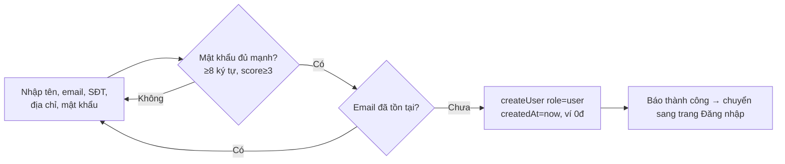

## 2. Đăng nhập theo tab
`login.html` → `login.js` · auth lưu ở `sessionStorage` (mỗi tab độc lập)
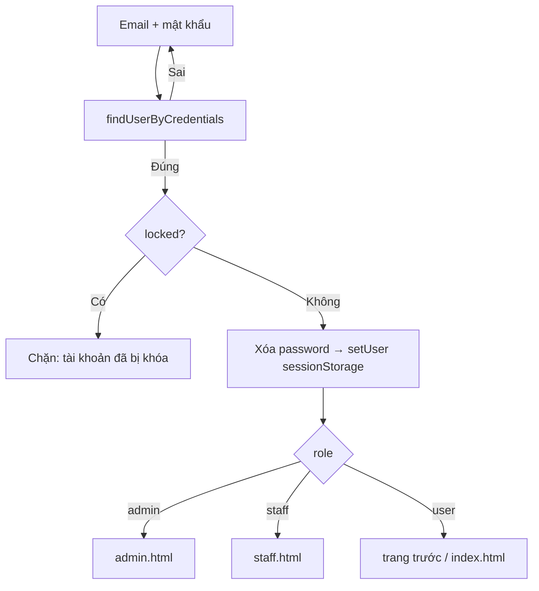

## 3. Quên / đặt lại mật khẩu
`quenmatkhau.html` → `forgot-password.js` (3 bước trên cùng trang, mã OTP qua email)
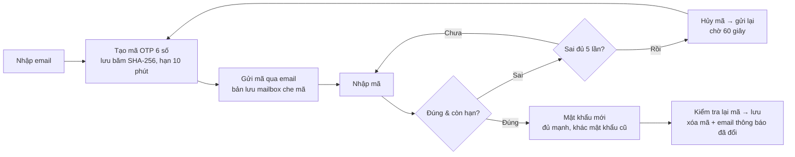

## 4. Hồ sơ, đổi mật khẩu & avatar
`profile.html` → `profile.js` (các tab)
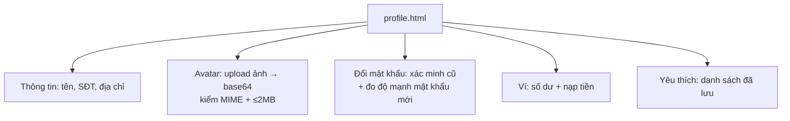

---

## 5. Danh mục, tìm kiếm, lọc, phân trang
`index.html` → `app.js`
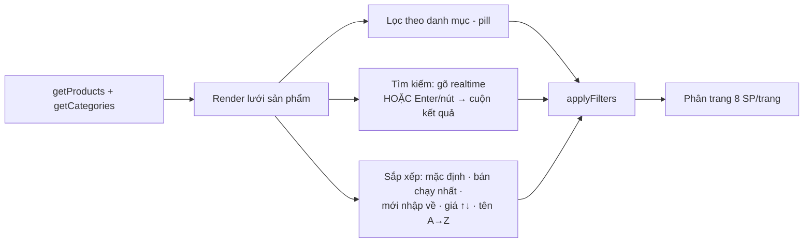

## 6. Chi tiết sản phẩm & đánh giá
`product-detail.html` → `detail.js`
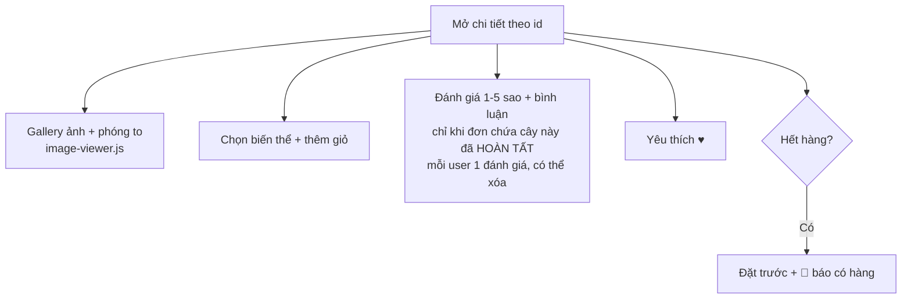

## 7. Yêu thích (wishlist)
`favorites.js` (logic) · `wishlist.html` → `wishlist.js` (trang riêng) · icon ♥ kèm số lượng trên header mọi trang
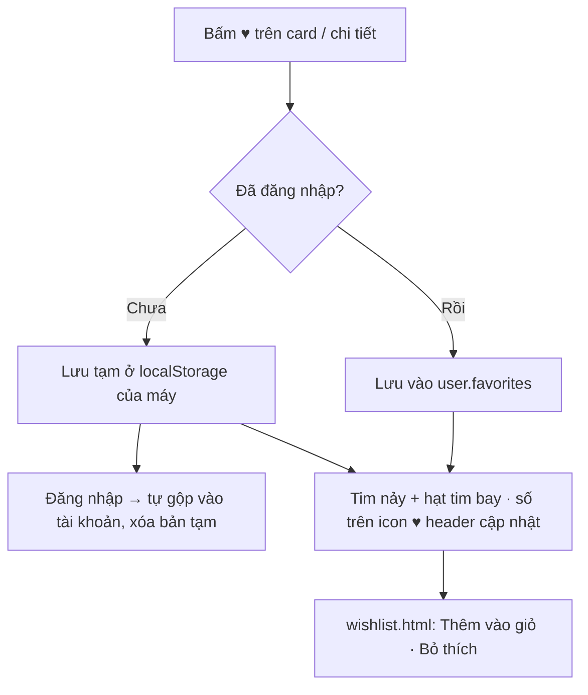
*Khách chưa đăng nhập vẫn xem được trang Yêu thích, kèm lời nhắc đăng nhập để đồng bộ. Tab Yêu thích trong hồ sơ vẫn giữ nguyên.*

## 8. Giỏ hàng
`cart.html` · lưu `localStorage` theo user id (`storage.js`)
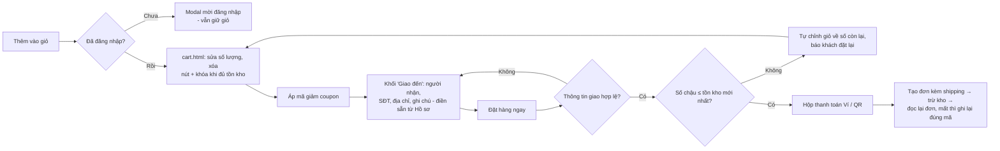
*Tồn kho tính **chung cho mọi size** của một cây (thẻ sản phẩm, trang chi tiết, giỏ trượt và trang giỏ đều chặn). Tồn = 0 là hàng **đặt trước**, không giới hạn. Tóm tắt đơn có dòng **Dự kiến nhận hàng** (xem [26](#26-dự-kiến-giao-hẹn-ngày-giao--sắp-tới-bạn)).*

---

## 9. Thanh toán chuyển khoản QR
`payment.js` (modal) → `cart.html` → nhân viên duyệt
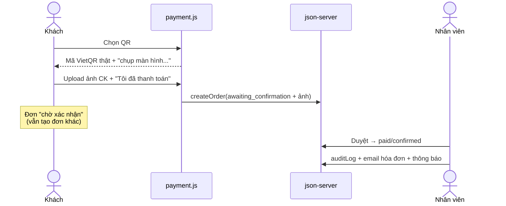

## 10. Ví web & nạp ví
`payment.js` (openTopupModal) · `cart.html` (trả bằng ví)
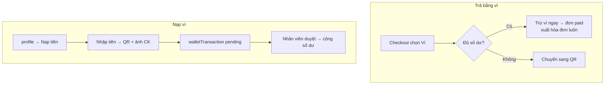

## 11. Đặt trước & báo có hàng lại
`detail.js` (createStockAlert) · `staff.js` (notifyBackInStock)
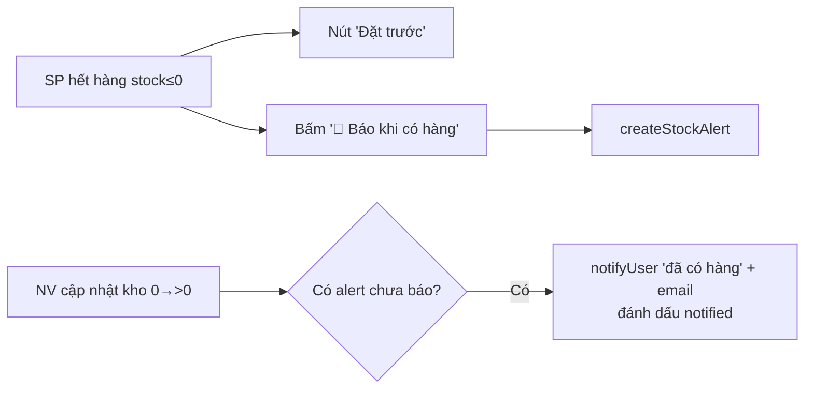

## 12. Hóa đơn PDF
`invoice.js` — jsPDF + AutoTable + font Việt
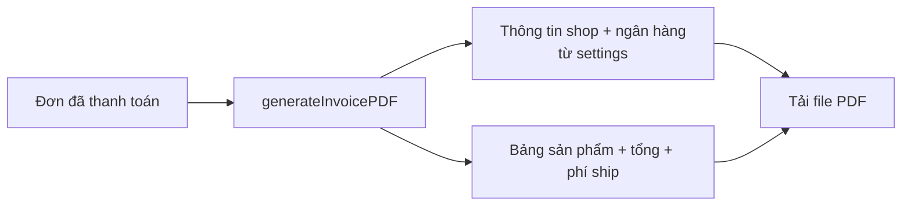

## 13. Đơn hàng của tôi
`donhang.html` → `orders.js` · nút thao tác lấy từ `order-flow.js` (xem [22](#22-vòng-đời-đơn-hàng-giao-nhận--khiếu-nại), [23](#23-hủy-đơn-hoàn-hàng-hoàn-tiền))
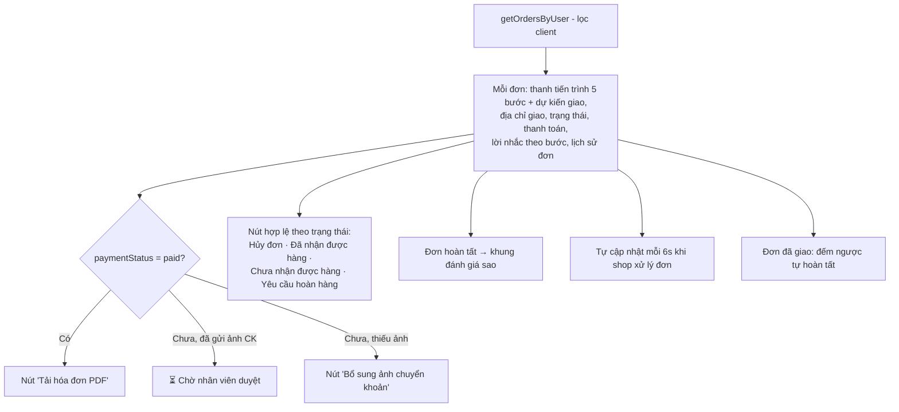

---

## 14. Thông báo & email
`notify.js` + `email.js`
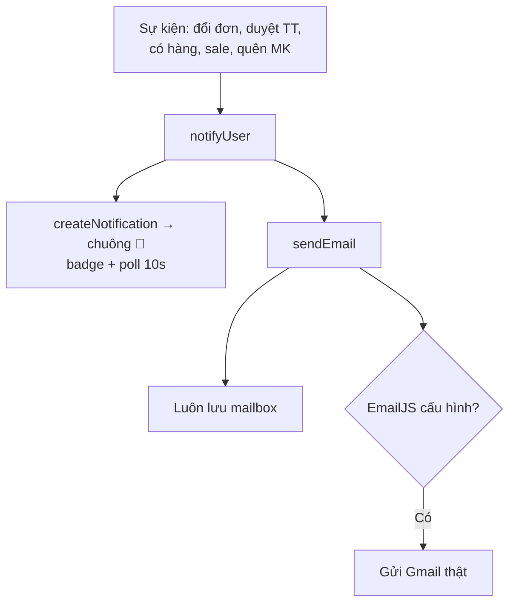

## 15. Chat realtime khách ↔ nhân viên
`chat.js` (khách) · `staff.js` (nhân viên) · polling 2.5s
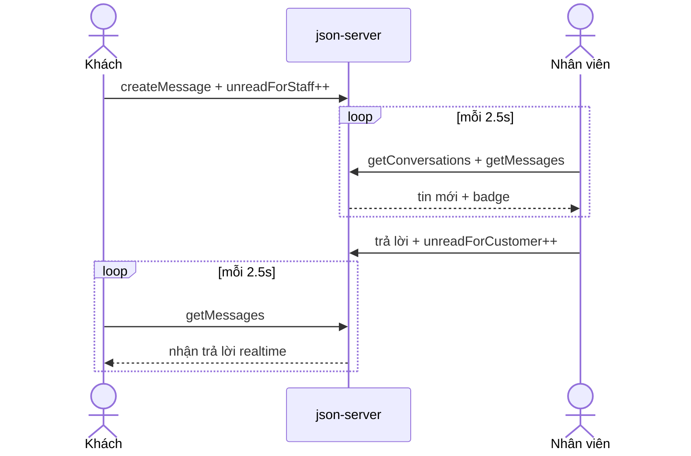

## 16. Chatbot FAQ
`chatbot.js` — trợ lý tự động (độc lập với chat nhân viên)
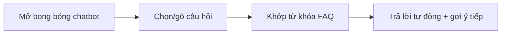

---

## 17. Nghiệp vụ nhân viên
`staff.html` → `staff.js` (5 tab)
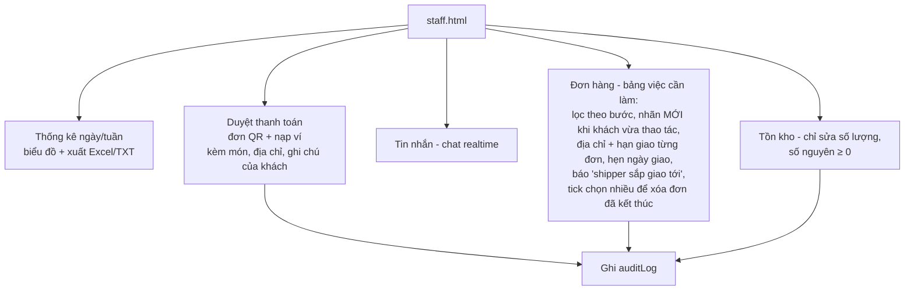

## 18. Nhật ký audit (minh bạch)
Ghi bởi `staff.js` → xem tại `admin.html` tab "Nhật ký NV"
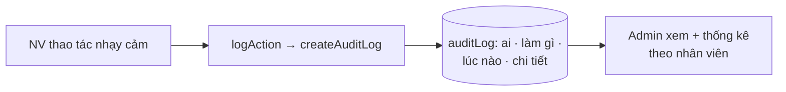
*Ghi log: duyệt/từ chối nạp ví (`confirm_topup`/`reject_topup`) · sửa tồn kho (`update_stock`) · mọi bước vòng đời đơn do nhân viên hoặc quản trị thực hiện (`order_<hành động>`, vd `order_approve_payment`, `order_ship`, `order_set_delivery_date`, `order_out_for_delivery`, `order_receive_return`) · xóa đơn hàng loạt (`orders_bulk_delete`).*

## 19. Quản trị (admin)
`admin.html` (12 tab: Thống kê · Đơn hàng · Sản phẩm · Danh mục · Nhãn sản phẩm · Đánh giá · Khuyến mãi · Mã giảm · Banner · Tài khoản · Nhật ký NV · Cài đặt)
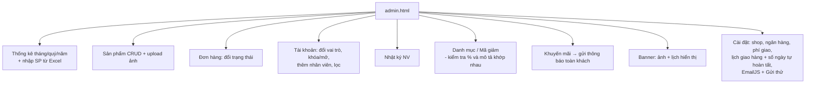

## 20. Banner theo lịch & Three.js
`banner.js` + `three-ambient.js` (initBannerParticles)
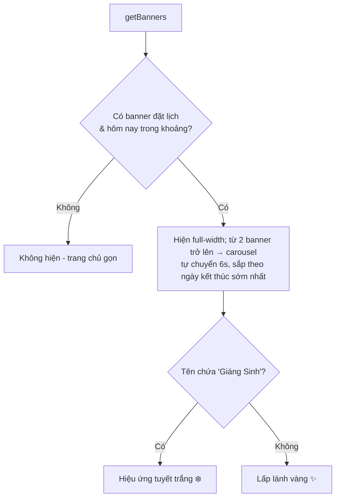

## 21. Tự động theo thời gian
`sale.js`
```mermaid
flowchart LR
  A[Sản phẩm addedDate] --> B{Trong 30 ngày?}
  B -->|Có| C[Hiện mục 'Hàng Mới Về']
  B -->|Không| D[Về bán bình thường]
  E[Tài khoản createdAt] --> F{< 1 tháng?}
  F -->|Có| G[KH mới - được sale]
  F -->|Không| H[KH thường]
  I[Đơn delivered] --> J{Còn < 24 giờ tới hạn<br/>tự hoàn tất & chưa nhắc?}
  J -->|Có| K[Nhắc khách 1 lần:<br/>thông báo + email]
  I --> L{Quá N ngày từ lúc giao?}
  L -->|Có| M[Tự hoàn tất<br/>receivedConfirmedBy = system]
```
*Việc nhắc và tự hoàn tất chạy khi có người mở "Đơn hàng của tôi" hoặc bảng đơn của nhân viên / quản trị (web không có máy chủ chạy nền) — không ai mở thì chạy ở lần mở kế tiếp.*

---

## 22. Vòng đời đơn hàng: giao nhận & khiếu nại
`order-flow.js` (luật) · `order-ui.js` (bảng của shop) · `orders.js` (trang khách)
```mermaid
flowchart LR
  CF[confirmed<br/>Đã thanh toán, chờ giao] -->|NV: Giao cho vận chuyển| SH[shipping<br/>Đang giao]
  SH -->|NV: Đã giao thành công| DL[delivered<br/>Chờ khách xác nhận]
  DL -->|Khách: Đã nhận được hàng| CP[completed<br/>Hoàn tất]
  DL -->|Hệ thống: quá N ngày<br/>nhắc trước 24 giờ| CP
  CP -->|Khách: Chưa nhận được hàng<br/>chỉ khi TỰ hoàn tất, trong 7 ngày| DI
  DL -->|Khách: Chưa nhận được hàng| DI[delivery_issue<br/>Khiếu nại]
  DI -->|NV: Giao lại cho khách| SH
  DI -->|NV: Đã xác minh khách đã nhận| DL
  DI -->|Khách: Vẫn chưa nhận được hàng| DI
  DI -->|NV: Không giao được| CN[cancelled + hoàn tiền]
  SH -->|NV: Giao không thành công| CN
```
*Đơn đang khiếu nại **không** tự hoàn tất → không bao giờ kẹt. Mỗi lần khách báo lại, số lần báo được đếm và hiện cho nhân viên. Đơn hệ thống **tự** hoàn tất (khách vắng nhà, quên bấm) vẫn cho khách báo chưa nhận trong hạn đổi trả; khách đã **tự bấm** "Đã nhận" thì không.*

## 23. Hủy đơn, hoàn hàng, hoàn tiền
```mermaid
flowchart TD
  subgraph Huy["Hủy đơn (trước khi giao vận chuyển)"]
    A1[Khách/NV: Hủy đơn + lý do] --> A2[cancelled + trả lại đúng số kho đã trừ]
    A2 --> A3{Đã thanh toán?}
    A3 -->|Rồi| A4[Hoàn ngay vào Ví web]
    A3 -->|Chưa duyệt nhưng khách báo đã chuyển| A5[refundStatus = pending<br/>→ mục 'Cần hoàn tiền']
  end
  subgraph Hoan["Hoàn hàng (trong 7 ngày kể từ lúc giao)"]
    B1[Khách: Yêu cầu hoàn hàng] --> B2[return_requested]
    B2 -->|NV duyệt| B3[return_approved → khách gửi trả]
    B3 -->|NV nhận lại hàng| B4[returned + trả kho + hoàn tiền vào ví]
    B2 -->|NV từ chối / khách rút| B5[Về trạng thái trước đó]
  end
  subgraph Kiem["Kiểm tra sao kê rồi mới hoàn"]
    C1[refundStatus = pending] -->|Đã nhận tiền| C2[refunded - cộng ví]
    C1 -->|Không thấy tiền| C3[declined - báo khách]
  end
```
*Mọi khoản hoàn đều vào **Ví web** và ghi một giao dịch `refund`.*

## 24. Đánh giá sao & bình luận sau khi nhận hàng
`orders.js` (gửi từ trang đơn) · `detail.js` (hiện ở trang sản phẩm)
```mermaid
flowchart LR
  A[Đơn hoàn tất] --> B[Khung '⭐ Đánh giá sản phẩm'<br/>liệt kê từng cây trong đơn]
  B --> C[Chấm 1-5 sao + nhận xét ≤500 ký tự]
  C --> D[createReview kèm orderId]
  D --> E[Trang sản phẩm: điểm trung bình,<br/>phân bố sao, shop trả lời được]
  F[Đơn mới 'Đã giao'] --> G[Chỉ hiện lời nhắc<br/>'Bấm Đã nhận được hàng rồi mới đánh giá']
```
*1 khách × 1 sản phẩm = 1 đánh giá. Đã đánh giá thì hiện số sao đã chấm + liên kết Xem.*

## 25. Tự cập nhật không cần tải lại trang
`live.js` — so "chữ ký" dữ liệu với máy chủ mỗi 6 giây, khác thì mới vẽ lại
```mermaid
flowchart LR
  A[Mỗi 6 giây] --> B{Tab ẩn / panel ẩn /<br/>đang mở hộp thoại /<br/>đang gõ / đang tick chọn đơn?}
  B -->|Có| A
  B -->|Không| C[Lấy chữ ký dữ liệu trên server]
  C --> D{Khác lần trước?}
  D -->|Không| A
  D -->|Có| E[Vẽ lại vùng đang xem]
```
*Áp dụng cho: tab Đơn hàng & tab Duyệt thanh toán của nhân viên, trang "Đơn hàng của tôi" của khách. Số trên nút tab được cập nhật nền nên nhảy cả khi đang đứng ở tab khác.*

## 26. Dự kiến giao, hẹn ngày giao & "Sắp tới bạn"
`order-flow.js` (`deliveryEstimate`, `estimateWindow`) · lịch làm việc trong Cài đặt · `orders.js` (thanh tiến trình) · `order-ui.js` (hộp hẹn ngày)
```mermaid
flowchart TD
  T[Thời điểm thanh toán] --> C{Trước giờ chốt?<br/>mặc định 16:00}
  C -->|Có| S[Bắt đầu: hôm nay]
  C -->|Không| S2[Bắt đầu: ngày làm việc kế tiếp]
  S & S2 --> P[+ ngày chuẩn bị<br/>= ngày giao cho vận chuyển]
  P --> W[+ vận chuyển nhanh nhất – chậm nhất<br/>= khoảng ngày nhận]
  W --> X[Chỉ đếm ngày làm việc:<br/>bỏ Chủ nhật, bỏ ngày nghỉ]
  H{NV đã hẹn ngày?} -->|Có| D[Hiện 'Shop hẹn giao …']
  H -->|Không| E[Hiện 'Dự kiến giao …' + câu giải thích cách tính]
  X --> H
  E & D --> Q{Quá ngày cuối mà chưa giao?}
  Q -->|Có| L[Chậm hơn dự kiến - đỏ ở bảng của shop]
  SH[Đang giao] -->|NV: Shipper sắp giao tới| AR[Sắp tới bạn<br/>xe chạy sát bước 'Đã giao']
```
*Ví dụ với cài đặt mặc định (chốt 16:00, chuẩn bị 0 ngày, vận chuyển 1–2 ngày, không giao Chủ nhật): thanh toán Thứ Hai 10:00 → nhận Thứ Ba – Thứ Tư; Thứ Bảy 17:00 → nhận Thứ Ba – Thứ Tư. Đơn có cây đặt trước → chưa hẹn ngày. Giỏ hàng hiện cùng cách tính ở dòng "Dự kiến nhận hàng".*

## 27. Bán chạy nhất (top 3)
`sale.js` (`topSellers`) · `app.js` (`renderBestSellers`) · `index.html` mục "Bán Chạy Nhất"
```mermaid
flowchart TD
  A[Đơn đã bán - BR01] --> B[Cộng số chậu theo cây<br/>bỏ phụ kiện]
  B --> C[Sắp giảm dần]
  C --> D[k = min 3, số cây]
  D --> E{Cây thứ k bán bằng<br/>cây thứ k+1?}
  E -->|Có| F[k = k - 1] --> E
  E -->|Không / k = 0| G{k > 0?}
  G -->|Có| H[Hiện k cây trên 'Bảng tin của tiệm'<br/>hạng 1 là thẻ lớn · con dấu thứ hạng · đồng hạng nếu bằng số]
  G -->|Không| I[Đổi thành 'Tiệm chọn giúp bạn':<br/>tối đa 3 cây dễ chăm, còn hàng]
  H --> J{Số bán từ 10 chậu trở lên?}
  J -->|Có| K[Nêu con số: 'N chậu đã về nhà mới']
  J -->|Không| M[Nói bằng lời:<br/>'Khách ghé tiệm hay chọn nhất dạo này']
```
*Ví dụ: `[10, 8, 8, 8]` → 1 cây · `[10, 10, 8, 5]` → 3 cây (hai cây đầu đồng hạng 1) · `[9, 7, 5, 5]` → 2 cây · `[5, 5, 5, 5]` → "Tiệm chọn giúp bạn". Bố cục: 1 cây → một khối ngang lớn; 2 cây → khối lớn + 1 thẻ đứng; 3 cây → khối lớn + 2 thẻ xếp chồng; điện thoại xếp dọc. Khách không thấy câu giải thích cách tính — chỉ có chữ "i" nhỏ cạnh phụ đề.*

---

*Chi tiết kiến trúc kỹ thuật: [ARCHITECTURE.md](ARCHITECTURE.md) · Luồng tổng hợp: [WORKFLOW.md](WORKFLOW.md).*
