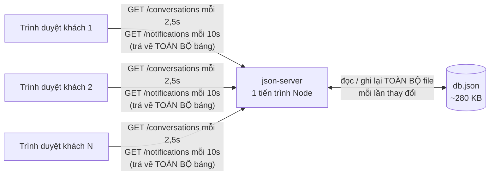
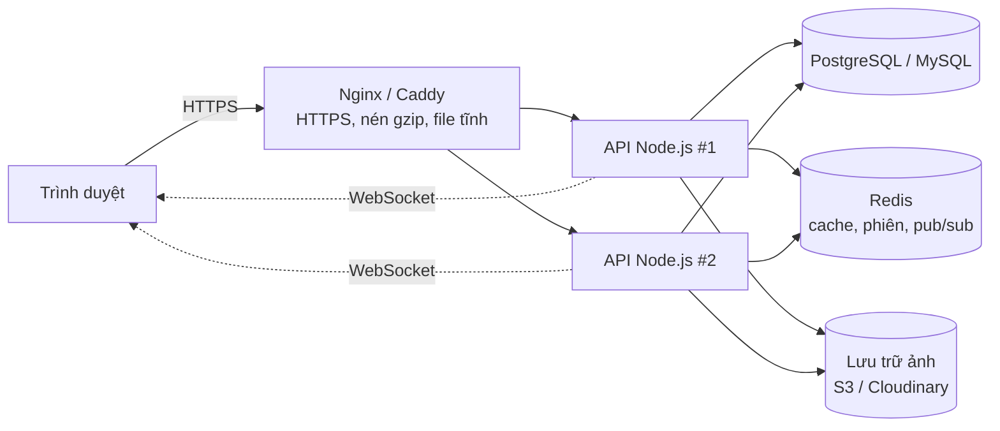

# Lá & Sỏi — Khả Năng Chịu Tải & Lộ Trình Nâng Cấp

> Trả lời câu hỏi: *"Web đang chạy tốt với ~100 người dùng, muốn lên 200 (rồi 1.000, 10.000…) thì làm gì?"*
> Mọi con số dưới đây là **đo thật** trên máy phát triển (11/11/2026) bằng `tools/loadtest.mjs`, không phải ước đoán.

---

## 1. Tóm tắt nhanh

| Câu hỏi | Trả lời ngắn |
|---|---|
| 200 người cùng mở web có chạy được không? | **Có.** Đo thực tế: mô phỏng 1.600 khách đang mở web cùng lúc, độ trễ p95 chỉ **14 ms**, 0 lỗi. Số người dùng **đồng thời** chưa phải điểm nghẽn. |
| Vậy cái gì sẽ hỏng trước? | (1) **Dung lượng tải về tăng theo bình phương** số khách, vì mỗi trình duyệt tải *toàn bộ* bảng dữ liệu rồi tự lọc. (2) **Ghi đồng thời không an toàn** trên json-server. (3) `db.json` phình to vì ảnh lưu dạng base64. (4) **Bảo mật**: dữ liệu mọi người dùng đều đọc được qua API. |
| Từ 100 lên 200 cần làm gì? | Làm **Cấp 1** (sửa code, không đổi hạ tầng) — mục 4. |
| Lên hàng nghìn người? | Bắt buộc **Cấp 2**: thay json-server bằng backend thật + CSDL thật — mục 5. |

---

## 2. Hiện trạng kiến trúc (ảnh hưởng tới tải)



| Đặc điểm | Hệ quả khi đông người |
|---|---|
| Mỗi khách đã đăng nhập tự gửi **~0,5 request/giây** dù không làm gì (chat 2,5s + chuông 10s). | 200 khách ≈ 100 req/s chỉ để "hỏi có gì mới không". |
| Khi đang mở trang "Đơn hàng của tôi", hoặc tab Đơn hàng / Duyệt thanh toán của nhân viên, `js/live.js` hỏi thêm **1 lần mỗi 6 giây** (chỉ đọc, tự dừng khi tab hoặc panel bị ẩn). | Thêm ~0,17 req/s cho mỗi màn hình đang mở; không cộng dồn khi người dùng chuyển sang tab khác. |
| `api.js` lấy **toàn bộ** `/notifications`, `/messages`, `/conversations`, `/orders` rồi mới lọc theo người dùng ở trình duyệt (do json-server so khớp kiểu cứng). | Mỗi lần hỏi, khách tải về dữ liệu của **tất cả** người khác. |
| Ảnh chuyển khoản, ảnh đại diện lưu **base64 trong `db.json`**. | `/orders` hiện nặng **158 KB** chỉ với 60 đơn. |
| json-server ghi lại **cả file** sau mỗi thay đổi; chạy **1 tiến trình**. | Ghi tối đa ~180 lượt/giây và chậm dần khi file lớn. |
| Phân quyền chỉ kiểm tra ở trình duyệt. | Ai cũng gọi thẳng được `GET /users`, `GET /orders`. |

---

## 3. Kết quả đo thực tế

### 3.1 Kích thước dữ liệu trả về
| Endpoint | Kích thước | Ghi chú |
|---|---|---|
| `/conversations` | 550 B | 2 hội thoại |
| `/notifications` | 3,7 KB | 12 thông báo (~306 B/thông báo) |
| `/products` | 37 KB | 20 sản phẩm *(số liệu lúc đo)* |
| `/orders` | **158 KB** | 60 đơn *(số liệu lúc đo)* — chủ yếu là ảnh chuyển khoản base64 |

### 3.2 Đọc — mô phỏng N khách đang mở web (polling đúng nhịp thật, mỗi kịch bản 15 giây)
| Khách đồng thời | Request/giây (mục tiêu) | p50 | p95 | p99 | Lỗi |
|---:|---:|---:|---:|---:|---:|
| 100 | 50 | 2 ms | 4 ms | 9 ms | 0 |
| 200 | 100 | 2 ms | 4 ms | 5 ms | 0 |
| 400 | 200 | 2 ms | 5 ms | 7 ms | 0 |
| 800 | 400 | 3 ms | 7 ms | 10 ms | 0 |
| 1.600 | 800 | 5 ms | 14 ms | 24 ms | 0 |

Trần đọc khi gửi liên tục (50 kết nối song song): `GET /conversations` ≈ **2.333 req/s**; `GET /orders` chỉ ≈ **464 req/s** (vì nặng 158 KB).

### 3.3 Ghi — tạo bản ghi liên tục (bản ghi test đã được xóa sạch)
| Kết nối song song | Ghi/giây | p50 | p95 |
|---:|---:|---:|---:|
| 1 | 39 | 10 ms | 120 ms |
| 10 | 180 | 54 ms | 73 ms |
| 50 | 179 | 280 ms | 327 ms |

⚠️ **Phát hiện khi đo:** sau khi ghi đồng thời, nhiều lệnh xóa đã trả "thành công" nhưng bản ghi vẫn còn khi đọc lại; phải chạy dọn 5 lượt mới sạch. Nghĩa là **json-server không đảm bảo nhất quán khi nhiều người ghi cùng lúc**. Đây là lý do số một phải thay bằng CSDL thật trước khi có nhiều người mua hàng cùng lúc (trừ tiền ví, trừ kho, lượt dùng mã giảm giá đều là thao tác ghi).

**Nguyên nhân đã tìm ra và đã sửa (11/2026):** json-server 1.x ở chế độ thường dùng *chokidar* theo dõi `db.json`; mỗi khi file đổi nó **đọc lại toàn bộ file vào bộ nhớ**. Sự kiện "file đổi" đến *sau* khi một lượt ghi xong, nên lượt ghi kế tiếp đã nằm trong bộ nhớ nhưng chưa xuống đĩa sẽ **bị đè mất**. Lỗi thật đã gặp: đặt hàng xong, API trả kho = 39 nhưng đọc lại vẫn là 40.
**Cách sửa:** chạy bằng `node tools/start-db.mjs` (đặt `NODE_ENV=production` → tắt theo dõi file). Kiểm chứng: ghi liên tiếp 20 bản ghi rồi xóa 20 bản ghi → server và file đều khớp 20/20 và 0/0, không mất lượt nào. Lỗi này nằm ở **công cụ giả lập**, không ở code web; CSDL thật (Cấp 2) không có vấn đề này.

### 3.4 Điểm nghẽn thật: dung lượng tăng theo **bình phương**
Mỗi khách tải *toàn bộ* thông báo của mọi người mỗi 10 giây. Ví dụ mỗi khách có 20 thông báo (một đợt khuyến mãi tạo 1 thông báo cho mọi khách):

| Khách | Tổng thông báo | Mỗi lần tải | Băng thông riêng phần thông báo |
|---:|---:|---:|---:|
| 100 | 2.000 | ~0,6 MB | ~6 MB/s |
| 200 | 4.000 | ~1,2 MB | **~24 MB/s** |
| 1.000 | 20.000 | ~6 MB | **~600 MB/s** — không thể |

→ **Gấp đôi số khách thì băng thông gấp 4.** Tin nhắn chat và đơn hàng cũng cùng kiểu này. Đây là thứ sẽ làm web "chậm dần đều" khi đông người, chứ không phải số người online.

---

## 4. Cấp 1 — Từ ~100 lên ~200–500 người (chỉ sửa code, giữ json-server)

Chi phí thấp, làm được ngay, không đổi cách chạy dự án.

| # | Việc cần làm | Tác dụng | File liên quan |
|---|---|---|---|
| 1.1 | **Lọc trên server thay vì tải cả bảng**: dùng `?userId=…`, `?conversationId=…` (chuẩn hóa mọi id về chuỗi để json-server so khớp đúng). | Băng thông từ *bình phương* về *tuyến tính* — quan trọng nhất. | `js/api.js` |
| 1.2 | **Tạm dừng polling khi tab bị ẩn** (Page Visibility API) và giãn nhịp khi không có gì mới (2,5s → 5s → 10s). *(`js/live.js` đã làm phần "dừng khi tab/panel bị ẩn" cho màn hình đơn hàng; chat và chuông thì chưa.)* | Giảm 50–80% request thực tế (đa số tab mở nền). | `js/chat.js`, `js/notify.js`, `js/staff.js` |
| 1.3 | **Chỉ lấy dữ liệu mới**: hỏi `?createdAt_gte=<lần trước>` / `_sort=createdAt&_order=desc&_limit=20` thay vì mọi bản ghi. | Mỗi lần hỏi chỉ vài trăm byte. | `js/api.js` |
| 1.4 | **Đưa ảnh ra khỏi `db.json`**: lưu file ảnh vào thư mục (`assets/uploads/`) hoặc dịch vụ lưu trữ, `db.json` chỉ giữ đường dẫn. | `/orders` từ 158 KB → vài KB; ghi nhanh hơn nhiều. | `js/payment.js`, `js/profile.js`, `admin.html` |
| 1.5 | **Phân trang** các danh sách quản trị (`_page`, `_limit`). | Trang admin/nhân viên không tải hàng nghìn đơn cùng lúc. | `admin.html`, `js/staff.js` |
| 1.6 | **Cache** dữ liệu ít đổi (sản phẩm, danh mục, cài đặt) 1–5 phút ở trình duyệt. | Bớt request khi khách chuyển trang. | `js/api.js` |

**Ước tính sau Cấp 1:** mỗi khách còn ~0,1–0,2 req/s và mỗi request chỉ vài KB → json-server phục vụ thoải mái vài trăm người. Nhưng **giới hạn ghi đồng thời (mục 3.3) vẫn còn** → không nên vượt quá khoảng 500 người hoặc nhiều đơn cùng lúc.

---

## 5. Cấp 2 — Lên ~1.000–10.000 người: backend & CSDL thật (bắt buộc)



| # | Việc cần làm | Vì sao |
|---|---|---|
| 2.1 | Thay json-server bằng **API riêng** (Node.js + Express/NestJS) và **PostgreSQL/MySQL**. Giao diện không phải viết lại vì mọi lời gọi đã gom ở `js/api.js` — chỉ đổi phần bên trong file này. | Ghi đồng thời an toàn (transaction), truy vấn có chỉ mục, không ghi lại cả file. |
| 2.2 | **Đưa quy tắc nghiệp vụ về server**: tính giá theo khuyến mãi, phí giao, kiểm tra mã giảm giá, trừ ví, trừ kho — trong **một transaction**. | Hiện các quy tắc này chạy ở trình duyệt nên người dùng có thể sửa. Hai người mua món cuối cùng cùng lúc sẽ không bị bán quá kho. |
| 2.3 | **Xác thực thật**: băm mật khẩu (bcrypt/argon2), phiên bằng cookie HttpOnly hoặc JWT, kiểm tra quyền **ở server** cho từng API. | Hiện `GET /users` trả về mật khẩu dạng chữ thường của mọi người; trang chi tiết sản phẩm còn tải danh sách người dùng để hiện tên người đánh giá. |
| 2.4 | **WebSocket hoặc Server-Sent Events** cho chat và thông báo thay cho polling. | Chỉ gửi khi có tin mới; hết hẳn ~0,5 req/s/khách. |
| 2.5 | **Ảnh lên dịch vụ lưu trữ + CDN**; dùng URL có chữ ký cho ảnh chuyển khoản (riêng tư). | Server không phải phục vụ ảnh; ảnh chuyển khoản không bị lộ. |
| 2.6 | **HTTPS** qua Nginx/Caddy + Let's Encrypt; bật gzip/brotli. | Mã hóa đường truyền, giảm 60–80% dung lượng JSON. |
| 2.7 | **Redis** cache sản phẩm/cài đặt; giới hạn tần suất (rate limit) cho đăng nhập, gửi OTP. | Giảm tải CSDL; chặn dò mật khẩu và spam OTP. |
| 2.8 | Chạy **nhiều tiến trình API** (PM2 cluster / Docker) sau load balancer — API không lưu trạng thái trong bộ nhớ. | Tận dụng nhiều nhân CPU, chạy tiếp khi một tiến trình lỗi. |

---

## 6. Cấp 3 — Hàng chục nghìn người trở lên

| Việc | Ghi chú |
|---|---|
| CDN cho toàn bộ file tĩnh (HTML/CSS/JS/ảnh sản phẩm). | Phần lớn lượt truy cập không chạm tới server. |
| CSDL có bản sao chỉ đọc (read replica); tách bảng lớn (đơn hàng theo năm). | Thống kê/báo cáo chạy trên bản sao, không làm chậm việc mua hàng. |
| Hàng đợi (RabbitMQ / BullMQ) cho email, thông báo hàng loạt, xuất báo cáo. | Gửi khuyến mãi cho 50.000 khách không làm treo API. |
| Tự động tăng/giảm số máy (Kubernetes / dịch vụ cloud). | Chịu được đỉnh tải dịp lễ, sale. |
| Giám sát: log tập trung, cảnh báo độ trễ/lỗi (Grafana, Sentry). | Biết sự cố trước khi khách báo. |

---

## 7. Bảng tổng hợp theo quy mô

| Quy mô người dùng đồng thời | Kiến trúc đủ dùng | Việc chính |
|---|---|---|
| ≤ 100 (hiện tại) | json-server + polling | Chạy được, nhưng chú ý dữ liệu phình to. |
| 100 → 500 | json-server + **Cấp 1** | Lọc trên server, dừng polling khi ẩn tab, ảnh ra file, phân trang. |
| 500 → 10.000 | **Cấp 2** | Backend + PostgreSQL, transaction, xác thực thật, WebSocket, HTTPS, Redis. |
| > 10.000 | **Cấp 3** | CDN, read replica, hàng đợi, autoscaling, giám sát. |

---

## 8. Cách tự đo lại

```bash
# 1. Chạy json-server (chế độ an toàn dữ liệu)
node tools/start-db.mjs

# 2. Ở cửa sổ khác: mô phỏng 100, 200, 400 khách (chỉ ĐỌC, không làm thay đổi dữ liệu)
node tools/loadtest.mjs 100,200,400
```

Cách đọc kết quả: nếu **p95 > 200 ms** hoặc **có lỗi**, đó là ngưỡng chịu tải ở cấu hình hiện tại. Đo lại sau mỗi bước nâng cấp để thấy hiệu quả.

> Script chỉ đo phần đọc. Không chạy thử tải **ghi** trên `db.json` thật — mục 3.3 cho thấy ghi đồng thời có thể làm dữ liệu không nhất quán.

---

*Xem thêm: [ARCHITECTURE.md](ARCHITECTURE.md) · [USECASE.md](USECASE.md) · [database.md](database.md) · [API_DOCUMENT.md](API_DOCUMENT.md)*
