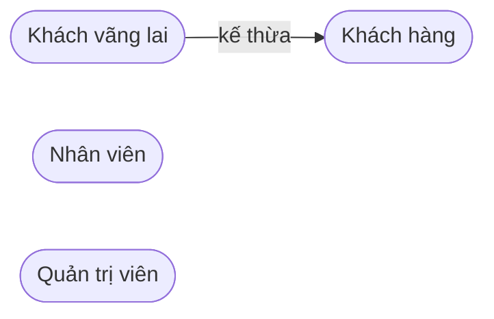
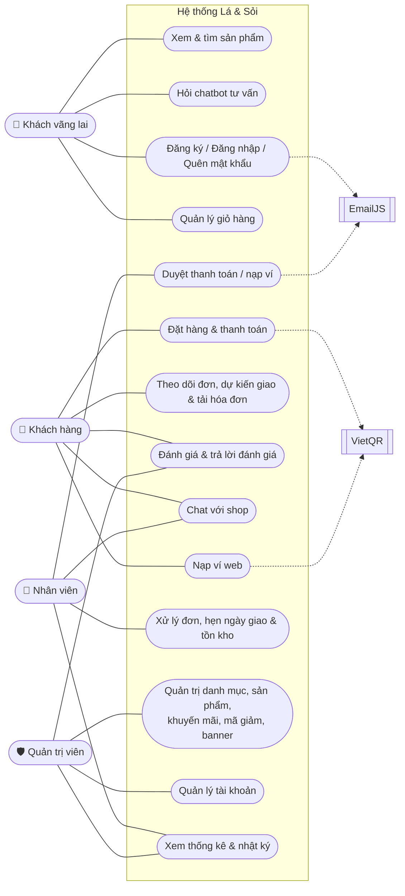
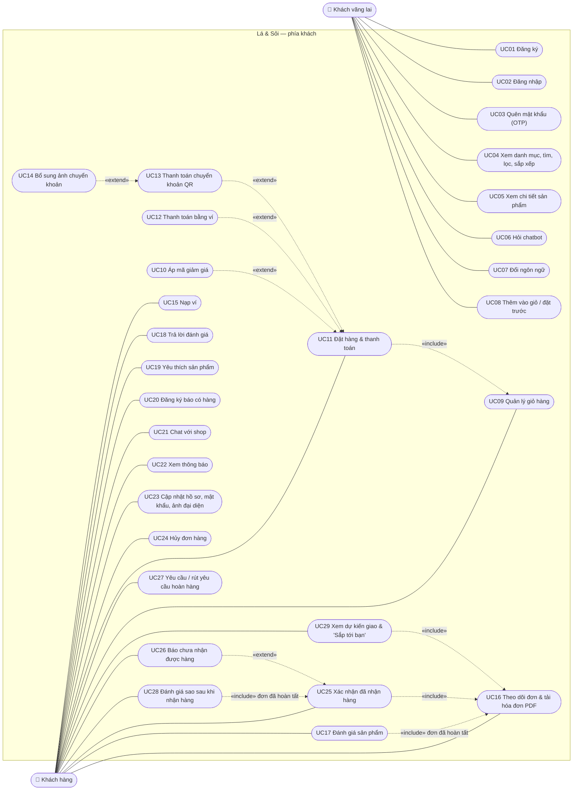
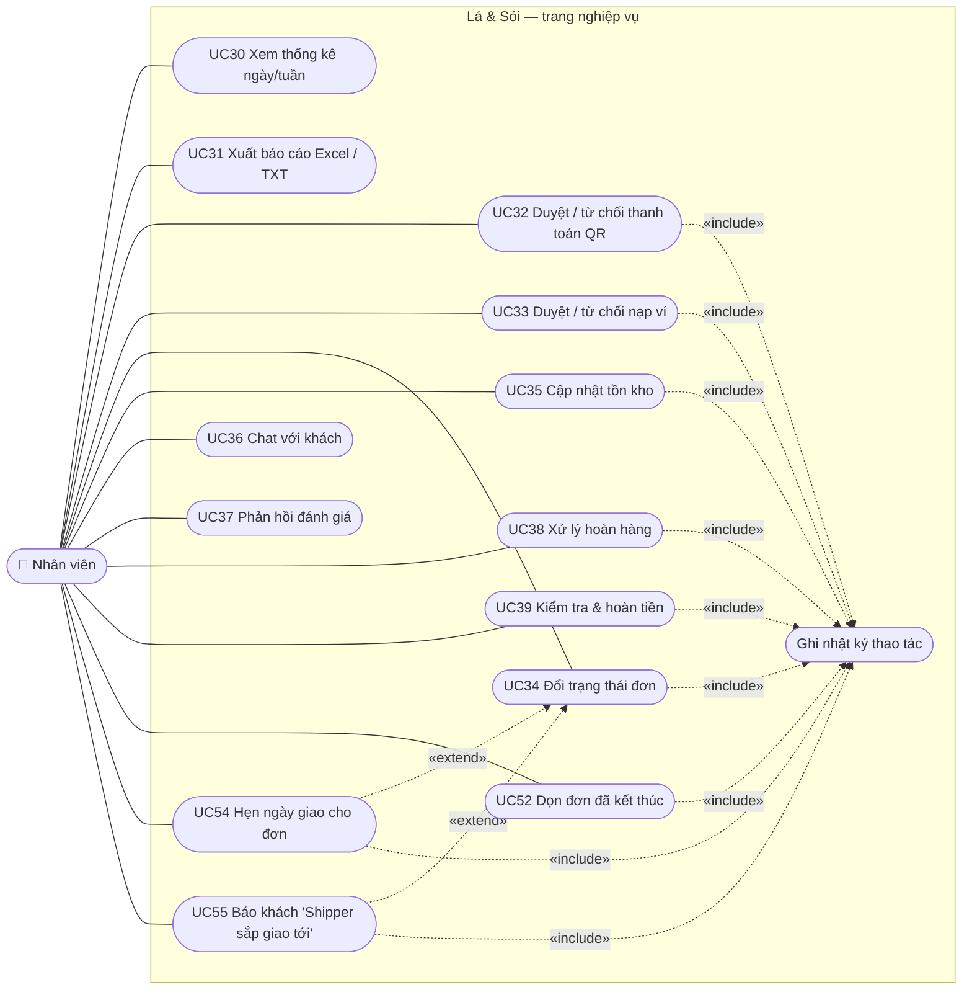
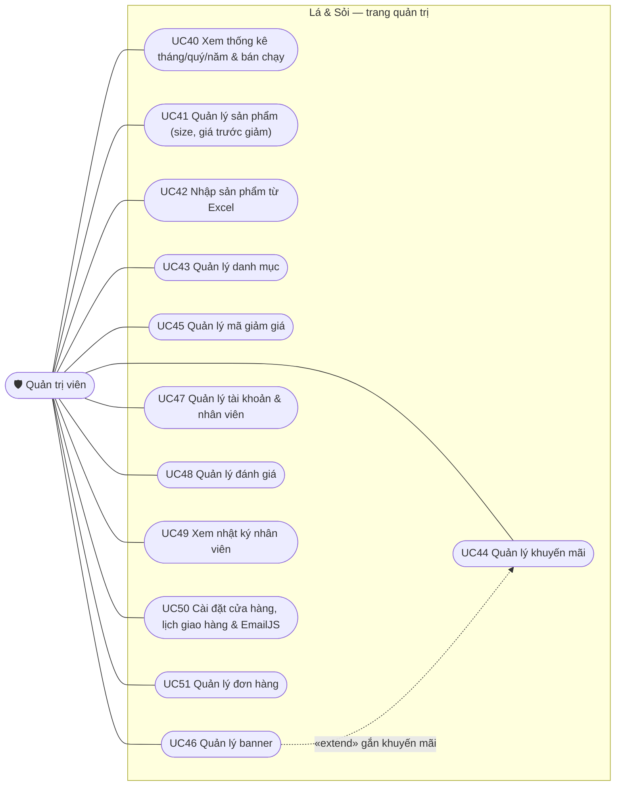
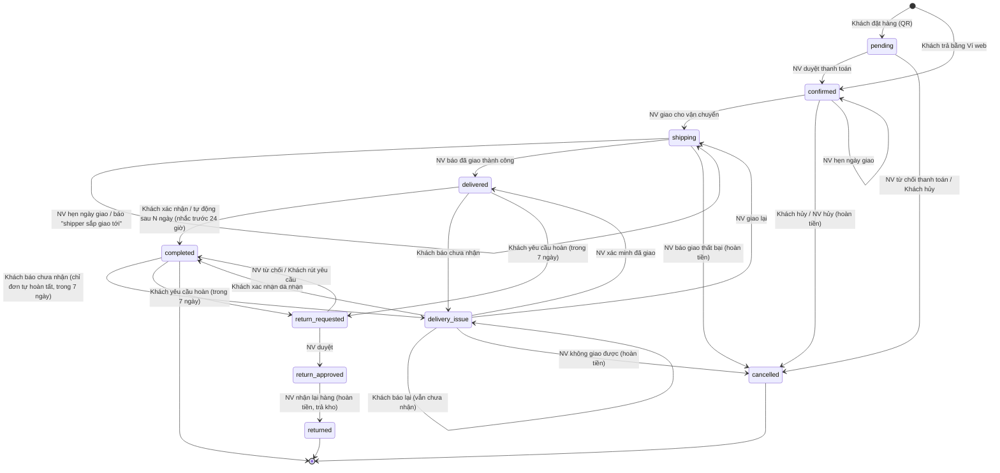

# Lá & Sỏi — Đặc Tả Use Case

> Tài liệu use case của website bán cây cảnh **Lá & Sỏi**, viết theo đúng hành vi hiện tại của mã nguồn.
> Cập nhật: 14/11/2026. Sơ đồ dùng Mermaid (xem bằng GitHub hoặc VS Code + *Markdown Preview Mermaid Support*).

---

## Mục lục
1. [Tác nhân](#1-tác-nhân)
2. [Sơ đồ use case tổng quan](#2-sơ-đồ-use-case-tổng-quan)
3. [Sơ đồ use case theo tác nhân](#3-sơ-đồ-use-case-theo-tác-nhân)
4. [Danh sách use case](#4-danh-sách-use-case)
5. [Đặc tả chi tiết](#5-đặc-tả-chi-tiết)
6. [Quy tắc nghiệp vụ dùng chung](#6-quy-tắc-nghiệp-vụ-dùng-chung)
7. [Tự cập nhật không cần tải lại trang](#7-tự-cập-nhật-không-cần-tải-lại-trang-jslivejs)
8. [Vòng đời đơn hàng: giao hàng, hủy, hoàn hàng, hoàn tiền](#8-vòng-đời-đơn-hàng-giao-hàng-hủy-hoàn-hàng-hoàn-tiền)

---

## 1. Tác nhân

| Tác nhân | Loại | Mô tả |
|---|---|---|
| **Khách vãng lai** | Chính | Chưa đăng nhập. Xem, tìm kiếm sản phẩm, dùng chatbot, thêm giỏ (phải đăng nhập khi đặt hàng). |
| **Khách hàng** (`role: user`) | Chính | Đã đăng nhập. Mua hàng, thanh toán, ví, đánh giá, chat với shop, nhận thông báo. Kế thừa mọi quyền của khách vãng lai. |
| **Nhân viên** (`role: staff`) | Chính | Duyệt thanh toán / nạp ví, xử lý đơn, cập nhật tồn kho, chat với khách, xem thống kê ngày/tuần. Mọi thao tác nhạy cảm được ghi nhật ký. |
| **Quản trị viên** (`role: admin`) | Chính | Toàn quyền quản lý sản phẩm, tài khoản, khuyến mãi, mã giảm giá, banner, đánh giá, cài đặt; xem thống kê và nhật ký nhân viên. |
| **EmailJS** | Phụ (hệ thống ngoài) | Gửi email thật (OTP, hóa đơn, thông báo). Nếu chưa cấu hình, email chỉ được lưu vào hộp thư mô phỏng. |
| **VietQR** | Phụ (hệ thống ngoài) | Sinh ảnh mã QR chuyển khoản từ thông tin ngân hàng trong Cài đặt. |
| **Đồng hồ hệ thống** | Phụ | Điều khiển các quy tắc theo thời gian: khuyến mãi, banner theo lịch, hàng mới về (30 ngày), hạn mã giảm giá, hạn OTP, **dự kiến giao theo lịch làm việc**, **nhắc khách xác nhận nhận hàng** và **tự hoàn tất đơn đã giao**. |

> Quản trị viên **có thể vào trang nhân viên** (`staff.html` cho phép `staff` và `admin`), nhưng khi đăng nhập luôn được đưa về trang quản trị.

---

## 2. Sơ đồ use case tổng quan

---

## 3. Sơ đồ use case theo tác nhân

### 3.1 Khách vãng lai & Khách hàng

### 3.2 Nhân viên

### 3.3 Quản trị viên

---

## 4. Danh sách use case

| Mã | Tên | Tác nhân | Trang / module |
|---|---|---|---|
| UC01 | Đăng ký | Khách vãng lai | `dangky.html` / `register.js` |
| UC02 | Đăng nhập | Mọi người dùng | `login.html` / `login.js` |
| UC03 | Quên mật khẩu bằng OTP | Mọi người dùng | `quenmatkhau.html` / `forgot-password.js` |
| UC04 | Xem danh mục, tìm, lọc, sắp xếp | Khách vãng lai | `index.html` / `app.js` |
| UC05 | Xem chi tiết sản phẩm | Khách vãng lai | `product-detail.html` / `detail.js` |
| UC06 | Hỏi chatbot | Khách vãng lai | `chatbot.js` |
| UC07 | Đổi ngôn ngữ (6 thứ tiếng) | Khách vãng lai | `i18n.js` |
| UC08 | Thêm vào giỏ / đặt trước | Khách vãng lai | `storage.js` |
| UC09 | Quản lý giỏ hàng | Khách hàng | `cart.html` |
| UC10 | Áp mã giảm giá | Khách hàng | `cart.html` / `sale.js` |
| UC11 | Đặt hàng & thanh toán | Khách hàng | `cart.html` / `payment.js` |
| UC12 | Thanh toán bằng ví | Khách hàng | `payment.js` |
| UC13 | Thanh toán chuyển khoản QR | Khách hàng | `payment.js` |
| UC14 | Bổ sung ảnh chuyển khoản | Khách hàng | `donhang.html` / `orders.js` |
| UC15 | Nạp ví | Khách hàng | `profile.html` / `payment.js` |
| UC16 | Theo dõi đơn & tải hóa đơn PDF | Khách hàng | `donhang.html` / `invoice.js` |
| UC17 | Đánh giá sản phẩm | Khách hàng | `detail.js` |
| UC18 | Trả lời đánh giá | Mọi người dùng đã đăng nhập | `detail.js` |
| UC19 | Yêu thích sản phẩm (khách vãng lai lưu tạm trên máy, đăng nhập thì gộp vào tài khoản) | Khách vãng lai, Khách hàng | `favorites.js` / `wishlist.html` |
| UC20 | Đăng ký báo có hàng | Khách hàng | `detail.js` |
| UC21 | Chat với shop | Khách hàng | `chat.js` |
| UC22 | Xem thông báo | Khách hàng | `notify.js` |
| UC23 | Cập nhật hồ sơ, mật khẩu, ảnh đại diện | Khách hàng | `profile.js` |
| UC24 | Hủy đơn hàng | Khách hàng | `donhang.html` / `order-flow.js` |
| UC25 | Xác nhận đã nhận hàng | Khách hàng | `donhang.html` / `order-flow.js` |
| UC26 | Báo chưa nhận được hàng | Khách hàng | `donhang.html` / `order-flow.js` |
| UC27 | Yêu cầu / rút yêu cầu hoàn hàng | Khách hàng | `donhang.html` / `order-flow.js` |
| UC28 | Đánh giá sao & bình luận sau khi nhận hàng | Khách hàng | `donhang.html` / `orders.js` |
| UC29 | Xem dự kiến giao & "Sắp tới bạn" (thanh tiến trình đơn) | Khách hàng | `donhang.html` / `orders.js` / `order-flow.js` |
| UC30 | Xem thống kê ngày/tuần | Nhân viên | `staff.js` |
| UC31 | Xuất báo cáo Excel / TXT | Nhân viên, Quản trị viên | `report.js` |
| UC32 | Duyệt / từ chối thanh toán QR | Nhân viên | `staff.js` |
| UC33 | Duyệt / từ chối nạp ví | Nhân viên | `staff.js` |
| UC34 | Xử lý đơn: giao hàng, hủy đơn | Nhân viên, Quản trị viên | `order-ui.js` / `order-flow.js` |
| UC38 | Xử lý hoàn hàng | Nhân viên, Quản trị viên | `order-ui.js` / `order-flow.js` |
| UC39 | Kiểm tra & hoàn tiền | Nhân viên, Quản trị viên | `order-ui.js` / `order-flow.js` |
| UC52 | Dọn đơn đã kết thúc (xóa nhiều đơn một lượt) | Nhân viên, Quản trị viên | `order-ui.js` |
| UC54 | Hẹn ngày giao cho đơn | Nhân viên, Quản trị viên | `order-ui.js` / `order-flow.js` |
| UC55 | Báo khách "Shipper sắp giao tới" | Nhân viên, Quản trị viên | `order-ui.js` / `order-flow.js` |
| UC35 | Cập nhật tồn kho | Nhân viên | `staff.js` |
| UC36 | Chat với khách | Nhân viên | `staff.js` |
| UC37 | Phản hồi đánh giá | Nhân viên, Quản trị viên | `detail.js`, `admin.html` |
| UC40 | Xem thống kê theo khoảng thời gian chọn được | Quản trị viên | `admin.html` / `admin-dashboard.js` |
| UC53 | Quản lý nhãn sản phẩm | Quản trị viên | `admin.html` / `admin-labels.js` |
| UC41 | Quản lý sản phẩm | Quản trị viên | `admin.html` |
| UC42 | Nhập sản phẩm từ Excel | Quản trị viên | `report.js` |
| UC43 | Quản lý danh mục | Quản trị viên | `admin.html` |
| UC44 | Quản lý khuyến mãi | Quản trị viên | `admin.html` / `sale.js` |
| UC45 | Quản lý mã giảm giá | Quản trị viên | `admin.html` |
| UC46 | Quản lý banner | Quản trị viên | `admin.html` / `banner.js` |
| UC47 | Quản lý tài khoản & nhân viên | Quản trị viên | `admin.html` |
| UC48 | Quản lý đánh giá | Quản trị viên | `admin.html` |
| UC49 | Xem nhật ký nhân viên | Quản trị viên | `admin.html` |
| UC50 | Cài đặt cửa hàng, lịch giao hàng & EmailJS | Quản trị viên | `admin.html` |
| UC51 | Quản lý đơn hàng | Quản trị viên | `admin.html` |

---

## 5. Đặc tả chi tiết

> Chỉ đặc tả những use case có luồng đáng kể. Các use case còn lại trong bảng mục 4 là thao tác CRUD/hiển thị đơn giản.
> Thứ tự: **khách hàng** (UC01–UC29) → **nhân viên** (UC32–UC55) → **quản trị** (UC40–UC50).

### ━━ Phía khách hàng ━━

### UC01 — Đăng ký
| Mục | Nội dung |
|---|---|
| Tác nhân | Khách vãng lai |
| Tiền điều kiện | Chưa đăng nhập. |
| Luồng chính | 1. Nhập họ tên, email, SĐT, địa chỉ, mật khẩu, xác nhận mật khẩu. 2. Hệ thống kiểm tra email đúng định dạng, **SĐT (nếu nhập) gồm 10 số bắt đầu bằng 0** (chấp nhận khoảng trắng, dấu chấm, `+84`), mật khẩu đủ mạnh (≥ 8 ký tự và đạt ≥ 3/5 tiêu chí: chữ thường, chữ hoa, số, ký tự đặc biệt), xác nhận khớp. 3. Hệ thống kiểm tra email chưa tồn tại — **không phân biệt chữ hoa / thường** (`An@Gmail.com` trùng `an@gmail.com`). 4. Tạo tài khoản `role: user`, email lưu dạng chữ thường, ví 0đ, ghi `createdAt`. 5. Báo thành công và chuyển sang trang đăng nhập. |
| Luồng thay thế | 2a. Dữ liệu sai → báo lỗi tại từng ô. 3a. Email đã dùng → "Email này đã được sử dụng". |
| Hậu điều kiện | Có tài khoản mới; trong 30 ngày đầu được coi là **khách mới** (dùng được mã dành cho tài khoản mới). |

### UC02 — Đăng nhập
| Mục | Nội dung |
|---|---|
| Luồng chính | 1. Nhập email + mật khẩu (tài khoản mẫu để chấm bài ghi trong README). 2. Hệ thống tìm tài khoản theo email (**không phân biệt chữ hoa / thường**) và so mật khẩu. 3. Lưu phiên **theo từng tab** (sessionStorage), đã loại bỏ mật khẩu và các trường mã OTP. 4. Điều hướng: admin → `admin.html`, nhân viên → `staff.html`, khách → trang đang xem dở (nếu có) hoặc trang chủ. |
| Luồng thay thế | 2a. Sai thông tin → báo lỗi chung (không nói rõ sai email hay mật khẩu). 2b. Tài khoản bị khóa → "Tài khoản này đã bị khóa". 4a. Trang cần quay lại là trang nội bộ (admin/staff) mà tài khoản là khách → về trang chủ. |
| Ghi chú | Mỗi tab trình duyệt có phiên riêng → mở song song tab khách và tab nhân viên để thử chat. Vào trang nhân viên / quản trị, phiên được **đối chiếu lại với máy chủ** (tài khoản còn tồn tại, đúng email, đúng vai trò); phiên bị sửa tay trong trình duyệt → đăng xuất, về trang đăng nhập. Chưa đăng nhập mà mở `admin.html` / `staff.html` → sang trang đăng nhập rồi quay lại. |

### UC03 — Quên mật khẩu bằng OTP
| Mục | Nội dung |
|---|---|
| Tác nhân | Người dùng, EmailJS |
| Luồng chính | 1. Nhập email. 2. Nếu email có tài khoản: tạo mã **6 số**, lưu dạng băm SHA-256, hạn **10 phút**, gửi qua email. Trang luôn hiện cùng một thông báo (không tiết lộ email có tồn tại hay không). 3. Nhập mã vào 6 ô (hỗ trợ dán cả mã). 4. Mã đúng → nhập mật khẩu mới đủ mạnh, khác mật khẩu cũ. 5. Hệ thống kiểm tra lại mã, lưu mật khẩu, xóa mã, gửi email "mật khẩu đã được thay đổi", chuyển sang đăng nhập. |
| Luồng thay thế | 3a. Sai mã → báo số lần còn lại; sai **5 lần** → mã bị hủy. 3b. Hết hạn → yêu cầu gửi lại. 3c. Gửi lại mã: chỉ sau **60 giây** (kiểm tra theo thời điểm gửi lưu trên server); mã cũ mất hiệu lực. 3d. Đổi email khác → quay lại bước 1. 2a. Chưa cấu hình EmailJS → hiện mã ngay trên trang (chế độ demo). |
| Bảo mật | Bản sao email lưu trong hộp thư mô phỏng được che mã (`••••••`). |

### UC04 — Xem danh mục, tìm, lọc, sắp xếp
| Mục | Nội dung |
|---|---|
| Luồng chính | 1. Trang chủ tải sản phẩm, danh mục, khuyến mãi. 2. Lọc theo danh mục (tab), tìm theo tên hoặc tên khoa học (không phân biệt dấu, hoa/thường; gõ là lọc, Enter/nút tìm thì cuộn tới kết quả). 3. Sắp xếp: mặc định, **Bán chạy nhất** (số chậu đã bán), **Mới nhập về**, giá thấp → cao / cao → thấp (giá đã áp khuyến mãi), tên A → Z. 4. Phân trang. |
| Thành phần kèm theo | Banner theo lịch, mục Đang sale (đếm ngược), Hàng mới về (thêm trong 30 ngày), **Bán chạy nhất** (tối đa 3 cây, xếp theo số chậu đã bán, không cắt ngang nhóm hòa nhau — xem BR23), **gợi ý chọn cây**: hộp thoại 3 câu hỏi (ánh sáng, thói quen tưới, thú cưng) mở từ nav / hero / dải mời phía trên danh sách sản phẩm — trả lời xong hiện ngay tối đa 6 cây phù hợp kèm Thêm vào giỏ và Xem chi tiết; có thú cưng thì chỉ gợi ý cây an toàn; không có cây khớp hẳn thì hiện cây "gần phù hợp" có ghi rõ; nút "Lọc cả cửa hàng theo kết quả" lọc lưới sản phẩm theo đúng câu trả lời (gỡ bằng "Xóa tất cả bộ lọc"). |
| Luồng thay thế | 1a. Không kết nối được máy chủ → tự thử lại 2 lần, sau đó hiện thông báo + nút Thử lại. 2a. Không có kết quả → trạng thái rỗng. |

### UC05 — Xem chi tiết sản phẩm
| Mục | Nội dung |
|---|---|
| Luồng chính | 1. Mở `product-detail.html?id=…`. 2. Hiện ảnh (phóng to), giá theo size (đã trừ khuyến mãi, có giá gạch và % giảm), phiếu chăm sóc, thông số, tồn kho, đánh giá. 3. Chọn size → giá cập nhật. |
| Luồng thay thế | 1a. Mã không tồn tại → "Không tìm thấy cây này". 2a. Hết hàng → nút **Đặt trước** và **Báo tôi khi có hàng lại** (UC20). |

### UC08 — Thêm vào giỏ / đặt trước
| Mục | Nội dung |
|---|---|
| Luồng chính | 1. Chọn size, số lượng, bấm Thêm vào giỏ. Thêm từ thẻ sản phẩm (không chọn size) → tự lấy **size đầu tiên**, giống mặc định của trang chi tiết. 2. Cùng sản phẩm + cùng size → cộng dồn số lượng; khác size → dòng riêng. 3. Tổng số chậu của **mọi size cùng một cây** không vượt tồn kho (BR24). |
| Luồng thay thế | 1a. Chưa đăng nhập → mời đăng nhập, sau đó quay lại trang đang xem. 1b. Hết hàng → thêm dạng **đặt trước** (giao khi có hàng). 3a. Giỏ đã có đủ số tồn kho → báo *"Giỏ của bạn đã có đủ N chậu…"*, không thêm; thêm được một phần → báo đúng số đã thêm. |

### UC09 — Quản lý giỏ hàng
| Mục | Nội dung |
|---|---|
| Luồng chính | 1. Mở giỏ. 2. Hệ thống **tính lại giá** từng món theo giá niêm yết + khuyến mãi đang chạy (hiện giá gạch và tên khuyến mãi). 3. Tăng/giảm/xóa món; nút **+** khóa khi đã chọn hết số còn trong kho (dòng ghi *"Đã chọn hết N chậu còn trong kho"*). 4. Tóm tắt: tạm tính, giảm giá mã, **phí giao** (theo Cài đặt: dưới ngưỡng thì tính phí, từ ngưỡng thì miễn phí, kèm gợi ý "mua thêm X để được miễn phí"), tổng thanh toán, **dự kiến nhận hàng** (khoảng ngày theo lịch làm việc của shop, rê chuột vào ⓘ để xem cách tính). 5. Khối **Giao đến**: người nhận, SĐT, địa chỉ, ghi chú cho shop — điền sẵn từ Hồ sơ. |
| Ghi chú | Giỏ hàng lưu trong trình duyệt theo từng tài khoản. Nếu admin đổi tên/xóa size đang có trong giỏ, món đó giữ giá lúc thêm vào. |

### UC10 — Áp mã giảm giá
| Mục | Nội dung |
|---|---|
| Luồng chính | 1. Nhập mã. 2. Kiểm tra lần lượt: tồn tại và chưa bị xóa → đang hoạt động → đã tới ngày bắt đầu → chưa hết hạn → còn lượt (0 = không giới hạn) → đạt đơn tối thiểu → (nếu yêu cầu) tài khoản mới. 3. Tính giảm = % × tạm tính, không vượt mức tối đa; hiện rõ khi đã chạm mức tối đa. |
| Luồng thay thế | 2a. Không hợp lệ → báo đúng lý do. 3a. Đổi số lượng làm tổng thay đổi → tiền giảm tự tính lại; mã không còn hợp lệ thì tự gỡ. |

### UC11 — Đặt hàng & thanh toán
| Mục | Nội dung |
|---|---|
| Tiền điều kiện | Đã đăng nhập, giỏ có hàng. |
| Luồng chính | 1. Bấm Đặt hàng ngay. 2. Kiểm tra khối **Giao đến**: tên người nhận, SĐT hợp lệ, địa chỉ đầy đủ (BR25). 3. Hệ thống lấy **khuyến mãi, cài đặt phí giao và tồn kho mới nhất**, tính lại tổng. 4. Mở hộp thanh toán: Ví web (UC12) hoặc Chuyển khoản QR (UC13). 5. Tạo đơn lưu: món (giá thực, giá niêm yết, tên khuyến mãi), tạm tính, phí giao, giảm giá, tổng, **địa chỉ giao (`shipping`)**. 6. Trừ kho, **đọc lại đơn trên máy chủ** — đơn bị máy chủ làm rơi thì ghi lại nguyên đơn với đúng mã. 7. Cộng lượt dùng mã, làm trống giỏ; khách tích "Lưu làm địa chỉ mặc định" thì SĐT + địa chỉ được ghi vào Hồ sơ. |
| Luồng thay thế | 2a. Thiếu / sai thông tin giao → tô đỏ ô sai, cuộn tới ô đó, không mở thanh toán. 3a. Kho vừa giảm (người khác mua) → giỏ tự chỉnh về đúng số còn lại, báo khách kiểm tra rồi đặt lại. 4a. Đóng hộp thanh toán → hủy thao tác, giỏ giữ nguyên. 5a. Lỗi máy chủ → báo lỗi, giỏ giữ nguyên. |

### UC12 — Thanh toán bằng ví
| Mục | Nội dung |
|---|---|
| Luồng chính | 1. Hệ thống lấy số dư **mới nhất từ máy chủ**. 2. Đủ tiền → hiện số dư trước/sau. 3. Xác nhận → trừ ví, đơn `confirmed / paid`, ghi giao dịch ví, tải hóa đơn PDF ngay. |
| Luồng thay thế | 2a. Không đủ → nút Ví bị khóa kèm số dư và gợi ý nạp tiền. |

### UC13 — Thanh toán chuyển khoản QR
| Mục | Nội dung |
|---|---|
| Tác nhân | Khách hàng, VietQR |
| Luồng chính | 1. Hiện mã VietQR (đúng số tiền, nội dung dạng `LASOI<mã khách>-<5 số>`), thông tin ngân hàng. 2. Khách chuyển khoản, tải ảnh chụp màn hình (tự **nén** dưới 80KB; nhận ảnh tới 10MB). 3. Bấm "Tôi đã thanh toán" → đơn `pending / awaiting_confirmation`. 4. Chờ nhân viên duyệt (UC32). |
| Luồng thay thế | 2a. Chưa tải ảnh → nút xác nhận bị khóa. 2b. **Quên chụp ảnh** → bấm "Tôi đã chuyển khoản nhưng quên chụp ảnh", đơn được đánh dấu thiếu ảnh để nhân viên đối soát sao kê; có thể bổ sung sau (UC14). |

### UC15 — Nạp ví
| Mục | Nội dung |
|---|---|
| Luồng chính | 1. Hồ sơ → tab Ví → Nạp tiền, nhập số tiền. 2. Chuyển khoản theo QR, tải ảnh. 3. Tạo giao dịch nạp `pending`. 4. Nhân viên duyệt (UC33) → cộng số dư, thông báo cho khách. |
| Luồng thay thế | 4a. Nhân viên từ chối (nhập lý do) → số dư không đổi, khách nhận thông báo kèm lý do. |

### UC16 — Theo dõi đơn & tải hóa đơn PDF
| Mục | Nội dung |
|---|---|
| Luồng chính | 1. Mở "Đơn hàng của tôi": mã đơn, **thanh tiến trình 5 bước** (kèm giờ từng bước), món, **địa chỉ giao**, phương thức, trạng thái đơn, trạng thái thanh toán, tổng; lọc theo trạng thái, tải thêm 10 đơn mỗi lần. 2. Đơn đã thanh toán → nút Tải hóa đơn PDF. Hóa đơn ghi đúng số liệu đã lưu trong đơn (tạm tính, phí giao, giảm giá, tổng = số tiền khách đã trả). |
| Luồng thay thế | 1a. Đơn chờ duyệt chưa có ảnh → nút Bổ sung ảnh (UC14). 1b. Thanh toán bị từ chối → hiện lý do. |

### UC17 — Đánh giá sản phẩm
| Mục | Nội dung |
|---|---|
| Tiền điều kiện | Đăng nhập với vai trò khách và có **đơn đã hoàn tất** (`completed`) chứa sản phẩm này — tức khách đã bấm xác nhận nhận hàng, hoặc đơn tự hoàn tất sau N ngày (mặc định 3, chỉnh trong Cài đặt). |
| Luồng chính | 1. Chọn 1–5 sao, viết nhận xét. 2. Gửi → hiện trong danh sách, cập nhật điểm trung bình và phân bố sao. |
| Luồng thay thế | Đơn còn ở bước "Đã giao — chờ khách xác nhận" → hiện lời nhắc *"Vào Đơn hàng của tôi bấm Đã nhận được hàng là viết đánh giá được ngay"*. Chưa mua → *"Chỉ khách đã mua và đã nhận cây này mới có thể viết đánh giá"*. Đã đánh giá → chỉ được xóa để viết lại (mỗi người 1 đánh giá / sản phẩm). Nhân viên/admin không chấm sao, chỉ trả lời (UC18). |
| Liên quan | Gửi đánh giá ngay trong trang đơn hàng: **UC28**. |

### UC18 — Trả lời đánh giá
| Mục | Nội dung |
|---|---|
| Tác nhân | Mọi người dùng đã đăng nhập |
| Luồng chính | 1. Bấm "Trả lời" dưới một đánh giá. 2. Nhập nội dung (≤ 300 ký tự), gửi. 3. Trả lời của nhân viên/admin được gắn nhãn **Phản hồi từ shop**. |
| Luồng thay thế | Người viết hoặc admin xóa được câu trả lời. |

### UC20 — Đăng ký báo có hàng
| Mục | Nội dung |
|---|---|
| Luồng chính | 1. Ở sản phẩm hết hàng, bấm "Báo tôi khi có hàng lại". 2. Khi nhân viên cập nhật kho từ 0 lên > 0 (UC35), hệ thống gửi thông báo + email cho mọi khách đã đăng ký và đánh dấu đã báo. |
| Luồng thay thế | Đã đăng ký rồi → báo "đã đăng ký". Chưa đăng nhập → yêu cầu đăng nhập. |

### UC21 / UC36 — Chat giữa khách và shop
| Mục | Nội dung |
|---|---|
| Luồng chính | 1. Khách bấm "Nhắn shop" → mở hội thoại (tạo mới nếu chưa có). 2. Gửi tin bằng nút hoặc Enter. 3. Nhân viên thấy tin ở tab Tin nhắn (có số chưa đọc), trả lời. 4. Hai bên tự nhận tin mới mỗi **2,5 giây**. |
| Ghi chú | Chatbot (UC06) là trợ lý tự động riêng, độc lập với chat nhân viên. |

### UC22 — Xem thông báo
| Mục | Nội dung |
|---|---|
| Luồng chính | 1. Chuông trên header hiện số chưa đọc (cập nhật mỗi 10 giây). 2. Mở danh sách → đánh dấu đã đọc. |
| Sự kiện tạo thông báo | Đổi trạng thái đơn, **shop hẹn / đổi ngày giao**, **shipper sắp giao tới**, **nhắc xác nhận nhận hàng trước 24 giờ**, duyệt / từ chối thanh toán (kèm lý do), duyệt / từ chối nạp ví (kèm lý do), có hàng lại, admin tạo khuyến mãi (gửi tất cả khách). Đều kèm email. |

### UC24 — Hủy đơn hàng (khách)
| Mục | Nội dung |
|---|---|
| Tiền điều kiện | Đơn ở "Chờ xác nhận" hoặc "Đã xác nhận" (shop **chưa** giao cho vận chuyển). |
| Luồng chính | 1. Bấm **Hủy đơn**, chọn nhanh một lý do có sẵn hoặc tự nhập (bắt buộc, **ít nhất 5 ký tự chữ / số** — chặn kiểu "no."). 2. Đơn → `cancelled`, trả lại kho đúng số đã trừ. 3. Đơn đã thanh toán → hoàn **ngay** toàn bộ tiền vào Ví web. |
| Luồng thay thế | 3a. Đơn chuyển khoản **chưa được duyệt** nhưng khách đã gửi ảnh / báo "đã chuyển nhưng quên chụp" → không hoàn tự động, đơn vào mục **Cần hoàn tiền** (UC39). 3b. Đơn chưa trả tiền → chỉ hủy. |

### UC25 — Xác nhận đã nhận hàng
| Mục | Nội dung |
|---|---|
| Luồng chính | 1. Đơn "Đã giao" → bấm **Đã nhận được hàng**. 2. Đơn → `completed`. |
| Luồng thay thế | 1a. Khách không bấm → đơn hiện dải **"Chờ bạn xác nhận"** với giờ tự hoàn tất và thời gian còn lại. 1b. Còn dưới **24 giờ** → hệ thống gửi **1 lời nhắc** (thông báo + email), mỗi lần giao chỉ nhắc 1 lần. 1c. Hết hạn → **tự hoàn tất** (mặc định 3 ngày kể từ lúc giao, chỉnh trong Cài đặt). Đơn tự hoàn tất vẫn cho khách **báo chưa nhận** (UC26) trong hạn đổi trả. |
| Ghi chú | Web không có máy chủ chạy nền: việc nhắc và tự hoàn tất chạy khi có người mở "Đơn hàng của tôi" hoặc bảng đơn của nhân viên / quản trị; không ai mở thì chạy ở lần mở kế tiếp (vẫn đúng hạn đã tính). |

### UC26 — Báo chưa nhận được hàng
| Mục | Nội dung |
|---|---|
| Luồng chính | 1. Đơn "Đã giao" — hoặc đơn **do hệ thống tự hoàn tất** và còn trong 7 ngày đổi trả — nhưng khách chưa nhận → bấm **Chưa nhận được hàng**, chọn lý do có sẵn hoặc mô tả. 2. Đơn → `delivery_issue`, shop thấy ở bộ lọc "Khiếu nại giao hàng" kèm cờ **chưa đọc**. 3. Shop chọn một trong ba: **Giao lại cho khách** (đơn về "Đang giao"), **Đã xác minh: khách đã nhận** (kèm bằng chứng), hoặc **Không giao được — hủy & hoàn tiền**. |
| Luồng thay thế | 3a. Shop xác minh "khách đã nhận" nhưng khách **vẫn chưa nhận** → khách bấm **Vẫn chưa nhận được hàng** (báo được nhiều lần, hệ thống đếm số lần báo) → quay lại bước 2. Khiếu nại **không** tự hoàn tất, nên đơn không bao giờ bị kẹt. 1a. Khách **đã tự bấm** "Đã nhận được hàng" → không báo chưa nhận được nữa (chỉ còn yêu cầu hoàn hàng). |

### UC27 — Yêu cầu / rút yêu cầu hoàn hàng
| Mục | Nội dung |
|---|---|
| Tiền điều kiện | Đơn "Đã giao" **hoặc** "Hoàn tất", còn trong **7 ngày** kể từ lúc giao. |
| Luồng chính | 1. Bấm **Yêu cầu hoàn hàng**, nhập lý do (bắt buộc). 2. Đơn → `return_requested`, chờ shop duyệt (UC38). |
| Luồng thay thế | 2a. Khách đổi ý → **Rút yêu cầu**, đơn về trạng thái trước đó. 1a. Quá 7 ngày → nút bị khóa. |

### UC28 — Đánh giá sao & bình luận sau khi nhận hàng
| Mục | Nội dung |
|---|---|
| Tác nhân | Khách hàng |
| Tiền điều kiện | Đơn ở trạng thái `completed` — khách **đã bấm xác nhận nhận hàng** (hoặc đơn tự hoàn tất sau N ngày). Đơn mới `delivered` chỉ hiện lời nhắc, chưa cho chấm sao. |
| Luồng chính | 1. "Đơn hàng của tôi" → mục **⭐ Đánh giá sản phẩm** mở sẵn, liệt kê từng cây trong đơn. 2. Chấm 1–5 sao, viết nhận xét (tối đa 500 ký tự). 3. **Gửi đánh giá** → lưu kèm `orderId`, hiện ngay ở trang chi tiết sản phẩm (điểm trung bình, phân bố sao, cho phép shop trả lời). |
| Luồng thay thế | 2a. Chưa chọn sao → báo "Hãy chọn số sao trước nhé", không gửi. 3a. Đã đánh giá cây đó rồi → hiện số sao đã chấm + liên kết **Xem**; muốn viết lại thì xóa đánh giá cũ ở trang sản phẩm. |
| Ràng buộc | 1 khách × 1 sản phẩm = 1 đánh giá; chỉ khách **đã mua và đã xác nhận nhận hàng** mới được đánh giá (áp dụng cả ở trang chi tiết sản phẩm). |

### UC29 — Xem dự kiến giao & "Sắp tới bạn"
| Mục | Nội dung |
|---|---|
| Tác nhân | Khách hàng, Đồng hồ hệ thống |
| Luồng chính | 1. Mở "Đơn hàng của tôi". 2. Mỗi đơn đang đi có **thanh tiến trình 5 bước** (Đặt hàng → Xác nhận → Đang giao → Đã giao → Hoàn tất): bước đã qua có dấu tick tự vẽ, bước hiện tại có vòng sóng, đơn đang giao có **xe chạy** trên đường nối tới đúng quãng đã đi. 3. Dưới thanh là dải **dự kiến giao**: nhãn trạng thái + khoảng ngày + câu giải thích cách tính (BR22). |
| Các trạng thái của dải | **Chờ xác nhận** (dự kiến nếu shop duyệt tiền hôm nay) · **Đang chuẩn bị hàng** · **Đang trên đường** · **Sắp tới bạn** (nhân viên báo shipper sắp giao — UC55, hoặc hôm nay là ngày hẹn) · **Chậm hơn dự kiến** (quá ngày mà chưa giao) · **Hàng đặt trước** (có cây đặt trước → chưa hẹn được ngày) · **Chờ bạn xác nhận** (đã giao — kèm giờ tự hoàn tất). |
| Luồng thay thế | 3a. Nhân viên đã **hẹn ngày** (UC54) → dải ghi *"Shop hẹn giao …"* thay cho ước tính, kèm lời nhắn của shop. |
| Ghi chú | Tôn trọng `prefers-reduced-motion` (tắt hiệu ứng). Giỏ hàng cũng hiện "Dự kiến nhận hàng" trước khi đặt. |

### ━━ Phía nhân viên ━━

### UC32 — Duyệt / từ chối thanh toán QR
| Mục | Nội dung |
|---|---|
| Tác nhân | Nhân viên, EmailJS |
| Luồng chính | 1. Tab Duyệt thanh toán liệt kê đơn chờ duyệt (mã, số tiền, nội dung chuyển khoản, món, **người nhận · SĐT · địa chỉ · ghi chú của khách**, ảnh). 2. Bấm ảnh → xem phóng to ngay trong trang. 3. Đối chiếu tiền về → **Xác nhận đã nhận tiền** → đơn `confirmed / paid`, ghi nhật ký, gửi email hóa đơn, thông báo cho khách. |
| Luồng thay thế | 1a. Đơn thiếu ảnh → hướng dẫn đối soát theo nội dung chuyển khoản + số tiền. 3a. **Từ chối** (nhập lý do) → đơn `cancelled / rejected`, ghi nhật ký, thông báo cho khách. |

### UC34 — Xử lý đơn: giao hàng, hủy đơn (nhân viên / quản trị)
| Mục | Nội dung |
|---|---|
| Luồng chính | 1. Tab Đơn hàng lọc theo: Cần xử lý, Chờ xác nhận, Chờ giao, Đang giao, Chờ khách xác nhận, Khiếu nại giao hàng, Hoàn hàng, Cần hoàn tiền… 2. Mỗi dòng hiện người nhận, SĐT (bấm để gọi), địa chỉ, ghi chú của khách và **hạn giao** ("Giao trước hết ngày dd/mm — ước tính theo lịch" / "Đã hẹn khách giao ngày…", đỏ khi trễ; đơn đã giao thì ghi giờ tự hoàn tất và đã nhắc khách hay chưa). 3. Mỗi đơn **chỉ hiện các nút hợp lệ** với trạng thái hiện tại: **Hẹn ngày giao** (UC54) · **Giao cho vận chuyển** (ghi đơn vị / mã vận đơn) → **Shipper sắp giao tới** (UC55) → **Đã giao thành công** (ghi chú người nhận) hoặc **Giao không thành công** (lý do → hủy, hoàn tiền, trả kho). 4. Mỗi bước ghi vào **lịch sử đơn** (ai, vai trò, lúc nào, ghi chú), ghi nhật ký nhân viên, gửi thông báo + email cho khách. |
| Quy tắc | Đơn **chưa thanh toán** không thể giao (nút bị khóa kèm lý do). Đơn chuyển khoản đang chờ duyệt tiền thì dùng **Từ chối thanh toán** (UC32), không dùng Hủy. Trạng thái được đọc lại ngay trước khi lưu — 2 nhân viên bấm cùng lúc thì người sau được báo "hãy tải lại trang". Lý do hủy / từ chối có nút chọn nhanh và cần ít nhất 5 ký tự. Badge tab "Đơn hàng" = số **đơn cần xử lý**, khớp với ô "Đơn cần xử lý" ở trang Hôm nay. |

### UC35 — Cập nhật tồn kho
| Mục | Nội dung |
|---|---|
| Luồng chính | 1. Tab Tồn kho: sửa số lượng, Lưu — chỉ nhận **số nguyên ≥ 0** (ô trống, chữ, số âm, số lẻ → báo lỗi, không lưu). 2. Ghi nhật ký. 3. Nếu từ 0 lên > 0 → kích hoạt báo có hàng (UC20). |
| Ràng buộc | Nhân viên chỉ sửa số lượng, không thêm/xóa sản phẩm. |

### UC38 — Xử lý hoàn hàng
| Mục | Nội dung |
|---|---|
| Luồng chính | 1. Đơn `return_requested` → **Duyệt hoàn hàng** (kèm hướng dẫn gửi trả) → `return_approved`. 2. Nhận được hàng gửi về → **Đã nhận lại hàng** → `returned`, trả kho, hoàn tiền vào Ví web. |
| Luồng thay thế | 1a. **Từ chối hoàn hàng** (lý do bắt buộc) → đơn về trạng thái trước khi yêu cầu. |

### UC39 — Kiểm tra & hoàn tiền
| Mục | Nội dung |
|---|---|
| Tiền điều kiện | Đơn có `refundStatus = pending` (khách hủy khi tiền chuyển khoản chưa được duyệt). |
| Luồng chính | 1. Bộ lọc **Cần hoàn tiền**. 2. Đối chiếu sao kê → **Đã nhận tiền — hoàn vào ví** → cộng ví khách, ghi giao dịch `refund`, `refundStatus = refunded`. |
| Luồng thay thế | 2a. Không thấy tiền → **Không nhận được tiền** (ghi kết quả) → `refundStatus = declined`, khách được thông báo kèm hướng dẫn liên hệ. |

### UC52 — Dọn đơn đã kết thúc (chọn nhiều — xóa một lượt)
| Mục | Nội dung |
|---|---|
| Tác nhân | Nhân viên / quản trị |
| Tiền điều kiện | Đơn ở trạng thái **đã kết thúc** (`completed`, `cancelled`, `returned`) hoặc **chưa thanh toán** (`pending`, chưa chọn/chưa trả tiền). |
| Luồng chính | 1. Tab Đơn hàng: tick ô vuông ở từng dòng, hoặc ô ở tiêu đề để **chọn hết** các đơn xóa được trong mục đang xem. 2. Thanh đỏ hiện "Đã chọn N đơn". 3. **Xóa N đơn** → hộp xác nhận liệt kê mã đơn, cảnh báo không hoàn tác. 4. Đồng ý → xóa, ghi nhật ký `orders_bulk_delete`, số trên các ô lọc cập nhật lại. |
| Luồng thay thế | 1a. Đơn đang xử lý: ô tick bị khóa kèm giải thích → không thể xóa nhầm chứng từ đang chạy. 3a. Bấm "Bỏ chọn" hoặc đổi bộ lọc → bỏ toàn bộ lựa chọn. |

### UC54 — Hẹn ngày giao cho đơn
| Mục | Nội dung |
|---|---|
| Tác nhân | Nhân viên / quản trị, EmailJS |
| Tiền điều kiện | Đơn ở `confirmed` (đã thanh toán, chờ giao) hoặc `shipping`. |
| Luồng chính | 1. Bấm **Hẹn ngày giao** (đã hẹn thì là **Đổi ngày hẹn giao**). 2. Hộp chọn ngày gợi ý sẵn ngày cuối của khoảng ước tính theo lịch, kèm dòng *"Theo lịch làm việc: dự kiến …"*. 3. Chọn ngày, nhập lời nhắn cho khách (không bắt buộc), **Lưu ngày hẹn**. 4. Đơn lưu `expectedDeliveryDate` — ngày này **thay cho ước tính** ở mọi nơi (khách, bảng đơn, email "đang giao"); ghi lịch sử đơn + nhật ký nhân viên; khách nhận thông báo + email *"Shop hẹn giao đơn … ngày …"*. |
| Luồng thay thế | 3a. Ngày đã qua → báo lỗi, không lưu. 3b. Chọn Chủ nhật / ngày nghỉ trong Cài đặt → cảnh báo nhưng vẫn cho lưu (trường hợp đã thỏa thuận riêng với khách). 4a. Đơn bị khiếu nại rồi **giao lại** → ngày hẹn cũ tự bỏ, quay về ước tính theo lịch. |
| Hậu điều kiện | Quá ngày hẹn mà chưa giao → đơn hiện **Trễ hẹn giao** (đỏ) ở bảng của shop, **Chậm hơn ngày hẹn** ở phía khách. |

### UC55 — Báo khách "Shipper sắp giao tới"
| Mục | Nội dung |
|---|---|
| Tác nhân | Nhân viên / quản trị |
| Tiền điều kiện | Đơn ở `shipping` và chưa báo lần nào cho lần giao này. |
| Luồng chính | 1. Bấm **Shipper sắp giao tới**, nhập lời nhắn (vd tên shipper, khung giờ — không bắt buộc). 2. Đơn vẫn ở `shipping`, lưu `outForDeliveryAt`. 3. Khách thấy dải **"Sắp tới bạn"**, xe trên thanh tiến trình chạy sát bước "Đã giao", và nhận thông báo + email *"Đơn … sắp tới bạn"*. |
| Luồng thay thế | Giao lại sau khiếu nại → cờ "sắp tới" được xóa, báo lại được cho lần giao mới. |

### ━━ Phía quản trị ━━

### UC40 — Xem thống kê theo khoảng thời gian (admin)
| Mục | Nội dung |
|---|---|
| Luồng chính | 1. Chọn kiểu kỳ: **Tháng / Quý / Năm / Tự chọn** (ngày bắt đầu – kết thúc); nút ‹ › lùi / tới từng kỳ, "Kỳ hiện tại" để quay về. 2. **Câu tóm tắt** của kỳ (số chậu, số đơn, số khách, doanh thu) và một câu so với kỳ liền trước cùng độ dài; **phiếu số liệu**: doanh thu đứng riêng một hàng, bên dưới là đơn đã bán, trung bình mỗi đơn, số chậu đã bán, số khách đã mua — ô nào cũng ghi kèm số của kỳ trước. 3. Nhóm **Xu hướng doanh thu**: biểu đồ đường theo ngày / tuần / tháng, chồng đường nét đứt của kỳ trước; đổi được sang biểu đồ cột; bấm chú thích để ẩn / hiện từng đường. 4. Nhóm **Đơn hàng** (đơn đang ở bước nào · khách trả bằng gì · có gì cần để ý) và nhóm **Sản phẩm & khách hàng** (biểu đồ cột so sánh theo danh mục / sản phẩm / khách hàng / bốn quý của năm, kèm bảng xếp hạng chi tiết gập mở được: bán chạy nhất · doanh thu theo danh mục · ai mua nhiều nhất). 5. Xuất báo cáo Excel / TXT đúng kỳ đang chọn (UC31). |
| Quy tắc | Mọi số liệu và biểu đồ đổi theo kỳ đang chọn. Lựa chọn lưu trong trình duyệt → tải lại trang không mất. Doanh thu và số lượng bán chỉ tính đơn **đã thanh toán hoặc đã giao, không bị hủy / hoàn**. "Sản phẩm sắp hết" là số hiện tại, không theo kỳ. |
| Luồng thay thế | Tự chọn mà ngày bắt đầu sau ngày kết thúc → báo lỗi, giữ nguyên kỳ cũ. Kỳ trước chưa có số liệu → ghi "kỳ trước chưa có" thay vì phần trăm. |

### UC53 — Quản lý nhãn sản phẩm
| Mục | Nội dung |
|---|---|
| Luồng chính | 1. Mục **Nhãn sản phẩm**: thấy các nhóm (mặc định: Độ khó chăm sóc — mỗi cây 1 nhãn; An toàn & lưu ý — nhiều nhãn) và nhãn trong nhóm kèm số sản phẩm đang dùng. 2. Thêm / sửa nhóm (tên, kiểu gán, mô tả). 3. Thêm / sửa nhãn (tên, màu trong bảng 6 màu, mô tả, đánh dấu "an toàn với thú cưng"), có xem trước. 4. Gán nhãn cho sản phẩm trong form sửa sản phẩm (nhóm chọn-1 dùng nút tròn, nhóm chọn-nhiều dùng ô tick). |
| Luồng thay thế | Trùng tên trong cùng nhóm → không cho lưu. Xóa nhãn / nhóm → hỏi xác nhận kèm số sản phẩm bị ảnh hưởng, rồi gỡ nhãn khỏi các sản phẩm đó. Đổi nhóm từ "nhiều" sang "1" khi còn sản phẩm mang ≥ 2 nhãn của nhóm → bị chặn. |
| Hiệu lực | Thẻ sản phẩm hiện nhãn đầu tiên theo thứ tự nhóm; trang chi tiết hiện mọi nhãn; kết quả gợi ý chọn cây hiện tên nhãn. |

### UC41 — Quản lý sản phẩm
| Mục | Nội dung |
|---|---|
| Luồng chính | 1. Thêm / sửa / xóa sản phẩm: tên, tên khoa học, danh mục, độ khó, tồn kho, ảnh (tải lên được tự nén), mô tả. 2. **Giá theo size**: bảng size (tên, chiều cao, Ø chậu, giá); khi có size, giá bán tự lấy theo size rẻ nhất. 3. **Giá trước giảm** (tùy chọn) để hiện giá gạch. |
| Luồng thay thế | Size thiếu tên/giá hoặc trùng tên → không cho lưu. Giá trước giảm ≤ giá bán → không cho lưu. |

### UC44 — Quản lý khuyến mãi
| Mục | Nội dung |
|---|---|
| Luồng chính | 1. Tạo/sửa: tên, loại, % giảm, **áp dụng cho** (toàn bộ hoặc một danh mục), thời gian bắt đầu–kết thúc, nội dung banner, kích hoạt. 2. Có thể gửi thông báo + email cho mọi khách. |
| Hiệu lực | Trong thời gian chạy, **giá mọi nơi tự giảm** (thẻ sản phẩm, chi tiết, giỏ, đơn, chatbot). Nhiều khuyến mãi cùng áp → lấy mức giảm cao nhất. Hết hạn → giá tự trở lại. |

### UC45 — Quản lý mã giảm giá
| Mục | Nội dung |
|---|---|
| Luồng chính | 1. Tạo/sửa mã: %, đơn tối thiểu, giảm tối đa, số lượt (0 = không giới hạn), **áp dụng từ ngày – hết hạn**, chỉ tài khoản mới, kích hoạt. 2. Lọc theo trạng thái: Dùng được, Chưa bắt đầu, Hết hạn, Hết lượt, Tạm ngưng, Đã xóa. 3. Ngưng / Kích hoạt. 4. **Xóa mềm** → chuyển sang "Đã xóa", có thể Khôi phục. |
| Ràng buộc | Không tạo trùng mã (kể cả mã đã xóa). Ngày bắt đầu ≤ ngày hết hạn. % giảm từ 1–100. Mã mới / đổi tên chỉ gồm 3–20 ký tự **chữ không dấu, số, `-`, `_`**. Mô tả ghi một % khác với % giảm thật → hỏi xác nhận; giảm từ 50% trở lên → hỏi xác nhận (nêu rõ mức giảm tối đa). Banner "khách mới" ở giỏ đọc đúng % của mã NGUOIMOI và ghi đúng điều kiện: tài khoản đăng ký trong vòng 1 tháng (không giới hạn "đơn đầu tiên"). |

### UC46 — Quản lý banner
| Mục | Nội dung |
|---|---|
| Luồng chính | 1. Tạo/sửa: tiêu đề, mô tả, ảnh, đường dẫn, thứ tự, hiển thị, **lịch hiển thị**, **gắn khuyến mãi** (tùy chọn). 2. Danh sách ghi rõ banner **đang hiện trên trang chủ** hay không và lý do. |
| Quy tắc hiển thị | Có ngày → hiện đúng những ngày đó. Không ngày nhưng gắn khuyến mãi → hiện khi khuyến mãi chạy. Không ngày, không gắn → không hiện. Nhiều banner cùng đúng dịp → trang chủ hiện dạng **carousel** tự chuyển (banner kết thúc sớm nhất đứng đầu). Nhãn "−X%" chỉ hiện khi khuyến mãi gắn kèm đang chạy. |
| Luồng thay thế | Lịch banner nằm ngoài lịch khuyến mãi gắn kèm → hỏi xác nhận trước khi lưu (tránh quảng cáo giảm giá không có thật). |

### UC47 — Quản lý tài khoản & nhân viên
| Mục | Nội dung |
|---|---|
| Luồng chính | 1. Lọc theo vai trò. 2. Đổi vai trò, khóa / mở khóa (chặn đăng nhập), xóa. 3. Thêm nhân viên mới. |
| Ràng buộc | Không thể khóa / xóa / đổi vai trò chính tài khoản đang đăng nhập. |

### UC48 — Quản lý đánh giá
| Mục | Nội dung |
|---|---|
| Luồng chính | 1. Xem mọi đánh giá (ngày, sản phẩm, khách, sao, nội dung, các trả lời). 2. Lọc theo số sao hoặc "Chưa phản hồi". 3. Phản hồi từ shop. 4. Xóa đánh giá. |

### UC49 — Xem nhật ký nhân viên
| Mục | Nội dung |
|---|---|
| Luồng chính | Xem ai · làm gì · lúc nào. Các loại thao tác được ghi: duyệt/từ chối nạp ví (`confirm_topup`, `reject_topup`), sửa tồn kho (`update_stock`), mọi bước vòng đời đơn do nhân viên/quản trị thực hiện (`order_<hành động>` — duyệt/từ chối thanh toán, giao hàng, hủy, hoàn hàng, hoàn tiền…), xóa đơn hàng loạt (`orders_bulk_delete`). |

### UC50 — Cài đặt cửa hàng & EmailJS
| Mục | Nội dung |
|---|---|
| Luồng chính | Sửa tên shop, địa chỉ, SĐT, giờ mở cửa, **phí giao & ngưỡng miễn phí**, **lịch giao hàng** (giờ chốt đơn, số ngày chuẩn bị, số ngày vận chuyển nhanh nhất – chậm nhất, có giao Chủ nhật không, ngày nghỉ `dd/mm` hằng năm hoặc `dd/mm/yyyy` một lần, **số ngày tự hoàn tất** sau khi giao), tài khoản ngân hàng (dùng cho VietQR), khóa EmailJS + nút **Gửi thử**. Áp dụng ngay sau khi lưu. |
| Ràng buộc | Số ngày vận chuyển chậm nhất ≥ nhanh nhất; giờ chốt 0–24 (24 = không chốt giờ); ngày nghỉ sai định dạng → báo lỗi, không lưu. |

---

## 6. Quy tắc nghiệp vụ dùng chung

| Mã | Quy tắc |
|---|---|
| BR01 | **Đã bán** = đơn đã thanh toán hoặc đã giao, không bị hủy / hoàn hàng / hoàn tiền. Dùng cho doanh thu, số lượng bán, "Bán chạy" (BR23), sắp xếp "Bán chạy nhất". *(Điều kiện được đánh giá chặt hơn — xem BR21.)* |
| BR02 | **Giá bán thực** = giá niêm yết (theo size) trừ khuyến mãi đang chạy có mức giảm cao nhất áp dụng cho sản phẩm. |
| BR03 | **Phí giao** = phí trong Cài đặt nếu tạm tính (sau khuyến mãi, trước mã giảm) dưới ngưỡng; ngược lại miễn phí. |
| BR04 | **Tổng thanh toán** = tạm tính − giảm giá mã + phí giao. Hóa đơn luôn bằng số đã lưu trong đơn. |
| BR05 | Đơn chuyển khoản phải được nhân viên duyệt mới thành "đã thanh toán"; đơn chưa thanh toán không thể giao. |
| BR06 | Mọi thao tác nhạy cảm của nhân viên được ghi nhật ký. |
| BR07 | **Khách mới** = tài khoản tạo trong vòng 30 ngày. **Hàng mới về** = sản phẩm thêm trong vòng 30 ngày. |
| BR08 | Ảnh tải lên được nén trên trình duyệt trước khi lưu (máy chủ dữ liệu chỉ nhận request ≤ 100KB). |
| BR09 | Mật khẩu: ≥ 8 ký tự và đạt ≥ 3/5 tiêu chí (thường, HOA, số, ký tự đặc biệt). |
| BR10 | OTP: 6 số, hạn 10 phút, tối đa 5 lần sai, gửi lại sau 60 giây, chỉ lưu dạng băm. |
| BR11 | **Nhân viên và quản trị viên không được mua hàng**: ẩn giỏ hàng, chặn thêm vào giỏ, trang giỏ hiện thông báo. |
| BR12 | **Kho bị trừ khi đặt hàng**; số đã trừ lưu trong đơn (`stockDeducted`) để khi hủy / giao thất bại / nhận lại hàng hoàn trả **đúng** số đó. |
| BR13 | **Hoàn tiền luôn về Ví web** và ghi giao dịch `refund`. Đơn đã thanh toán → hoàn ngay; đơn chưa duyệt tiền mà khách báo đã chuyển → chờ nhân viên kiểm tra sao kê. |
| BR14 | Khách chỉ hủy được trước khi shop giao cho vận chuyển; hoàn hàng trong 7 ngày kể từ lúc giao; đơn "Đã giao" tự hoàn tất sau N ngày (mặc định 3, chỉnh trong Cài đặt). |
| BR15 | Đơn hủy / đã hoàn hàng / đã hoàn tiền **không** tính vào doanh thu, số lượng bán, "Bán chạy". |
| BR16 | Thanh toán chuyển khoản chỉ được duyệt ở **một nơi duy nhất**: tab "Duyệt thanh toán" (nơi có ảnh chuyển khoản). Tab "Đơn hàng" của nhân viên chỉ dẫn sang đó, không có nút duyệt → không xác nhận trùng. Quản trị viên không có tab đó nên duyệt ngay tại tab "Đơn hàng" (vẫn là một nơi). |
| BR17 | Các ô lọc là **việc cần làm** phải về **0** khi xử lý xong. Đơn chưa thanh toán và đơn đã kết thúc được tách sang ô riêng để không làm sai số việc tồn. |
| BR18 | Khách thao tác trên đơn (xác nhận đã nhận, báo chưa nhận, hủy, yêu cầu hoàn hàng) → đơn được đánh dấu **chưa đọc** cho shop: badge trên tab "Đơn hàng", dòng nhắc và nhãn MỚI trên đơn. Shop thao tác hoặc bấm "Đánh dấu đã đọc" thì cờ tắt. |
| BR19 | Đơn `delivered` **tự hoàn tất** sau N ngày (Cài đặt › *Tự hoàn tất sau khi giao*, mặc định 3) kể từ mốc giao gần nhất; trước hạn 24 giờ khách nhận **1 lời nhắc** (`receiveReminderAt` đánh dấu đã nhắc); đơn tự hoàn tất được ghi `receivedConfirmedBy = system` và khách vẫn báo "chưa nhận" được trong hạn đổi trả (đơn cũ thiếu `deliveredAt` thì lấy mốc có được: lịch sử giao → ngày gửi → ngày cập nhật → ngày tạo) → ô "Chờ khách xác nhận" luôn tự vơi, không treo vĩnh viễn. Đây là ô **chờ khách**, không tính là việc của shop. |
| BR20 | Chỉ xóa được đơn **đã kết thúc** hoặc **chưa thanh toán**; đơn đang xử lý bị khóa. Mọi lần xóa hàng loạt đều ghi nhật ký nhân viên. |
| BR21 | Mỗi khách chỉ đánh giá **1 lần / 1 sản phẩm**, và chỉ sau khi đơn chứa sản phẩm đó đã **hoàn tất** (khách xác nhận đã nhận hàng, hoặc tự hoàn tất sau N ngày) — đơn mới "đã giao" thì chưa được. Đánh giá gửi từ trang đơn hàng được lưu kèm mã đơn để đối chiếu. |
| BR22 | **Dự kiến giao** tính theo lịch làm việc trong Cài đặt, chỉ đếm **ngày làm việc** (bỏ Chủ nhật nếu không giao Chủ nhật, bỏ ngày nghỉ khai báo): ngày bắt đầu xử lý = ngày thanh toán nếu trước **giờ chốt** (mặc định 16:00), ngược lại ngày làm việc kế tiếp → + **ngày chuẩn bị** (mặc định 0) = ngày giao cho vận chuyển → + **ngày vận chuyển nhanh nhất – chậm nhất** (mặc định 1–2) = khoảng ngày nhận. Đơn đang giao tính từ ngày giao cho vận chuyển. Nhân viên **hẹn ngày** cho một đơn (UC54) → ngày hẹn thay cho ước tính. Đơn có cây đặt trước → chưa hẹn ngày. Quá ngày cuối mà chưa giao → "chậm hơn dự kiến". |
| BR23 | **Bán chạy nhất (trang chủ)**: xếp cây (không tính phụ kiện) theo số chậu đã bán (BR01), lấy **tối đa 3**, nhưng **không cắt ngang một nhóm hòa nhau** — cây cuối cùng được hiện phải bán nhiều hơn hẳn cây đầu tiên bị bỏ ra. Vd `[10, 8, 8, 8]` → chỉ hiện 1 cây; `[10, 10, 8, 5]` → hiện 3 cây, hai cây đầu **đồng hạng 1**; tất cả bằng nhau → ẩn mục. Hiện ít hơn 3 cây thì ghi rõ lý do. |
| BR24 | **Tồn kho tính chung cho mọi size** của một cây: tổng số chậu trong giỏ ≤ tồn kho (ở thẻ sản phẩm, trang chi tiết, giỏ trượt, trang giỏ). Lúc đặt hàng kiểm tra lại với tồn kho mới nhất. Tồn kho = 0 là hàng **đặt trước** → không giới hạn. |
| BR25 | Đơn mới phải có **thông tin giao**: người nhận ≥ 2 ký tự, **SĐT Việt Nam 10 số bắt đầu bằng 0** (bỏ khoảng trắng / dấu chấm / gạch, `+84…` → `0…`), địa chỉ ≥ 10 ký tự; ghi chú không bắt buộc. |
| BR26 | **Email không phân biệt chữ hoa / thường** khi đăng ký, đăng nhập, quên mật khẩu; email mới được lưu dạng chữ thường. |

---

## 7. Tự cập nhật không cần tải lại trang (`js/live.js`)
Mỗi vùng đang xem tự so "chữ ký" dữ liệu với máy chủ sau mỗi **6 giây**; chữ ký đổi mới vẽ lại:

| Vùng | Thấy được gì mà không cần F5 |
|---|---|
| Nhân viên / quản trị — tab **Đơn hàng** | Khách đặt, hủy, xác nhận đã nhận, báo chưa nhận, yêu cầu hoàn hàng → dòng mới, nhãn MỚI, số trên các ô lọc |
| Nhân viên — tab **Duyệt thanh toán** | Khách vừa chuyển khoản / bổ sung ảnh → thẻ chờ duyệt hiện ra |
| Nút tab **Duyệt thanh toán** & **Đơn hàng** | Số việc chờ nhảy ngay cả khi đang đứng ở tab khác |
| Khách — **Đơn hàng của tôi** | Shop duyệt tiền, giao hàng, hẹn / đổi ngày giao, báo "sắp tới", duyệt/từ chối hoàn hàng, hoàn tiền |

Hoãn làm mới khi: tab trình duyệt bị ẩn, panel đang ẩn, đang mở hộp thoại, đang gõ trong vùng đó, hoặc đang tick chọn đơn để xóa — tránh mất thao tác đang làm dở.

---

## 8. Vòng đời đơn hàng: giao hàng, hủy, hoàn hàng, hoàn tiền

| Trạng thái | Ý nghĩa | Ai thao tác tiếp |
|---|---|---|
| `pending` | Chờ xác nhận (thường là chờ duyệt tiền chuyển khoản) | Nhân viên duyệt / từ chối; khách có thể hủy |
| `confirmed` | Đã xác nhận, đã thanh toán, chờ giao | Nhân viên hẹn ngày giao / giao; khách hoặc shop có thể hủy |
| `shipping` | Đang giao | Nhân viên hẹn / đổi ngày giao, báo "shipper sắp giao tới", báo giao thành công / thất bại |
| `delivered` | Shop báo đã giao | Khách xác nhận / báo chưa nhận / yêu cầu hoàn; không phản hồi → nhắc trước 24 giờ rồi tự hoàn tất |
| `delivery_issue` | Khách báo chưa nhận được | Nhân viên: giao lại / xác minh đã giao / hủy & hoàn tiền. Khách báo lại được nhiều lần |
| `completed` | Hoàn tất | Khách còn được yêu cầu hoàn trong 7 ngày; đơn **tự** hoàn tất thì còn được báo chưa nhận trong 7 ngày |
| `return_requested` → `return_approved` → `returned` | Hoàn hàng | Nhân viên duyệt, nhận lại hàng |
| `cancelled` | Đã hủy | — (có thể còn bước hoàn tiền) |

**Trạng thái hoàn tiền** (`refundStatus`, tách riêng khỏi trạng thái đơn): `pending` (chờ NV kiểm tra sao kê) → `refunded` (đã cộng Ví web) hoặc `declined` (không thấy tiền).

**Minh bạch:** mọi bước lưu vào `timeline` của đơn (thời gian, người làm, vai trò, lý do / ghi chú) — khách xem ở "Lịch sử đơn", nhân viên / quản trị xem ở nút "Lịch sử"; thao tác của nhân viên còn ghi vào Nhật ký nhân viên (UC49).

---

*Xem thêm: [CHUC-NANG.md](CHUC-NANG.md) · [WORKFLOW.md](WORKFLOW.md) · [ARCHITECTURE.md](ARCHITECTURE.md) · [database.md](database.md) · [API_DOCUMENT.md](API_DOCUMENT.md) · [SCALING.md](SCALING.md)*
