# Lá & Sỏi — Workflow Hệ Thống

> Tài liệu mô tả các luồng nghiệp vụ (workflow) của website bán cây cảnh **Lá & Sỏi**.
> Dựa trực tiếp trên mã nguồn hiện tại — không suy diễn thêm.
> Cập nhật: 2026-11-12.

---

## 1. Tổng quan hệ thống

- **Loại ứng dụng:** Single-origin static web app (HTML + CSS + Vanilla JS ES Modules), gọi REST API.
- **Backend dữ liệu:** `json-server` (REST giả lập) đọc/ghi `db.json` tại `http://localhost:3000`.
- **Static server:** `serve.py` (Python `http.server` đa luồng, tắt cache) tại `http://localhost:8090`.
- **Xác thực:** theo **từng tab** (`sessionStorage`) → mở 1 tab khách + 1 tab nhân viên song song được.
- **11 trang HTML**, **41 module JS**, **4 file CSS**, **19 collection dữ liệu**.

### Vai trò & phân quyền

| Vai trò | Đăng nhập | Quyền chính |
|---|---|---|
| **Khách vãng lai** (guest) | Không | Xem sản phẩm, tìm kiếm, lọc, thêm giỏ (phải đăng nhập để đặt) |
| **Khách hàng** (`user`) | `an@gmail.com` / `cu@gmail.com` | Mua hàng, ví, yêu thích, đánh giá, chat, hồ sơ, xem đơn |
| **Nhân viên** (`staff`) | `nhanvien@lasoi.vn` | Duyệt thanh toán & nạp ví, chat khách, xử lý vòng đời đơn (giao – hoàn hàng – hoàn tiền), sửa tồn kho, báo cáo ngày/tuần |
| **Quản trị** (`admin`) | `admin@lasoi.vn` | Toàn quyền: sản phẩm, đơn, tài khoản, danh mục, mã giảm, banner, khuyến mãi, cài đặt, nhật ký |

> Guard phân quyền: `requireRole([...])` trong `storage.js` tự chuyển hướng nếu sai quyền.
> Trang `staff.html` yêu cầu `staff`/`admin`; `admin.html` kiểm tra `role === "admin"`.

---

## 2. Sơ đồ điều hướng trang

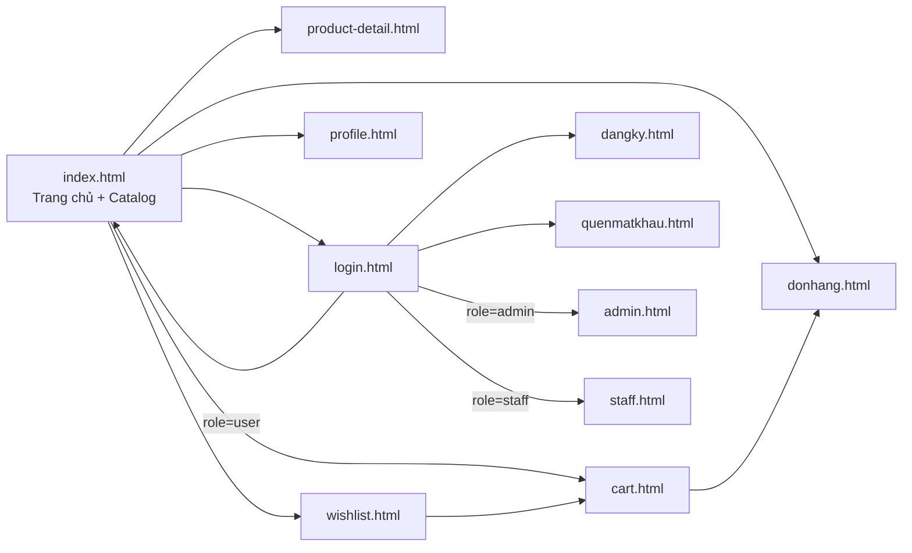

---

## 3. Luồng xác thực (Authentication)

### 3.1 Đăng ký — `dangky.html` → `register.js`
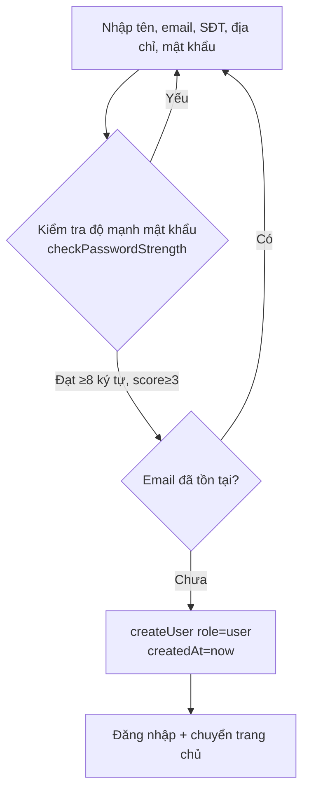

### 3.2 Đăng nhập — `login.html` → `login.js`
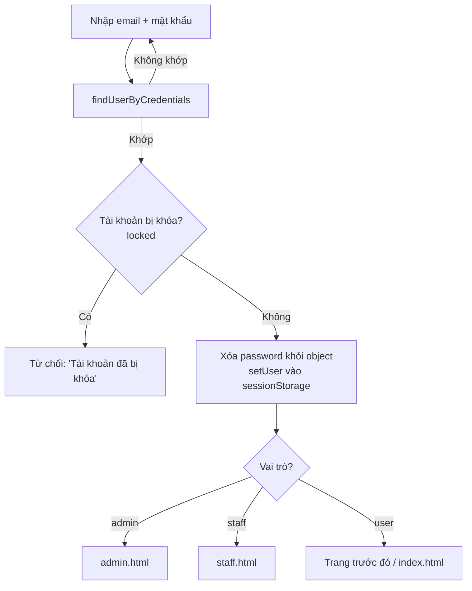

- **Đăng nhập theo tab:** `setUser/getUser/logout` dùng `sessionStorage` (khóa `user`). Mở tab mới = chưa đăng nhập; đóng tab = đăng xuất tab đó.
- **Giỏ hàng** vẫn dùng `localStorage` (bền vững, theo từng user id).

### 3.3 Quên mật khẩu bằng mã OTP
`quenmatkhau.html` → `forgot-password.js` — **3 bước trên cùng một trang**:
1. Nhập email → sinh mã **6 số**, lưu **băm SHA-256** (`resetOtpHash`) + hạn **10 phút** (`resetOtpExpiry`) trên user, gửi mã qua email. Trang luôn báo cùng một nội dung để không tiết lộ email có tồn tại hay không.
2. Nhập mã (6 ô, dán được cả mã). Sai **5 lần** → hủy mã; gửi lại mã phải chờ **60 giây**.
3. Mã đúng → đặt mật khẩu mới (đủ mạnh, khác mật khẩu cũ) → xóa mã, gửi email báo đã đổi.

> Bản sao email lưu trong `mailbox` che mã (`••••••`). Chưa cấu hình EmailJS → hiện mã ngay trên trang (chế độ demo).

---

## 4. Luồng mua hàng & thanh toán (luồng chính)

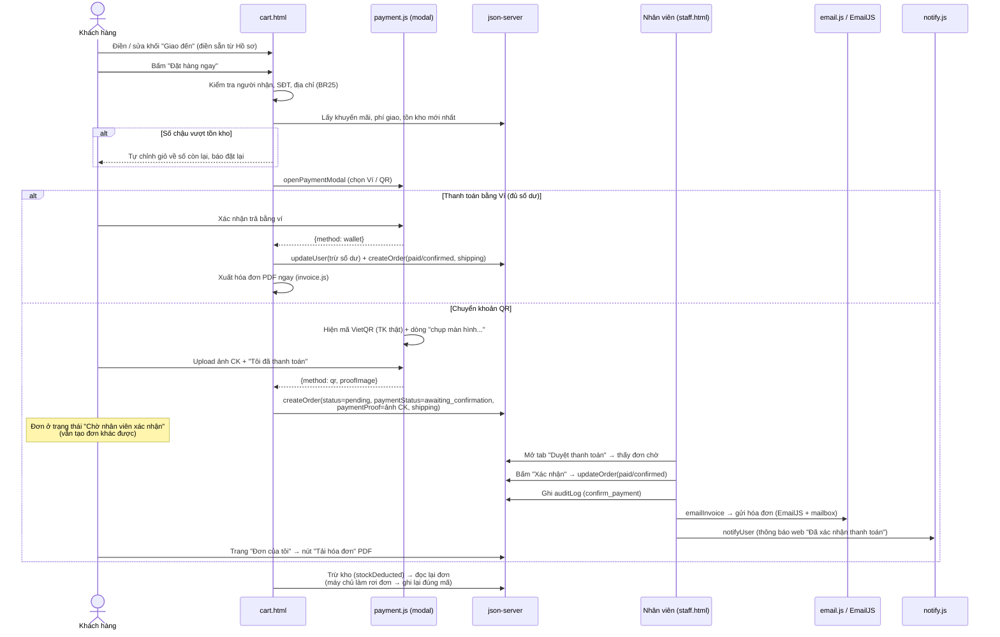

- **Phương thức thanh toán:** Ví web **hoặc** Chuyển khoản QR (VietQR), chọn trong modal.
- **Ví đủ số dư:** trừ thẳng, đơn `paid/confirmed` ngay, không cần nhân viên.
- **QR:** đơn `awaiting_confirmation` → **phải chờ nhân viên duyệt** mới xuất hóa đơn + email.
- **Địa chỉ giao bắt buộc:** đơn lưu `shipping = {name, phone, address, note}`; hiện ở đơn của khách, bảng đơn + thẻ duyệt thanh toán của nhân viên, hóa đơn PDF và email hóa đơn.
- **Tồn kho:** tính chung cho mọi size của một cây; kiểm tra lại với tồn kho mới nhất trước khi thanh toán.
- **An toàn ghi dữ liệu:** `api.js` cho các lượt ghi đi lần lượt, cách nhau 0,3 giây (phòng khi json-server bị bật kiểu `--watch` và làm rơi lượt ghi sát nhau); sau khi tạo đơn, giỏ hàng đọc lại đơn để chắc đơn đã nằm trên máy chủ.
- **VietQR:** ảnh QR thật từ `img.vietqr.io` (BIN 970436 Vietcombank, TK `1051236810` — PHAN TA HUU DUC), cấu hình trong `settings`.

### Trạng thái đơn hàng (`js/order-flow.js` — nơi duy nhất định nghĩa)

| Nhóm | Giá trị |
|---|---|
| **Trạng thái đơn** (`status`) | `pending` → `confirmed` → `shipping` → `delivered` → `completed`; nhánh phụ: `delivery_issue` (khách báo chưa nhận), `return_requested` → `return_approved` → `returned`, và `cancelled` |
| **Trạng thái thanh toán** (`paymentStatus`) | `awaiting_confirmation` → `paid` \| `rejected` (`unpaid` khi chưa ghi nhận) |
| **Trạng thái hoàn tiền** (`refundStatus`, độc lập) | `pending` (chờ đối soát sao kê) → `refunded` \| `declined` |

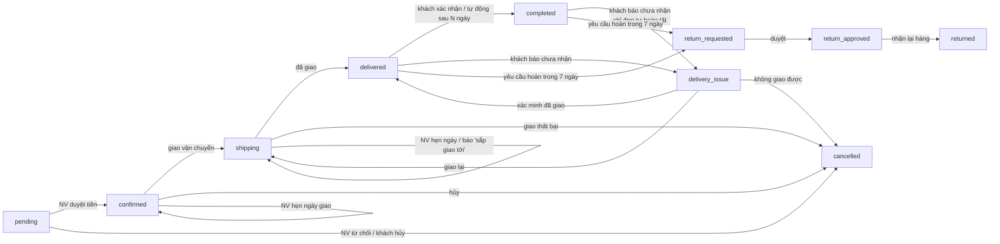

- Đơn **chưa thanh toán không thể giao** (nút bị khóa kèm lý do).
- Hủy / giao thất bại / nhận lại hàng → **trả lại đúng số kho đã trừ** (`stockDeducted`) và hoàn tiền vào **Ví web**.
- Mỗi bước ghi vào `timeline` của đơn (ai, vai trò, lúc nào, lý do/ghi chú) + nhật ký nhân viên + thông báo & email cho khách.
- **Dự kiến giao** tính theo lịch làm việc trong Cài đặt (giờ chốt, ngày chuẩn bị, ngày vận chuyển, Chủ nhật, ngày nghỉ); nhân viên hẹn ngày cụ thể thì ngày hẹn thay cho ước tính (xem mục 4.1).
- **Khách quên xác nhận:** đơn `delivered` hiện đếm ngược; còn < 24 giờ → nhắc 1 lần (thông báo + email); hết N ngày (mặc định 3) → tự hoàn tất; đơn tự hoàn tất vẫn cho khách báo chưa nhận trong 7 ngày.
- Đặc tả đầy đủ: [USECASE.md §8](USECASE.md).

### 4.1 Dự kiến giao & hẹn ngày giao

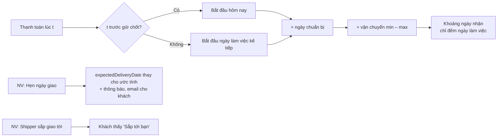

| Nơi hiện | Nội dung |
|---|---|
| Giỏ hàng | Dòng "Dự kiến nhận hàng" + câu giải thích cách tính |
| Đơn hàng của tôi | Thanh tiến trình 5 bước (giờ từng bước, xe chạy khi đang giao) + dải trạng thái: Chờ xác nhận · Đang chuẩn bị hàng · Đang trên đường · Sắp tới bạn · Chậm hơn dự kiến · Hàng đặt trước · Chờ bạn xác nhận |
| Bảng đơn NV / QT | "Giao trước hết ngày dd/mm (ước tính theo lịch)" · "Đã hẹn khách giao ngày …" · "⚠ Trễ hẹn giao" · "tự hoàn tất lúc … · đã nhắc khách" |

---

## 5. Luồng Ví web (nạp tiền)

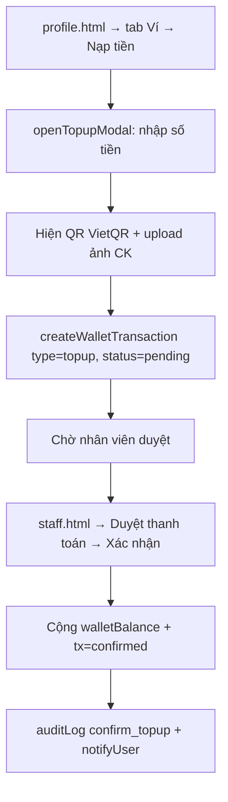

---

## 6. Luồng đặt trước (backorder) & báo có hàng lại

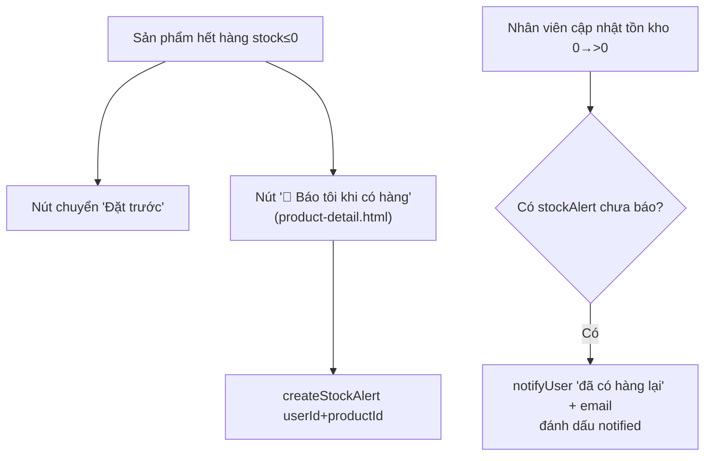

---

## 7. Luồng chat realtime khách ↔ nhân viên

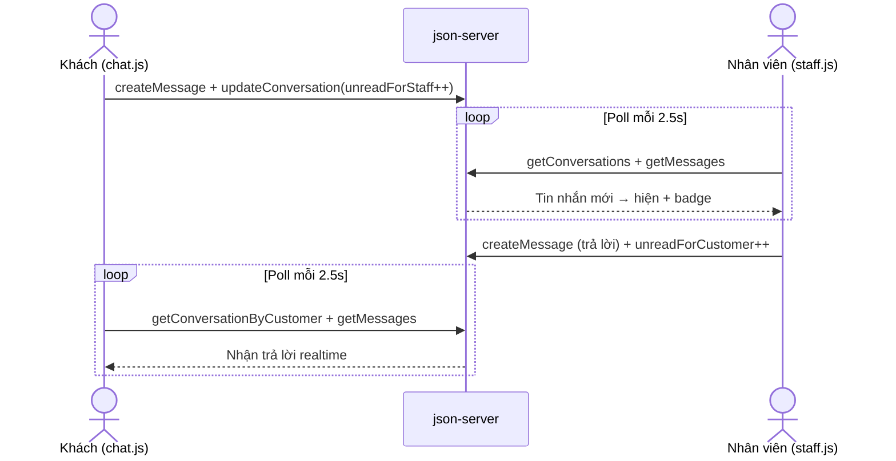

- **Realtime:** polling `json-server` mỗi **2.5 giây** (state dùng chung → chạy được 2 tab).
- Widget khách (`chat.js`, id `staffChatWidget`) chỉ hiện với `role=user`; nhân viên dùng tab "Tin nhắn" trong `staff.html`.
- *(Lưu ý: `chatbot.js` là trợ lý FAQ tự động riêng, khác với chat nhân viên.)*

---

## 8. Luồng thông báo & email (`notify.js` + `email.js`)

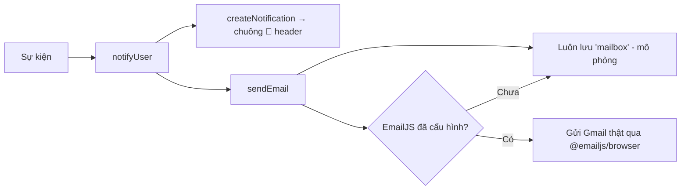

**Sự kiện phát thông báo:** đổi trạng thái đơn · duyệt thanh toán QR (hóa đơn) · duyệt nạp ví · có hàng lại · admin tạo khuyến mãi (gửi toàn bộ khách) · quên mật khẩu.
**Chuông 🔔** (chỉ khách): badge chưa đọc, dropdown, poll 10s, tự đánh dấu đã đọc.

---

## 9. Luồng nghiệp vụ Nhân viên (`staff.html`)

| Tab | Chức năng |
|---|---|
| Thống kê | Doanh thu/đơn hôm nay & tuần này, biểu đồ Chart.js, xuất Excel/TXT |
| Duyệt thanh toán | Xác nhận/từ chối đơn QR + yêu cầu nạp ví (có ảnh CK); thẻ đơn hiện món, người nhận, SĐT, địa chỉ, ghi chú của khách |
| Tin nhắn | Chat realtime với khách (badge chưa đọc) |
| Đơn hàng | Bảng việc cần làm: lọc theo bước (Cần xử lý · Khách vừa cập nhật · Chờ duyệt thanh toán · Chờ giao · Đang giao · Chờ khách xác nhận · Khiếu nại giao hàng · Đang hoàn hàng · Cần hoàn tiền · Chưa thanh toán · Hoàn tất · Đã hủy/đã hoàn hàng); mỗi đơn chỉ hiện nút hợp lệ với trạng thái (thêm **Hẹn ngày giao**, **Shipper sắp giao tới**); địa chỉ giao + hạn giao từng đơn; nhãn **MỚI** khi khách vừa thao tác; lý do hủy có nút chọn nhanh (≥ 5 ký tự); tick chọn nhiều để xóa đơn đã kết thúc. Badge tab = số đơn cần xử lý (khớp ô ở trang Hôm nay) |
| Tồn kho | Chỉ cập nhật số lượng — số nguyên ≥ 0 (không thêm/xóa sản phẩm) |

> **Minh bạch chống gian lận:** mọi thao tác nhạy cảm ghi vào `auditLog` — duyệt/từ chối nạp ví, sửa tồn kho, từng bước vòng đời đơn (`order_…`), xóa đơn hàng loạt.
> **Không duyệt tiền hai nơi:** nút duyệt thanh toán chỉ có ở tab "Duyệt thanh toán"; tab "Đơn hàng" chỉ dẫn sang đó.
> **Tự cập nhật:** tab Đơn hàng và tab Duyệt thanh toán tự làm mới mỗi 6 giây khi dữ liệu đổi (`js/live.js`); số trên nút tab nhảy cả khi đang ở tab khác.

---

## 10. Luồng quản trị (`admin.html` — 12 tab)

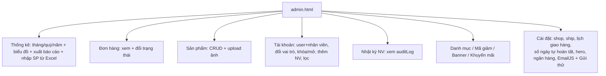

- **Quản lý tài khoản:** đổi vai trò, **khóa/mở khóa** (chặn đăng nhập), thêm nhân viên, lọc theo vai trò, tự bảo vệ tài khoản chính mình.
- **Khuyến mãi:** tạo khuyến mãi mới → hỏi xác nhận → phát thông báo + email cho **tất cả khách**.
- **Cài đặt EmailJS:** dán Public Key / Service ID / Template ID + nút **Gửi thử**.
- **Lịch giao hàng:** giờ chốt đơn, số ngày chuẩn bị, vận chuyển nhanh nhất – chậm nhất, giao Chủ nhật, ngày nghỉ (`dd/mm` hoặc `dd/mm/yyyy`), số ngày tự hoàn tất — dùng để tính "Dự kiến giao".
- **Mã giảm giá:** % 1–100; mã mới chỉ gồm chữ không dấu / số / `-` / `_`; mô tả ghi % khác % thật hoặc giảm ≥ 50% → hỏi xác nhận.
- **Phân quyền:** vào trang quản trị / nhân viên, phiên được đối chiếu với máy chủ (tài khoản, email, vai trò); chưa đăng nhập → sang trang đăng nhập.

---

## 11. Luồng tự động theo thời gian

| Tính năng | Quy tắc | Module |
|---|---|---|
| **"Mới về"** | Sản phẩm `addedDate` trong vòng **30 ngày** mới hiện mục "Hàng Mới Về"; quá 1 tháng tự về bán thường | `sale.js` `getNewArrivals` |
| **Banner theo lịch** | Chỉ hiện banner **có đặt lịch** và hôm nay trong `startDate`–`endDate` (vd Giáng Sinh 20–26/12 tự bật). Ngoài dịp → không hiện | `banner.js` |
| **Sale tài khoản mới** | Tài khoản tạo **< 1 tháng** được coi là KH mới (seed sẵn 1 KH mới + 1 KH cũ) | `sale.js` |
| **Dự kiến giao** | Khoảng ngày nhận tính theo giờ chốt + ngày chuẩn bị + ngày vận chuyển, bỏ Chủ nhật / ngày nghỉ; quá ngày cuối → "chậm hơn dự kiến" | `order-flow.js` `deliveryEstimate` |
| **Nhắc xác nhận nhận hàng** | Đơn `delivered` còn < 24 giờ tới hạn tự hoàn tất → nhắc khách 1 lần | `order-flow.js` `autoCompleteDelivered` |
| **Tự hoàn tất** | Đơn `delivered` quá N ngày (mặc định 3) → `completed`, ghi `receivedConfirmedBy = system` | `order-flow.js` `autoCompleteDelivered` |

> Không có máy chủ chạy nền: hai việc cuối chạy mỗi khi có người mở "Đơn hàng của tôi" hoặc bảng đơn của nhân viên / quản trị.

---

## 12. Hiệu ứng trực quan

- **Three.js** (`three-ambient.js`): 4 hiệu ứng nền — Particle Field (hero), Floating Leaves (toàn trang), Topo Field (quiz), **Banner Particles** (tuyết Giáng Sinh / lấp lánh vàng theo dịp).
- **Hover sản phẩm:** hiện nhãn tiêu bản (`specimen-tag`) với tên khoa học.
- **Thanh tiến trình đơn:** đường nối chạy dần, dấu tick tự vẽ lần lượt, vòng sóng ở bước hiện tại, xe giao hàng chạy trên đường nối khi đơn đang giao (tắt khi bật "giảm chuyển động").
- **Cây được khách thương nhất:** thẻ hiện dần khi cuộn tới (thẻ hạng 1 đi trước); rê chuột / focus bàn phím thì thẻ nhấc lên, ảnh phóng nhẹ, nhãn tiêu bản hé ra, con dấu thứ hạng xoay thẳng. Chỉ dùng `transform` / `opacity`.
- Ảnh sản phẩm là ảnh thật tự chụp (`assets/img/p1..p8.jpg`).

---

*Xem thêm chi tiết kiến trúc kỹ thuật tại [ARCHITECTURE.md](ARCHITECTURE.md).*
