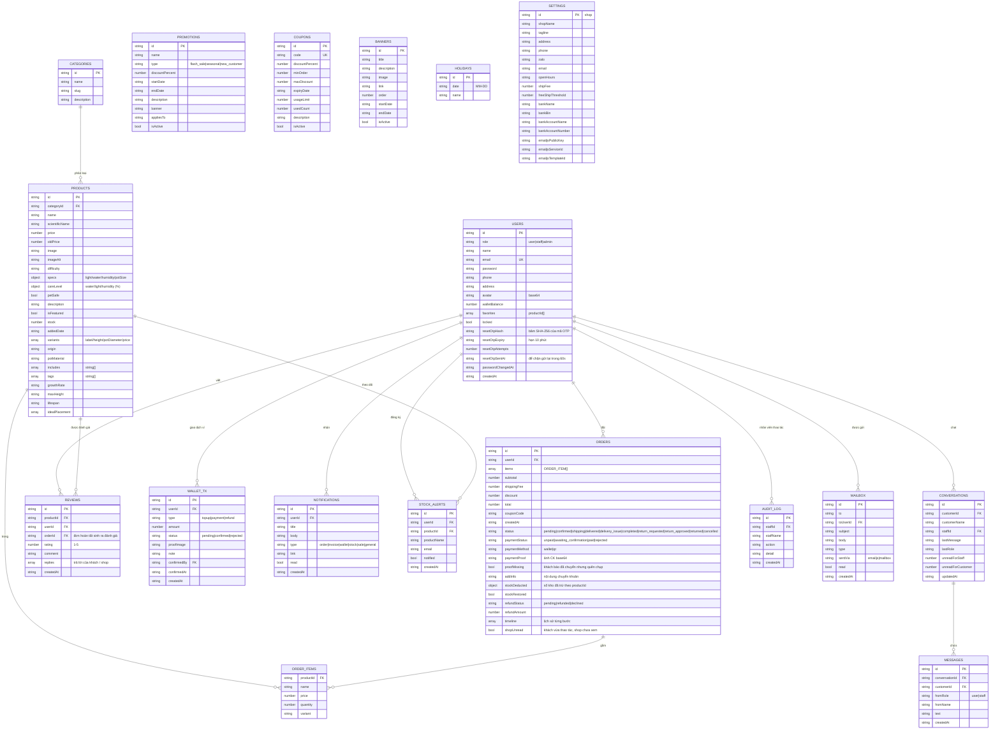

# Lá & Sỏi — Thiết Kế Cơ Sở Dữ Liệu

> Thiết kế dữ liệu của website bán cây cảnh **Lá & Sỏi**.
> Dựa trực tiếp trên `db.json` hiện hành. Cập nhật: 2026-11-12.

---

## 1. Tổng quan

- **Loại CSDL:** NoSQL dạng document — một file JSON duy nhất (`db.json`) phục vụ bởi **json-server 0.17.4**.
- **Giao tiếp:** REST (`GET/POST/PATCH/DELETE`) tại `http://localhost:3000`.
- **Khoá chính:** mọi `id` là **chuỗi** (tránh lỗi so khớp cứng kiểu của json-server 1.x; dự án nay chạy 0.17.4 nhưng vẫn giữ quy ước này).
- **Khoá ngoại:** biểu diễn bằng tham chiếu id (`categoryId`, `userId`, `productId`...).
- **19 collection** (gồm object `settings`) + 1 object `$schema` (meta).

> Cột "số dòng" là **ảnh chụp `db.json` ngày 12/11/2026**; các bảng phát sinh (đơn, thông báo, hộp thư, nhật ký…) tăng lên khi dùng thử.

| # | Collection | Kiểu | Số dòng | Mục đích |
|---|---|---|---|---|
| 1 | `categories` | mảng | 6 | Danh mục cây |
| 2 | `products` | mảng | 21 | Sản phẩm |
| 3 | `users` | mảng | 5 | Người dùng (1 admin, 1 staff, 3 khách — gồm 4 tài khoản demo) |
| 4 | `orders` | mảng | 65 | Đơn hàng |
| 5 | `reviews` | mảng | 7 | Đánh giá + trả lời |
| 6 | `promotions` | mảng | 4 | Chiến dịch khuyến mãi |
| 7 | `coupons` | mảng | 4 | Mã giảm giá |
| 8 | `banners` | mảng | 3 | Banner theo lịch |
| 9 | `holidays` | mảng | 10 | Ngày lễ VN (cho banner) |
| 10 | `conversations` | mảng | 2 | Phiên chat KH ↔ NV |
| 11 | `messages` | mảng | 8 | Tin nhắn chat |
| 12 | `notifications` | mảng | 26 | Thông báo web (🔔) |
| 13 | `mailbox` | mảng | 52 | Hộp thư mô phỏng (lưu vết email) |
| 14 | `walletTransactions` | mảng | 19 | Giao dịch ví (nạp / trả đơn / hoàn tiền) |
| 15 | `auditLog` | mảng | 20 | Nhật ký thao tác nhân viên & quản trị |
| 16 | `stockAlerts` | mảng | 1 | Đăng ký "báo có hàng" |
| 17 | `settings` | **object** | 1 | Cài đặt shop (tên, ngân hàng, EmailJS...) |
| 18 | `labelGroups` | mảng | 2 | Nhóm nhãn sản phẩm (Độ khó chăm sóc, An toàn & lưu ý) |
| 19 | `labels` | mảng | 6 | Nhãn sản phẩm thuộc từng nhóm |

---

## 2. Sơ đồ quan hệ (ER Diagram)



---

## 3. Chi tiết từng collection

### 3.1 `categories` — Danh mục cây
```json
{ "id": "1", "name": "Cây lọc không khí", "slug": "cay-loc-khong-khi" }
```
| Trường | Kiểu | Bắt buộc | Mô tả |
|---|---|---|---|
| `id` | string | ✓ | Khoá chính |
| `name` | string | ✓ | Tên hiển thị |
| `slug` | string | | Slug URL |

### 3.2 `products` — Sản phẩm
| Trường | Kiểu | Bắt buộc | Mô tả |
|---|---|---|---|
| `id` | string | ✓ | Khoá chính |
| `categoryId` | string | ✓ | FK → `categories.id` |
| `name` | string | ✓ | Tên cây |
| `scientificName` | string | | Tên khoa học (in nghiêng) |
| `price` | number | ✓ | Giá bán hiện tại (VND) |
| `oldPrice` | number | | Giá gốc trước giảm |
| `image` | string | ✓ | Đường dẫn ảnh |
| `imageAlt` | string | | Mô tả ảnh (a11y) |
| `difficulty` | string | | "Dễ chăm" / "Trung bình" / "Khó" |
| `specs` | object | | `{ light, water, humidity, potSize }` |
| `careLevel` | object | | `{ water: 0-100, light, humidity }` (%) |
| `petSafe` | bool | | An toàn với thú cưng |
| `description` | string | | Mô tả dài |
| `isFeatured` | bool | | Hiện ở khối "Nổi bật" |
| `stock` | number | ✓ | Tồn kho (≤0 là hết hàng) |
| `addedDate` | ISO date | | Ngày thêm (dùng cho "Mới về" 30 ngày) |
| `variants` | array | | `[{ label, height, potDiameter, price }]` |
| `origin` | string | | Xuất xứ |
| `potMaterial` | string | | Chất liệu chậu |
| `includes` | array | | Những gì khách nhận |
| `tags` | array | | Thẻ |
| `growthRate`, `maxHeight`, `lifespan` | string | | Thông số sinh học |
| `idealPlacement` | array | | Vị trí đặt phù hợp |

### 3.3 `users` — Người dùng
| Trường | Kiểu | Bắt buộc | Mô tả |
|---|---|---|---|
| `id` | string | ✓ | Khoá chính |
| `role` | string | ✓ | `"user"` \| `"staff"` \| `"admin"` |
| `name` | string | ✓ | Họ tên |
| `email` | string | ✓ | Duy nhất (kiểm ở client khi register) |
| `password` | string | ✓ | **Lưu dạng thô** (giới hạn học thuật) |
| `phone`, `address` | string | | Liên hệ |
| `avatar` | string | | Ảnh base64 ≤2MB |
| `walletBalance` | number | | Số dư ví (VND) |
| `favorites` | array | | Mảng `productId` yêu thích |
| `careJournal` | object | | *(tùy chọn, thêm 11/2026)* Nhật ký "Lịch chăm sóc tuần đầu" theo sản phẩm: `{ "<productId>": { start: "YYYY-MM-DD", done: ["d1","d23","d4","d7"], updatedAt } }`. Không có trường này thì trang vẫn chạy (khách chưa đăng nhập lưu tạm ở `localStorage` khóa `careweek_guest`, đăng nhập thì gộp vào đây) |
| `locked` | bool | | Admin khóa → chặn đăng nhập |
| `resetOtpHash` | string | | Băm SHA-256 của mã OTP quên mật khẩu (không lưu mã thô) |
| `resetOtpExpiry` | ISO date | | Hạn mã OTP — **10 phút** |
| `resetOtpAttempts` | number | | Số lần nhập sai (đủ 5 lần → hủy mã) |
| `resetOtpSentAt` | ISO date | | Thời điểm gửi mã, dùng để chặn gửi lại trong 60 giây |
| `passwordChangedAt` | ISO date | | Lần đổi mật khẩu gần nhất |
| `createdAt` | ISO date | | Thời điểm đăng ký (dùng cho "KH mới" <1 tháng) |

### 3.4 `orders` — Đơn hàng
```json
{
  "id": "1",
  "userId": "2",
  "items": [{ "productId": "13", "name": "Kim Tiền Mini", "price": 155000, "quantity": 1 }],
  "total": 250000,
  "createdAt": "2026-09-21T09:15:00.000Z",
  "status": "delivered"
}
```
**Nhóm 1 — thông tin đơn (ghi lúc đặt hàng, `cart.html`)**

| Trường | Kiểu | Mô tả |
|---|---|---|
| `userId` | string FK | → `users.id` |
| `items` | array | Snapshot lúc đặt (`productId`, `name`, `price`, `quantity`, `variant?`) |
| `subtotal`, `shippingFee`, `discount`, `total` | number | Tạm tính · phí giao · giảm giá mã · tổng phải trả |
| `couponCode` | string | Mã giảm đã áp (nếu có) |
| `paymentMethod` | enum | `wallet` \| `qr` |
| `addInfo` | string | Nội dung chuyển khoản (`LASOI<mã khách>-<5 số>`) |
| `clientRef` | string | **Mã riêng của lần đặt hàng, do trình duyệt sinh** (11 ký tự) — bằng luôn `id` của đơn. Dùng để tra lại đơn khi lệnh tạo gặp lỗi mạng, bảo đảm một đơn chỉ được ghi một lần. Đơn tạo trước 11/2026 không có trường này |
| `shipping` | object | Thông tin giao **bắt buộc** với đơn mới: `{ name, phone, address, note? }` — `phone` đã chuẩn hóa 10 số bắt đầu bằng 0. Đơn cũ (trước khi có ô địa chỉ) không có trường này |
| `stockDeducted` | object | `{ productId: số lượng }` đã trừ kho — để hoàn trả **đúng** số khi hủy / hoàn hàng |

**Nhóm 2 — vòng đời (chỉ `js/order-flow.js` được ghi)**

| Trường | Kiểu | Mô tả |
|---|---|---|
| `status` | enum | `pending` · `confirmed` · `shipping` · `delivered` · `delivery_issue` · `completed` · `return_requested` · `return_approved` · `returned` · `cancelled` |
| `paymentStatus` | enum | `unpaid` \| `awaiting_confirmation` \| `paid` \| `rejected` |
| `paymentProof` | string | Ảnh chụp chuyển khoản (base64) |
| `proofMissing` | bool | Khách báo "đã chuyển nhưng quên chụp" → nhân viên đối soát sao kê |
| `refundStatus` | enum | `pending` (chờ đối soát) \| `refunded` \| `declined` |
| `refundAmount`, `refundedAt` | | Số tiền và lúc hoàn vào Ví web |
| `timeline` | array | Mỗi bước: `{ action, label, status, at, by{id,name,role}, reason?, note?, refund? }` |
| `shopUnread`, `shopUnreadAt`, `shopUnreadLabel` | | Khách vừa thao tác, shop chưa xem (badge + nhãn MỚI) |
| `notReceivedReports` | number | Số lần khách báo "chưa nhận được hàng" |
| `stockRestored` | bool | Đã trả kho (chống trả 2 lần) |
| `statusBeforeReturn` | string | Trạng thái trước khi yêu cầu hoàn — để khôi phục khi từ chối/rút |
| `expectedDeliveryDate` | `"YYYY-MM-DD"` \| null | Ngày giao **nhân viên hẹn** (hành động `set_delivery_date`) — thay cho ước tính theo lịch. Bị xóa khi giao lại sau khiếu nại |
| `expectedDeliveryNote`, `expectedDeliverySetAt` | string, ISO date | Lời nhắn kèm ngày hẹn · lúc hẹn |
| `outForDeliveryAt`, `outForDeliveryNote` | ISO date, string | Nhân viên báo "Shipper sắp giao tới" (khách thấy "Sắp tới bạn"); xóa khi giao lại |
| `receiveReminderAt` | ISO date \| null | Đã nhắc khách xác nhận nhận hàng (trước hạn tự hoàn tất 24 giờ) — mỗi lần giao chỉ nhắc 1 lần, xóa khi giao lại |
| Mốc thời gian | ISO date | `paidAt`, `shippedAt`, `deliveredAt`, `completedAt`, `cancelledAt`, `returnRequestedAt`, `returnedAt`, `updatedAt` |
| Người thực hiện | string | `deliveredBy`, `cancelledBy`, `receivedConfirmedBy` (`"system"` = hệ thống tự hoàn tất → khách vẫn báo "chưa nhận" được trong 7 ngày) |
| Lý do | string | `cancelReason`, `rejectReason`, `returnReason` |

> Vòng đời đầy đủ (ai được làm gì ở trạng thái nào): [USECASE.md §8](USECASE.md) · [WORKFLOW.md §4](WORKFLOW.md).

### 3.5 `reviews` — Đánh giá & trả lời
| Trường | Kiểu | Mô tả |
|---|---|---|
| `productId`, `userId` | string FK | Sản phẩm được đánh giá · người viết |
| `orderId` | string FK | Đơn đã hoàn tất sinh ra đánh giá (có khi gửi từ trang "Đơn hàng của tôi") |
| `rating` | number | 1–5 sao |
| `comment` | string | ≤ 500 ký tự |
| `replies` | array | `[{ id, userId, text, createdAt }]` — trả lời của khách khác hoặc **phản hồi từ shop** |

- **Điều kiện viết:** khách phải có **đơn đã hoàn tất** (`completed`) chứa sản phẩm đó — tức đã bấm "Đã nhận được hàng" hoặc đơn tự hoàn tất sau N ngày (`settings.autoCompleteDays`, mặc định 3).
- 1 user chỉ 1 review / 1 product (kiểm phía client). Chủ review hoặc admin xóa được.
- Nhân viên / quản trị **không chấm sao**, chỉ trả lời.

### 3.6 `promotions` — Khuyến mãi
| Trường | Mô tả |
|---|---|
| `type` | `flash_sale` \| `seasonal` \| `new_customer` |
| `appliesTo` | `all` hoặc id danh mục |
| `startDate/endDate` | Phạm vi hiệu lực |
| `isActive` | Tắt nhanh không cần xóa |

### 3.7 `coupons` — Mã giảm
| Trường | Mô tả |
|---|---|
| `code` | Khoá tra cứu (unique logic, vd `CHAOBAN`) |
| `minOrder`, `maxDiscount` | Điều kiện áp |
| `usageLimit`, `usedCount` | Giới hạn lượt dùng |

### 3.8 `banners`
- Chỉ hiện khi `isActive=true` **và** `startDate/endDate` tồn tại **và** hôm nay trong khoảng.
- Tên chứa "Giáng Sinh/Noel" → kích hiệu ứng tuyết Three.js.

### 3.9 `holidays`
- `date` dạng `"MM-DD"` (10 ngày lễ VN).
- Dùng gợi ý admin tạo banner mùa.

### 3.10 `conversations` + `messages`
- 1 KH = 1 conversation.
- `unreadForStaff` / `unreadForCustomer`: badge chưa đọc.
- Polling 2.5s cả 2 phía.

### 3.11 `notifications`
- Chuông 🔔 header (khách): poll 10s, mở dropdown → `markAllRead`.
- `type` quyết định icon: order / invoice / wallet / stock / sale / general.

### 3.12 `mailbox`
- **Luôn** ghi 1 dòng khi gọi `sendEmail`, kể cả khi đã gửi EmailJS thật (lưu vết).
- `sentVia`: `emailjs` nếu gửi thật, `mailbox` nếu chỉ mô phỏng.

### 3.13 `walletTransactions`
- `type`: `topup` (nạp) / `payment` (trả đơn bằng ví) / `refund` (hoàn tiền đơn).
- Nạp ví phải chờ `status=pending` → nhân viên duyệt → `confirmed` + cộng số dư.
- **Mọi khoản hoàn tiền đều vào Ví web** và sinh một giao dịch `refund` kèm `orderId` (dù khách trả bằng ví hay chuyển khoản).
- **Hoàn tiền đúng một lần:** giao dịch hoàn mới có `id = "rf-<mã đơn>"` (mỗi đơn chỉ một), kèm `attempt` (mã lượt xử lý), `balanceBefore` / `balanceAfter` (số dư trước / sau dự kiến). `status` đi `processing` → `confirmed`: `processing` = lượt hoàn đang chạy (hoặc dừng giữa chừng — lượt sau dựa vào `balanceBefore` / `balanceAfter` để biết ví đã được cộng chưa, không đoán). Giao dịch hoàn cũ (trước 11/2026) có id ngẫu nhiên, vẫn được tính khi kiểm tra "đã hoàn chưa".

### 3.14 `auditLog`
Mọi thao tác nhạy cảm của nhân viên **và quản trị** được ghi lại (minh bạch, admin giám sát):

| `action` | Ghi bởi | Khi nào |
|---|---|---|
| `confirm_topup` / `reject_topup` | `staff.js` | Duyệt / từ chối yêu cầu nạp ví |
| `update_stock` | `staff.js` | Sửa tồn kho (ghi cả số cũ → số mới) |
| `order_<hành động>` | `order-flow.js` | Mỗi bước vòng đời đơn do nhân viên/quản trị làm: `order_approve_payment`, `order_reject_payment`, `order_ship`, `order_mark_delivered`, `order_delivery_failed`, `order_shop_cancel`, `order_approve_return`, `order_reject_return`, `order_receive_return`, `order_refund_confirm`, `order_refund_decline` |
| `orders_bulk_delete` | `order-ui.js` | Xóa nhiều đơn đã kết thúc một lượt |
| `product_create` / `product_update` / `product_price` / `product_stock` / `product_delete` / `product_import` | `admin.html` | Thêm / sửa / **đổi giá** / sửa tồn kho / xóa sản phẩm, nhập từ Excel — `detail` ghi giá trị cũ → mới |
| `promo_create` / `promo_update` / `promo_discount` / `promo_toggle` / `promo_delete` | `admin.html` | Khuyến mãi (đổi % giảm tách riêng thành `promo_discount`) |
| `coupon_create` / `coupon_update` / `coupon_discount` / `coupon_toggle` / `coupon_delete` / `coupon_restore` | `admin.html` | Mã giảm giá |
| `user_create` / `user_role` / `user_lock` / `user_unlock` / `user_delete` | `admin.html` | Tạo tài khoản nhân viên, đổi vai trò, khóa / mở khóa, xóa tài khoản |

> Thao tác của **khách** không ghi vào nhật ký nhân viên — nhưng vẫn lưu đầy đủ trong `timeline` của đơn.

### 3.15 `stockAlerts`
- Khi kho `0 → >0`, tìm alert `notified=false` tương ứng → thông báo + email, đánh `notified=true`.

### 3.17 `labelGroups` + `labels` — Nhãn sản phẩm (admin quản lý)

Nhãn trước đây viết cứng trong code; giờ là dữ liệu. Tách **2 bảng** vì mỗi nhóm là một loại thông tin độc lập với quy tắc gán riêng (độ khó: mỗi cây 1 mức; an toàn: nhiều lưu ý cùng lúc).

`labelGroups`
| Trường | Kiểu | Mô tả |
|---|---|---|
| `id` | string | Khóa chính (`care`, `safety`, hoặc id tự sinh) |
| `name` | string | Tên nhóm |
| `selection` | enum | `single` — mỗi sản phẩm chỉ 1 nhãn trong nhóm · `multi` — gán được nhiều nhãn |
| `description`, `order` | | Mô tả · thứ tự hiển thị |

`labels`
| Trường | Kiểu | Mô tả |
|---|---|---|
| `id` | string | Khóa chính |
| `groupId` | string FK | → `labelGroups.id` |
| `name` | string | Tên hiện trên chip |
| `color` | enum | `green` · `amber` · `red` · `blue` · `purple` · `gray` (bảng màu cố định, đủ tương phản) |
| `description` | string | Hiện khi rê chuột vào chip |
| `petSafe` | bool | Nhãn này nghĩa là "an toàn với thú cưng" → dùng cho bộ lọc của Gợi ý chọn cây |
| `order` | number | Thứ tự trong nhóm |

`products[].labelIds` — mảng id nhãn đã gán. Khi lưu sản phẩm hoặc sửa/xóa nhãn, hai trường cũ `difficulty` và `petSafe` được **tính lại từ nhãn** (chatbot và bộ lọc gợi ý chọn cây vẫn đọc 2 trường này).

Nhãn mặc định: *Dễ chăm · Trung bình · Cần chú ý* và *An toàn với thú cưng · Để xa thú cưng · Để xa tầm tay trẻ nhỏ*. Nhãn cũ "Không ăn được (độc nhẹ)" đã bỏ. Khởi tạo / chuyển dữ liệu cũ: `python tools/migrate-labels.py` (chạy lại nhiều lần vẫn an toàn).

### 3.16 `settings` (single object)
- Tên shop, địa chỉ, SĐT, Zalo, giờ mở cửa.
- Phí ship + ngưỡng miễn phí.
- **Lịch giao hàng** (tính "Dự kiến giao" — `js/order-flow.js`):

| Trường | Kiểu | Mặc định | Ý nghĩa |
|---|---|---|---|
| `cutoffHour` | number 0–24 | 16 | Giờ chốt đơn: thanh toán trước giờ này → đóng gói trong ngày; 24 = không chốt |
| `prepDays` | number | 0 | Số ngày làm việc chuẩn bị trước khi giao cho vận chuyển |
| `shipDaysMin`, `shipDaysMax` | number | 1, 2 | Số ngày làm việc vận chuyển nhanh nhất – chậm nhất (`max ≥ min`) |
| `deliverSunday` | bool | false | Có giao Chủ nhật không |
| `closedDates` | string | "" | Ngày nghỉ, cách nhau bằng dấu phẩy: `dd/mm` (hằng năm) hoặc `dd/mm/yyyy` (một lần) |
| `autoCompleteDays` | number 1–14 | 3 | Số ngày sau khi giao thì đơn tự hoàn tất nếu khách không phản hồi |

> Thiếu trường nào thì dùng mặc định — dữ liệu cũ chạy được ngay, không cần sửa `db.json`.
- **Tài khoản ngân hàng** (BIN + số TK + tên chủ TK) → dựng VietQR.
- **EmailJS** (publicKey + serviceId + templateId) → bật gửi Gmail thật.

---

## 4. Quy ước kỹ thuật

### 4.1 Lọc phía client
`json-server` 1.x so khớp **cứng kiểu**: `?userId=2` (số) **không** khớp `"2"` (chuỗi). Vì vậy `api.js` lọc phía client cho:
- `getOrdersByUser`, `getMessages`, `getNotifications`, `getStockAlerts`, `getWalletTransactions`, `getConversationByCustomer`.

### 4.2 Sinh id
- Tự sinh bởi json-server khi `POST` (khóa ngắn ngẫu nhiên).
- Seed dùng số đếm thủ công (`"1"`, `"2"`...).

### 4.3 Ảnh
- Ảnh sản phẩm: file thật tại `assets/img/pN.jpg`.
- Ảnh avatar + chứng từ CK: lưu base64 trực tiếp trong trường (chấp nhận ≤2MB).

### 4.4 Thời gian
- Luôn ISO 8601 UTC (`new Date().toISOString()`).
- So sánh ngày (banner, "mới về") dùng `Date` object, không parse chuỗi.

---

## 5. Giới hạn & ghi chú học thuật

- Mật khẩu **không hash** (đồ án môn học) — client **xóa** `password` trước khi lưu session.
- `json-server` **không** có xác thực server-side — phân quyền thực thi phía client bằng `requireRole`.
- Không có khóa ngoại cứng (JSON Schema trong `$schema` chỉ tham khảo).
- Bảo mật email: Public Key EmailJS lộ ở client là **bình thường & an toàn** (chỉ cho gửi, không đọc hộp thư).

---

*Xem thêm: [ARCHITECTURE.md](ARCHITECTURE.md) · [API_DOCUMENT.md](API_DOCUMENT.md) · [WORKFLOW.md](WORKFLOW.md) · [CHUC-NANG.md](CHUC-NANG.md).*
